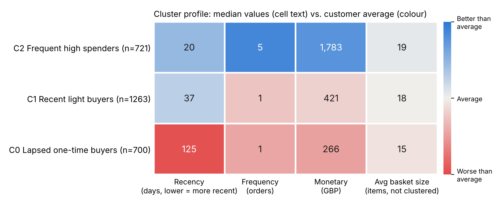
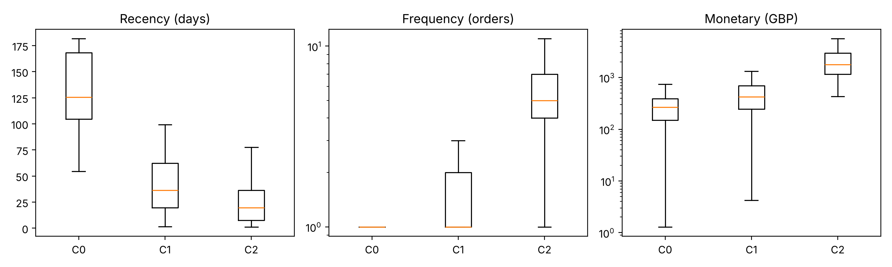
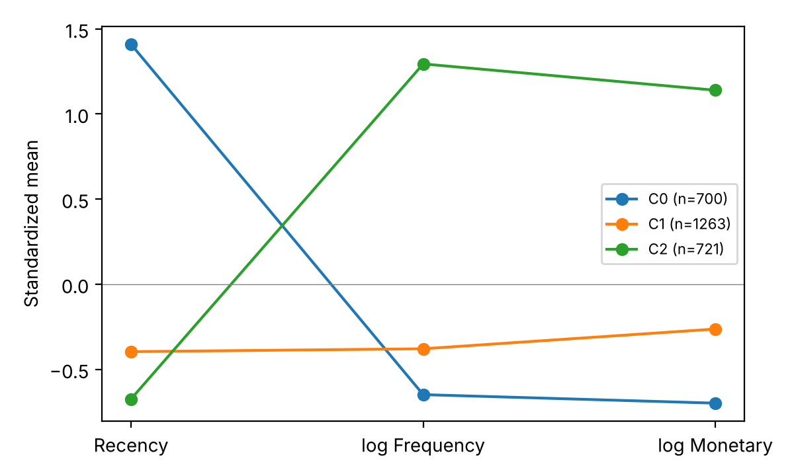

# aiaa3111-project-online-trade

AIAA3111 数据挖掘课程项目 · H2 分群购物模式。研究历史消费行为分群能否在相同规则预算下发现全局规则未充分体现的商品关联，并在未来交易中保持价值。

**当前状态（2026-11-08）：A 的 Online Retail II 数据处理已合并到 `main` 并通过全量验证；B 的顾客分群已完成并在 `b/customer-clustering` 分支等待审阅（选中 K-means，K = 3）；C 的规则挖掘与 D 的评价尚未开始。尚无规则或评价结果。**

## 进度汇报（截至 2026-11-08）

| 模块 | 负责人 | 状态 | 已完成 / 下一步 |
|---|---|---|---|
| A 数据处理与复现 | Qingyang LI | 已完成，PR #2 已于 11-08 合并 | Online Retail II 清洗、四时期切分、订单与购物篮、审计表和自动验证全部完成；`python3 scripts/run_all.py` 可一条命令复现。PR #2 合并前未经第二人审阅，建议 11-11 会议补做复核。 |
| B 顾客分群与对照分组 | Jinghan ZHAO | 已完成，待审阅后合并 | 在 Profile 期 RFM 特征上比较 K-means、高斯混合（GMM）、层次聚类（Ward）和 RFM 分档打分共 12 个候选，按预先确认的规则选中 K-means、K = 3；生成 20 次同规模顾客级随机分组。`python scripts/run_clustering.py` 一条命令复现，详见下文“顾客分群（B）”。群名称待确认。 |
| C 模式挖掘与解释 | Anqi ZHAO | 未开始 | 11-15 完成 G/L/R 规则挖掘。需在相对支持度之外增加最低绝对出现次数（小群在 Discovery 期可能只有几百个购物篮）。 |
| D 公平实验与未来评价 | Chenrui XIANG | 未开始 | 11-18 冻结测试配置，11-21 完成评价。 |

**已作出的决定**

- 数据集由 Online Retail（一年）改为 Online Retail II（两年），采用 `profile → discovery → validation → test` 四时期设计（见下文）。
- 顾客分群只使用 RFM 特征，不使用“买了什么商品”做分群：按商品偏好分群会让“各群规则不同”在很大程度上由分群方式本身决定，形成循环论证。
- 分群选择规则（2026-11-08 确认）：最小群占比 ≥ 5%、抽样稳定性 ARI ≥ 0.8、轮廓系数并列容差 0.02；R 使用原始天数，不取对数。

**待全员确认（冻结 `configs/experiment.json` 前）**

- A 的清洗口径，尤其是零价格行和非商品编码列表（见 `data/processed/special_stock_codes.csv`）；
- 三个顾客群的名称（`configs/experiment.json` 中 `cluster_names`，当前为建议名）；
- 支持度/置信度候选值、最低绝对计数和总规则预算；
- 主比较只覆盖 2,684 名 Profile 顾客：Test 期 10,890 个有效购物篮中只有 5,730 个（约 53%）属于这批顾客，报告与海报须明确说明适用范围，新顾客另用全局规则评价。

## 成员与任务

| 任务 | 成员 | 邮箱 | 主责 |
|---|---|---|---|
| A | Qingyang LI | qli863@connect.hkust-gz.edu.cn | 数据处理与复现 |
| B | Jinghan ZHAO | zhaojinghan06@gmail.com | 顾客分群与对照分组 |
| C | Anqi ZHAO | azhao258@connect.hkust-gz.edu.cn | 模式挖掘与解释 |
| D | Chenrui XIANG | cxiang359@connect.hkust-gz.edu.cn | 公平实验与未来评价 |

完整分工：[Word 文档](docs/team_assignment.docx) · [可在线查看的分工](docs/team_assignment.md)。邮箱用于项目联系记录，不表示已添加 GitHub 协作者。

## 研究任务 outline

1. **数据与可行性（A，已完成）**：清洗订单明细，按订单构建购物篮；检查历史顾客在后续时期的订单留存。
2. **历史分群（B）**：在 Profile 期 RFM 特征上比较 K-means、高斯混合、层次聚类和 RFM 分档打分，检查群体规模和稳定性，选定并冻结一种分群；生成同规模的随机顾客分组对照。
3. **发现差异 RQ1（C）**：用 FP-Growth 生成全局与局部关联规则，比较群体内外计数、support、confidence、lift。
4. **公平比较 RQ2（D 牵头，B/C 支持）**：控制系统总规则预算，比较真实分群、全局和随机分群；使用共同候选池排除门槛差异。
5. **未来验证 RQ3（D）**：冻结群体和规则，在未来订单上评价覆盖率、规则置信度和差异保持，报告适用顾客比例。
6. **解释与交付（全员）**：分析成功/失败案例，完成海报、答辩、报告和可复现代码。

聚类、规则发现、配置选择和最终评价必须使用相互独立的时期；不要用全年数据分群后把其中后半段称为未见测试集。Online Retail II 留存审计后已采用 `profile → discovery → validation → test` 四时期方案，精确边界见下文和 `configs/experiment.json`。候选参数仍须由 Validation 选择，不能把原型值称为已验证最优值。

未来无订单的顾客不创建空购物篮；某群无未来订单时指标记为不可评价。主比较在相同历史已知顾客的未来订单上进行，同时报告其占全部未来订单的比例。新顾客回退全局规则另行评价。

## 课程提交时间线

所有会议及截止时间均按 **Asia/Shanghai（UTC+8）** 记录，年份为 **2026**。课程节点来自课程说明与已提供日程；如有新公告，以课程公告为准。

| 时间 | 事项 | 提交要求 |
|---|---|---|
| 2026-10-15 23:59 | 团队注册与 Proposal | 标题、简介、全部成员姓名；已过期，不推断是否已提交 |
| 截至 2026-10-22 | Proposal 审阅 | 按教师反馈调整 |
| 2026-11-27 23:59 | Poster 提交 | 单独提交 Poster.pdf |
| 2026-12-04 15:00–16:20 | Poster Session | 展示海报并回答问题 |
| 2026-12-11 23:59 | 最终提交 | Group_XX_Project.zip：Report.pdf、code、README、数据或下载说明；不要求包含 Poster.pdf |
| 2026-12-18 23:59 | 同伴评价 | 每人独立评价队友 |

报告主文 6–10 页，包含图表；参考文献、披露和附录除外。单设外部协作者与 AIGC 使用披露。迟交一周以内扣已得分的 20%。

## 团队指定时间线

以下日期与会议时段按团队提供图片整理；图片未给出的具体时间标为“未指定”。负责人是根据 A–D 分工配置的执行责任。

| 日期 | 时间 | 团队节点 | 责任与交付 |
|---|---|---|---|
| 2026-11-04 | 22:00–23:00 | 开会，完成数据清洗 | A 主责；全员核对数据口径 |
| 2026-11-08 | 19:30–21:00 | 完成 cluster | B 主责；交付顾客标签与画像 |
| 2026-11-11 | 22:00–23:00 | 开会，汇报进度 | 全员；检查接口与实验阻塞 |
| 2026-11-15 | 19:30–21:00 | 完成 pattern，确定 poster 模板 | C 主责；全员确认模板 |
| 2026-11-18 | 22:00–23:00 | 开会，汇报进度 | 全员；审查评价协议与测试配置 |
| 2026-11-21 | 19:30–21:00 | 开会，完成评价，同时总结问题 | D 主责；全员解释成功与失败 |
| 2026-11-23 | 未指定 | 各人提供自己的 poster 内容和图片等 | 全员提交；C 汇总 |
| 2026-11-25 | 未指定 | 提出 poster 修改意见 | 全员交叉审阅 |
| 2026-11-26 | 未指定 | 确定 poster | C 整合；全员确认 |
| 2026-11-27 | 课程截止 23:59 | poster 提交 | C 提交；D 检查回执 |
| 2026-12-11 | 课程截止 23:59 | 提交最终内容 | A 打包提交；D 复核 |

11/18 会议建议冻结测试配置；11/21 完成评价。11/28–12/03 建议安排两次模拟答辩；12/05–12/10 整理最终报告并复现主表。这些是衔接建议，不是图片新增的已确定会议。

## 仓库结构与使用说明

日常协作按一条主线进行：**数据放 `data/`，方法代码写在 `src/`，参数统一放 `configs/`，通过 `scripts/` 运行，实验图表保存到 `results/`，最终整理进 `reports/`。** 分工、实验过程与会议决定统一记录在 `docs/`。

```text
aiaa3111-project-online-trade/
├── README.md                 项目总入口：分工、时间线、目录及运行说明
├── requirements.txt          Python 依赖清单
├── .gitignore                指定不上传的数据、缓存和本地环境
├── .gitattributes            统一文本换行等 Git 文件属性
├── .github/                  GitHub 协作模板
├── configs/                  实验参数
├── data/                     本地数据与经检查的共享数据
│   ├── raw/                  下载的原始数据
│   ├── interim/              清洗过程的中间数据
│   └── processed/            可供后续模块使用的数据
├── src/online_trade/         A–D 四人的核心代码
│   ├── data/                 A：数据处理
│   ├── clustering/           B：顾客分群
│   ├── patterns/             C：模式挖掘
│   └── evaluation/           D：实验评价
├── scripts/                  调用核心代码的运行入口
├── results/                  实验输出
│   ├── tables/               结果表格
│   └── figures/              结果图片
├── docs/                     分工、接口和过程记录
│   └── meetings/             会议纪要
└── reports/                  面向课程提交的材料
    ├── poster/               海报源文件及 Poster.pdf
    └── final/                报告源文件及 Report.pdf
```

### 各目录放什么、由谁维护

下表是各模块的存放约定。A 的 Online Retail II 数据处理已实现并通过完整审计；B、C、D 的聚类、规则和评价结果仍待各负责人实现和登记。

| 目录 | 用途与建议内容 | 主要负责人 |
|---|---|---|
| `data/raw/` | 放官方原始数据，保留下载时的内容；记录来源、下载日期和校验值。 | A |
| `data/interim/` | 放清洗中的订单明细，如处理退货、缺失值及异常记录后的阶段性文件，便于追查清洗过程。 | A |
| `data/processed/` | 放各模块交接的购物篮、时间切分、RFM 特征与群标签；经检查的 CSV、JSON、JSONL、Parquet 和小样本可选择性提交。未检查、私密或通过共享位置分发的大文件放 `local/` 子目录，仅本地保存。字段按 `docs/data_contract.md` 对齐。 | A 统筹，B/C 写入各自产物 |
| `src/online_trade/data/` | 写数据读取、清洗、购物篮构建、时间切分和留存审计逻辑，输出到 `data/` 对应阶段。 | A · Qingyang LI |
| `src/online_trade/clustering/` | 写历史 RFM 特征、标准化、真实聚类与随机分组逻辑，输出顾客标签、群体画像和稳定性统计。 | B · Jinghan ZHAO |
| `src/online_trade/patterns/` | 写全局与分群频繁项集、关联规则、共同候选池及相同总规则预算下的筛选逻辑。 | C · Anqi ZHAO |
| `src/online_trade/evaluation/` | 写全局、真实分群、随机分组的公平对照与未来验证，计算覆盖率、规则置信度及不确定性，并处理无订单、空分母等情况。 | D · Chenrui XIANG |
| `configs/` | 集中放数据时间窗口、随机种子、聚类数量、支持度和规则预算等参数。`experiment.example.json` 是起点；测试前保存冻结版本，实验记录引用该版本。 | D 统筹，全员确认 |
| `scripts/` | 放运行入口，负责读取配置并按顺序调用 `src/` 的方法。例如后续可增加数据处理或完整实验入口；实际算法统一写在对应的 `src/` 模块。 | A 整合，全员提供调用方式 |
| `results/tables/` | 放可分享的汇总结果，如样本数量、群体画像、规则比较、未来覆盖率、敏感性分析表；提交前去除顾客标识。 | D 汇总，A/B/C 提供结果 |
| `results/figures/` | 放实验生成的图，如群体画像、规则预算对比、未来表现和代表性模式图，供海报与报告引用。 | 全员，C/D 统一呈现 |
| `docs/` | 放分工、模块接口、实验日志、AIGC 使用记录等过程文档，具体文件见下表。 | 全员 |
| `docs/meetings/` | 按日期记录会议决定、未解决问题、负责人及下一次交付；建议用 `2026-11-04.md` 这样的文件名。 | 每次会议指定一人记录 |
| `reports/poster/` | 放海报编辑源文件、展示文字及最终 `Poster.pdf`。实验原图保留在 `results/figures/`，这里保存排版后的海报。 | C 整合，全员审阅 |
| `reports/final/` | 放报告编辑源文件和最终 `Report.pdf`，包括方法、结果、局限、真实引用与 AIGC 披露。最终 ZIP 由 A 按课程清单另行打包。 | D 整合，A 打包，全员审阅 |
| `.github/` | 保存 `pull_request_template.md`，提交合并请求时填写修改内容、验证方式及需要队友注意的事项。 | 全员 |

### 文档与根目录文件

| 文件 | 用途 |
|---|---|
| `README.md` | 先读这一份，了解研究任务、成员职责、时间安排和目录；代码完成后补齐真实运行命令。 |
| `requirements.txt` | 环境依赖清单；首轮实验后记录经过验证的版本，便于四人复现。 |
| `.gitignore` | 忽略原始数据、清洗中间数据、处理数据的 `local/` 子目录、环境及缓存；允许选择性提交经检查的处理数据和小样本。 |
| `.gitattributes` | 统一 Git 对文本换行等文件属性的处理，减少跨电脑协作的无关差异。 |
| `docs/README.md` | 文档索引，快速进入以下说明。 |
| `docs/team_assignment.docx` | 可下载的四人分工 Word 文档，包含职责、交付和交接要求。 |
| `docs/team_assignment.md` | 可直接在 GitHub 阅读和讨论的分工版本；分工调整时与 Word 同步。 |
| `docs/data_contract.md` | 统一模块之间传递的字段、数据格式和评价口径，交接前先核对。 |
| `docs/data_processing_guide.md` | Online Retail II 双表重叠、清洗、四时期、订单、购物篮和全部输出的详细说明。 |
| `docs/four_period_plan.md` | Profile、Discovery、Validation、Test 的实验设计与冻结边界。 |
| `docs/experiment_log.md` | 记录每次实验的配置、代码版本、评价样本、结果位置和结论，方便追溯。 |
| `docs/aigc_usage.md` | 记录外部工具与 AIGC 的具体用途、人工核查和修改，供报告披露使用。 |

**一次实验的文件流向示例：** A 从 `data/raw/` 读取数据，清洗后将购物篮与切分保存到 `data/processed/`；B 读取历史数据生成顾客分群；C 读取购物篮和群标签生成规则；D 按 `configs/` 中冻结的配置完成公平比较和未来验证，将可分享的汇总表与图分别放入 `results/tables/` 和 `results/figures/`。全员在 `docs/experiment_log.md` 记录这次实验，C/D 再将确认后的结果用于海报和报告。

各模块开发时仍应使用可手工核对的小样本检查计算是否正确；核查方法和结果记录在模块说明或实验日志中。

## Online Retail II 四时期数据处理

本项目现在使用 UCI Online Retail II 两年交易数据，并直接沿用仓库原有目录：配置在 `configs/`，原始文件在 `data/raw/`，处理结果在 `data/processed/`，入口在 `scripts/`，实现位于 `src/online_trade/data/`。仓库中不再建立额外的 `new dataset/` 目录。

### 四个时期

| 阶段 | 时间窗口 | 用途 |
|---|---|---|
| `profile` | `[2009-12-01, 2010-06-01)` | RFM、聚类和客户级随机分组 |
| `discovery` | `[2010-06-01, 2010-12-01)` | 挖掘全局、真实分群和随机分群候选规则 |
| `validation` | `[2010-12-01, 2011-06-01)` | 选择规则阈值、冗余处理和总预算 |
| `test` | `[2011-06-01, 2011-12-01)` | 全部设置冻结后的单次最终评价 |

工作簿两张表在 2010-12-01 至 2010-12-09 重叠。程序已按完整行值和重复次数确认两边 22,523 条记录完全相同、1,088 个共享订单无冲突，然后固定使用第一张表的 2010-12-01 以前数据和第二张表的 2010-12-01 起数据。物理证据全部保留，重叠副本不进入金额、订单、购物篮或实验。

聚类和规则挖掘使用不同时期：如果两者用同一段交易，群体特征和规则都由同一批数据决定，“分群后规则更好”会混入同期拟合。Validation 可以反复选择参数；Test 在所有设置冻结后只评价一次。

### 数据清洗思路（摘要）

本节概括 [详细数据处理说明](docs/data_processing_guide.md)，数字来自已发布快照的审计表（快照分支 `data/processed/A_data_preparation/audit_summary.csv`、`exclusion_summary.csv`）。

**核心原则：不删数据，只打标签。** 每一条原始明细都保留在 `clean_transactions.csv.gz` 中，并带有问题标记和 `primary_exclusion_reason`；标记决定它能否进入订单金额、购物篮和实验。因此任何汇总数字都能追溯到工作表和行号。清洗口径依据业务含义和审计证据确定，不依据聚类分数、规则覆盖率或 Test 表现调整。

**处理步骤**

1. **锁定版本**：处理前核对 `online_retail_II.xlsx` 的 SHA-256，不一致立即停止，保证四人使用同一份数据。
2. **处理跨表重叠**：逐行比对两张表的重叠区间，确认完全相同后按日期边界只保留一份（见上文）。
3. **统一格式**：订单号、顾客号、商品编码按字符串保存（避免丢失前导零和 `C` 前缀），商品编码转大写；金额用 Decimal 计算，`净额 = 毛购买额 − 退款额`。
4. **逐行打标签**：按固定优先级给每行一个主要排除原因。各原因互斥，可直接相加：

| 主要排除原因 | 行数 | 处理方式 | 理由 |
|---|---:|---|---|
| 跨表重叠副本 | 22,523 | 不进入任何分析 | 同一笔交易不能计两次 |
| 取消订单（订单号以 `C` 开头） | 19,165 | 不进入购物篮；符合条件的金额计入退款 | 取消不是购买，但退款信息保留 |
| 负数量（退货） | 3,393 | 同上 | 同上 |
| 非商品编码 | 4,633 | 不进入购物篮 | 邮费、折扣、手工调整、银行手续费、礼品券等不是实体商品，会产生无意义规则 |
| 规范来源内完全重复的后续行 | 11,741 | 只保留第一条；另存含重复金额作敏感性比较 | 疑似录入重复 |
| 零价格 | 2,571 | 不进入购物篮和 RFM Frequency，保留审计 | 多为赠品或内部调整 |
| 负价格 | 5 | 不进入购物篮或金额 | 坏账等调整记录 |
| **合计排除** | **64,031** | | 1,067,371 − 64,031 = **1,003,340** 条有效商品明细 |

5. **刻意保留、不自动删除的数据**：
   - 缺失顾客编号的明细（约 24.3 万行）保持空值，不合并成一个匿名顾客；这些订单可做全局补充分析，但无法连接顾客群，不进入 G/L/R 主比较。
   - 极端数量和金额（批发大单）不删除，列入 `extreme_lines.csv`、`extreme_orders.csv`，是否截尾由 B 作为建模决定记录。
   - 只含一种商品的购物篮（3,208 个）保留，因为它们是支持度和覆盖率分母的一部分。
6. **汇总成订单和购物篮**：53,628 张规范订单进入 `orders.csv.gz`；其中 39,516 张至少含一件有效商品，成为购物篮（订单内商品去重，不计数量）。83 张订单含多个时间戳（最大相差 540 秒），取最早时间，全部未跨时期边界。
7. **划定主比较对象**：在 Profile 期有有效正价格订单的已识别顾客共 **2,684** 名，于 2010-06-01 冻结。G/L/R 三种方法只在这批顾客的订单上比较；未来没有订单的顾客不创建空购物篮。

| 时期 | 仍活跃的 Profile 顾客 | 占比 | 主比较购物篮 / 该期全部有效购物篮 |
|---|---:|---:|---|
| Profile | 2,684 | 100% | 7,738 / 8,470 |
| Discovery | 1,928 | 71.8% | 7,521 / 11,273 |
| Validation | 1,458 | 54.3% | 4,862 / 8,067 |
| Test | 1,510 | 56.3% | 5,730 / 10,890 |

另有 500 名 Profile 顾客（18.6%）在之后三个时期都没有有效购物篮。

8. **自动验证与记录**：`run_all.py` 结束时检查行数对账、金额恒等式、订单与时期一一对应、两种购物篮表可互相还原等条件，全部通过才输出 `Validation passed`；每个输出的行数、大小和 SHA-256 写入 `run_manifest.json`，同一输入、代码和配置重跑应得到相同哈希。

### 运行

将哈希核对后的 `online_retail_II.xlsx` 放入 `data/raw/`，执行：

```bash
python3 scripts/run_all.py
```

只有最后显示 `Validation passed` 才能交接。核心输出：

| 文件 | 粒度 | 用途 |
|---|---|---|
| `clean_transactions.csv.gz` | 一行一个物理来源明细 | A 追踪清洗和敏感性 |
| `orders.csv.gz` | 一行一个规范订单 | B 计算 Profile RFM；D 确定未来评价分母 |
| `baskets.csv.gz` | 一行一个有效订单购物篮 | D 判断规则前件和后件命中 |
| `baskets_long.csv.gz` | 一行一个订单—商品 | C 在 Discovery 挖掘规则 |

购物篮是“一张订单内有效商品的去重集合”，不是跨订单归纳出的组合类别。B、C、D 可以使用同一套接口，但必须先按 `split` 和 `is_eligible_for_main_comparison` 筛选各自时期。完整字段、排除优先级、金额定义、审计文件、成员接口和冻结检查见[详细数据处理说明](docs/data_processing_guide.md)。

## 顾客分群（B）

**目标**：只用 Profile 期（`[2009-12-01, 2010-06-01)`）的购买记录，把 2,684 名 Profile 顾客按 RFM 分成若干群并冻结，交给 C 挖掘分群规则；同时生成同规模的随机分组，作为“分组本身带来多少好处”的对照。分群过程不使用 Discovery、Validation、Test 的任何信息。

### 运行

先准备 A 的订单表 `data/processed/orders.csv.gz`：运行 `python3 scripts/run_all.py`，或从快照分支取出：

```bash
git fetch origin a/online-retail-ii-data-snapshot
git show origin/a/online-retail-ii-data-snapshot:data/processed/A_data_preparation/orders.csv.gz > data/processed/orders.csv.gz
```

然后在仓库根目录执行：

```bash
python scripts/run_clustering.py                        # 完整运行，约 1 分钟
python scripts/run_clustering.py --bootstrap-repeats 5  # 快速试跑，不用于正式结果
```

需要 `pandas`、`numpy`、`scikit-learn`、`matplotlib`。本节结果的运行环境为 Python 3.13、scikit-learn 1.9.1、pandas 3.0.5、numpy 2.5.3、matplotlib 3.11.2；其他版本的小数位可能略有差异，选中结果和群规模应一致。全部参数在 `configs/experiment.json` 的 `clustering` 与 `random_control` 部分。

### 流程

| 步骤 | 做什么 | 代码 | 产出 |
|---|---|---|---|
| 1 选人、算 RFM | 取 Profile 期有效正向订单，按顾客汇总：R = 2010-06-01 距最后一单的天数，F = 不同订单数，M = 毛购买额之和；名单须与 A 标记的 2,684 名 Profile 顾客完全一致，否则报错 | `features.py` | 每人一行的 RFM 表 |
| 2 特征处理 | F、M 取 `log1p`，R 保留原始天数；三列再做 z-score 标准化（只用这 2,684 人拟合） | `features.py` | 2,684 × 3 特征矩阵 |
| 3 生成候选 | K-means、高斯混合（GMM）、层次聚类（Ward）、RFM 分档打分，各取 K = 3、4、5，共 12 个候选；群号统一按价值从低到高排列 | `methods.py` | 12 套群标签 |
| 4 评分与选择 | 对每个候选计算轮廓系数、50 次抽样稳定性（ARI）、最小群占比，按预先确认的规则选出一个 | `evaluation.py` | 候选比较表 |
| 5 画像 | 各群人数、R/F/M 分位数、平均购物篮大小；箱线图、蛇形图、热力图 | `pipeline.py` | 画像表、3 张图 |
| 6 随机对照 | 把选中的群标签随机打乱 20 次（种子 42–61），各组人数与真实分群完全相同，以顾客为单位 | `pipeline.py` | 随机分组长表 |
| 7 敏感性检查 | M 改用净额、R 改用 `log1p`，与选中结果比较 ARI | `pipeline.py` | 敏感性表 |
| 8 写出 | 含顾客编号的文件写入 `data/processed/local/`（不进功能分支，冻结版本发布到快照分支），汇总表和图写入 `results/` | `pipeline.py` | 见“输出文件” |

**为什么这样处理特征**

| 指标 | 原始偏度 | 处理 | 理由 |
|---|---:|---|---|
| R | 0.91 | 原始天数 | Profile 期只有半年，R 范围有限（最大约 182 天）；取对数会把“1 天 vs 10 天”放大到与“20 天 vs 180 天”相当，不符合业务含义 |
| F | 7.6 | `log1p` | 45% 的顾客只买过 1 单，少数人下几十单 |
| M | 18.8 | `log1p` | 最大值是中位数的 300 倍，前 1% 顾客贡献 28% 金额；不取对数会让少数批发大户单独成群 |

取对数后三列的标准差仍相差近百倍（R 50.7、log F 0.55、log M 1.17），不标准化时 K-means 的距离几乎只由 R 决定，所以三列都做标准化，使三项权重相同。画像表和图中的数字一律用原始单位（天、单、英镑）。

**选择规则（2026-11-08 确认，写在看结果之前）**

1. 淘汰实际群数少于 K、最小群占比 < 5% 或抽样稳定性 ARI < 0.8 的候选；
2. 在剩余候选中选轮廓系数最高者；
3. 与最高分相差不超过 0.02 的视为并列，并列时取更小的 K，再按 `kmeans → gmm → ward → rfm_score` 的顺序。

### 结果解读

#### 1. 12 个候选的比较（`results/tables/clustering_candidates.csv`）

| 方法 | K | 轮廓系数 | 稳定性 ARI（均值 ± 标准差） | 最小群占比 | 各群人数 | 合格 |
|---|---:|---:|---|---:|---|:---:|
| **K-means** | **3** | **0.361** | **0.93 ± 0.05** | **26.1%** | **700 / 1,263 / 721** | **选中** |
| K-means | 4 | 0.342 | 0.87 ± 0.08 | 10.6% | 594 / 867 / 938 / 285 | 是 |
| K-means | 5 | 0.308 | 0.68 ± 0.20 | 5.3% | 579 / 667 / 735 / 561 / 142 | 否（不稳定） |
| GMM | 3 | 0.189 | 0.93 ± 0.03 | 25.9% | 1,202 / 696 / 786 | 是 |
| GMM | 4 | 0.131 | 0.94 ± 0.07 | 14.5% | 1,202 / 600 / 493 / 389 | 是 |
| GMM | 5 | 0.109 | 0.96 ± 0.07 | 8.4% | 1,202 / 600 / 319 / 337 / 226 | 是 |
| Ward | 3 | 0.274 | 0.38 ± 0.14 | 29.6% | 889 / 795 / 1,000 | 否（不稳定） |
| Ward | 4 | 0.276 | 0.41 ± 0.12 | 6.1% | 889 / 795 / 837 / 163 | 否（不稳定） |
| Ward | 5 | 0.274 | 0.42 ± 0.11 | 6.1% | 889 / 795 / 327 / 510 / 163 | 否（不稳定） |
| RFM 分档 | 3 | 0.267 | 0.96 ± 0.02 | 26.7% | 997 / 970 / 717 | 是 |
| RFM 分档 | 4 | 0.199 | 0.96 ± 0.02 | 19.9% | 723 / 803 / 623 / 535 | 是 |
| RFM 分档 | 5 | 0.127 | 0.89 ± 0.06 | 15.4% | 723 / 562 / 450 / 414 / 535 | 是 |

怎么读：

- **轮廓系数**衡量群与群分得开不开（−1 到 1）；**稳定性 ARI** 衡量有放回抽样重做 50 次后分组是否一致（1 = 完全一致，0 ≈ 随机）；**最小群占比**防止出现太小、无法挖规则的群。
- **K-means, K = 3 被选中。** 它的轮廓系数最高（0.361）且稳定（0.93）。K-means, K = 4 的轮廓系数 0.342 与最高分只差 0.019，在并列容差内，按规则取更小的 K。
- **K-means, K = 5 被淘汰**：142 人的高额小群在不同抽样中时有时无，稳定性降到 0.68。
- **Ward 全部被淘汰**：逐步合并是“一锤子买卖”，早期合并稍有不同，整棵树都会改变，换一批样本结果差别很大（ARI ≈ 0.4）。
- **GMM 稳定但分不开**：总有一个约 1,200 人的宽分布罩住大片顾客，与其他群重叠，轮廓系数只有 0.11–0.19。
- **RFM 分档打分最稳定（ARI ≈ 0.96）**，因为排名分位数对抽样不敏感；但它不按距离分组，分离度低于 K-means。这说明 K-means 优于业界常用的人工分档。
- 所有轮廓系数都在 0.4 以下：顾客更像分布在一条连续光谱上，而不是天然分成几堆。分群是对光谱的合理切分，报告中应如实说明。

#### 2. 选中的三个群（`results/tables/clustering_profile.csv`）



热力图格内是各群的真实中位数；颜色表示比全体平均好（蓝）还是差（红），R 已反向处理，所以整张图统一按“越蓝越好”读。

| 群 | 建议名称 | 人数（占比） | R 中位数（四分位） | F 中位数 | M 中位数（四分位，英镑） | 平均篮子大小 | Profile 期购物篮 |
|---|---|---|---|---:|---|---:|---:|
| C2 | Frequent high spenders（高频高额买家） | 721（27%） | 20 天（8–37） | 5 | 1,783（1,156–2,953） | 22.8 | 4,811（62%） |
| C1 | Recent light buyers（近期低频买家） | 1,263（47%） | 37 天（20–62） | 1 | 421（247–691） | 21.4 | 2,058（27%） |
| C0 | Lapsed one-time buyers（流失的一次性买家） | 700（26%） | 125 天（105–168） | 1 | 266（150–393） | 19.4 | 869（11%） |

- **C0 与 C1 的区别几乎全在 R**：两群的 F 中位数都是 1 单，C1 最近来过，C0 已近半年没有购买。
- **C2 人数只占 27%，却贡献了 62% 的 Profile 期购物篮**。后续评价必须同时报告按订单和按顾客汇总的指标，防止少数高频顾客主导结论。
- **三群的平均购物篮大小接近（19–23 种商品）**：若 C 在 C2 中挖出更多规则，不能简单归因于“篮子更大”。



箱线图中箱体为中间 50% 的顾客，中线为中位数；F、M 使用对数纵轴，未画离群点。C0 的 F 箱体缩成一条线，因为该群几乎全部只买过 1 单。



蛇形图纵轴是标准化后的群均值，0 为全体平均。注意 R 越高表示越久没来；C2 左低右高（来得近、买得多），C0 正好相反。

#### 3. 敏感性检查（`results/tables/clustering_sensitivity.csv`）

| 改动 | 与选中结果的 ARI | 解读 |
|---|---:|---|
| M 改用净额（扣除退款） | 0.96 | 几乎不变，退款口径不影响分群 |
| R 改用 `log1p` | 0.36 | 分群明显改变，结果对 R 的尺度敏感 |

R 的处理方式是本模块最重要的建模选择。团队决定使用原始天数（理由见上），报告的局限部分须说明这一敏感性。

#### 4. 随机对照（`data/processed/local/random_groups.csv`）

20 个种子（42–61）各给出一套随机分组，每套都是 700 / 1,263 / 721 人，与真实分群完全相同，且同一顾客的全部订单在同一组。C 对每个种子按随机组重复挖掘规则，D 比较真实分群与这 20 次随机分组的结果分布：只有真实分群明显优于随机分组，才能说优势来自“按消费行为分群”，而不只是“分了组”。

### 交给 C、D 的信息

- 冻结的 `customer_clusters.csv` 和 `random_groups.csv` 发布在快照分支 `a/online-retail-ii-data-snapshot` 的 `data/processed/B_customer_clustering/`，取出后放到本地 `data/processed/local/`：

  ```bash
  git fetch origin a/online-retail-ii-data-snapshot
  S=origin/a/online-retail-ii-data-snapshot
  mkdir -p data/processed/local
  git show $S:data/processed/B_customer_clustering/customer_clusters.csv > data/processed/local/customer_clusters.csv
  git show $S:data/processed/B_customer_clustering/random_groups.csv > data/processed/local/random_groups.csv
  ```

  请使用这份冻结版本，不要用自己重跑的结果替代：不同库版本的 K-means 可能让少数边界顾客换群。重跑只用于复现检查（群规模应为 700 / 1,263 / 721）。
- 用 `customer_clusters.csv` 的 `customer_id → cluster_id` 把购物篮分到各群；随机组用 `random_groups.csv` 中对应 `seed` 的 `random_group_id`。
- 冻结后各群在后续时期的主比较购物篮数如下（仅供规划样本量，未参与分群选择）：

| 时期 | C0 | C1 | C2 |
|---|---:|---:|---:|
| Discovery | 801 | 2,173 | 4,547 |
| Validation | 431 | 1,253 | 3,178 |
| Test | 573 | 1,609 | 3,548 |

  C0 在 Discovery 期只有约 800 个购物篮，按最小相对支持度 0.005 换算只需 4 个篮子就算频繁，**C 必须增加最低绝对出现次数**。

### 局限

- 轮廓系数低于 0.4，群边界较软；分群是对连续光谱的切分。
- 结果对 R 的尺度敏感（取对数后 ARI 仅 0.36）。
- 群体在 2010-06-01 冻结，之后顾客行为可能变化（例如 C0 顾客重新活跃），这属于未来验证要分析的现象，而不是要修正的问题。
- 只覆盖 Profile 期已出现的 2,684 名顾客；新顾客不属于任何群。

### 输出文件

| 文件 | 内容 | 是否进 Git |
|---|---|---|
| `results/tables/clustering_candidates.csv` | 12 个候选的全部证据、是否合格、是否选中 | 是 |
| `results/tables/clustering_profile.csv` | 选中分群的画像 | 是 |
| `results/tables/clustering_sensitivity.csv` | 敏感性检查 | 是 |
| `results/tables/clustering_summary.json` | 选中方法、K、规则、群规模 | 是 |
| `results/figures/clustering_heatmap.png`、`clustering_rfm_boxplots.png`、`clustering_snake_plot.png` | 画像图 | 是 |
| `data/processed/local/customer_clusters.csv` | 每名顾客的群标签与 R、F、M（2,684 行） | 不进功能分支（含顾客编号）；冻结版本在快照分支 `data/processed/B_customer_clustering/`，校验值见 `data/processed/README.md` |
| `data/processed/local/random_groups.csv` | 20 套随机分组长表（53,680 行） | 同上 |

代码结构与字段说明见 [`src/online_trade/clustering/README.md`](src/online_trade/clustering/README.md)。

## 数据与环境

### 数据存放与四人交接

数据来源：[UCI Online Retail II](https://archive.ics.uci.edu/dataset/502/online+retail+ii)。下载 `online_retail_II.xlsx` 放入 `data/raw/`，并核对 `data/raw/README.md` 记录的 SHA-256。其他成员必须使用相同版本。

| 数据类型 | 放在哪里 | 是否提交 GitHub | 队友如何获取 |
|---|---|---|---|
| 原始完整数据及下载压缩包 | `data/raw/` | 不进入 `main`；已放入专用快照分支 | 从 UCI 下载或从 `a/online-retail-ii-data-snapshot` 获取，并核对 A 记录的校验值 |
| 可重新生成的清洗中间文件 | `data/interim/` | 否；仅目录说明和占位文件保留 | 使用同一原始数据、代码及配置重新生成 |
| 检查后的最终订单、购物篮和切分说明 | `data/processed/` | 完整客户级文件不进入 `main`；已放入专用快照分支 | 从 `a/online-retail-ii-data-snapshot` 的 `data/processed/A_data_preparation/`（A）、`B_customer_clustering/`（B）获取并核对校验值；A 的输出也可按配置重跑 |
| 用于演示和检查的小样本 | `data/processed/sample_*.csv` 等 | 可以；与最终数据使用相同的格式规则 | 从仓库拉取；明确样本生成方式与随机种子，不能当作完整实验数据 |
| 尚未检查、包含不宜共享字段或不适合进入 Git 的大文件 | `data/processed/local/` | 否；该目录内所有内容均忽略 | 本地生成，或从团队约定的共享位置下载 |
| 可分享的汇总结果和图表 | `results/tables/`、`results/figures/` | 可以，通常使用 CSV、PNG、PDF 等；Parquet 的例外仅限 `data/processed/` | 从仓库拉取 |

“允许提交”只表示 `.gitignore` 不再拦截这些文件，**不会自动上传，也不会自动检查文件大小或字段内容**。A/B/C 交接前确认数据许可与共享范围，保留实验必需的商品、订单和顾客关联键，检查有无额外加入的姓名、邮箱等信息。若需要替换顾客标识，各文件必须使用一致映射，映射表保存在本地。

建议先在 `data/processed/local/` 生成和核对数据；确认可共享后再将指定交接文件放到 `data/processed/`。优先逐个添加文件，例如 `git add data/processed/sample_baskets.csv`，并用 `git diff --cached --stat` 查看待提交清单。CSV、JSON、JSONL、Parquet 使用小写扩展名；Pickle、Joblib 等模型或缓存文件继续忽略。

**每份交接数据都要有获取与复现记录。** A 在 [data/processed/README.md](data/processed/README.md) 维护清单，B/C 补充各自产物，至少写明：文件名、用途和负责人、数据版本、时间窗口、行数和字段、文件大小、SHA-256、生成所用代码版本与配置，以及实际运行命令。需要共享到仓库之外时，还必须写明稳定的下载位置、访问方式和下载后应放入的相对路径；不要记录密码或临时访问令牌。四人核对校验值后再接续实验。

完整原始数据和已验证处理输出已发布在只读用途的 [`a/online-retail-ii-data-snapshot`](https://github.com/NGC12-ZJH/aiaa3111-project-online-trade/tree/a/online-retail-ii-data-snapshot) 分支；该分支不得合并到 `main`。精确提交、文件行数、大小、SHA-256 和生成命令登记在 `data/processed/README.md` 与快照的 `run_manifest.json`。最终课程 ZIP 应保留同样的下载与复现说明。

`.gitignore` 不会删除本地数据，也不会停止跟踪已经提交过的文件。网页上传不受本地忽略规则约束，同样需要按此存放约定选择文件。

### Python 环境

建议 Python 3.11 或更新版本，在仓库根目录创建虚拟环境：

```bash
python -m venv .venv
# Windows PowerShell
.venv\Scripts\Activate.ps1
python -m pip install -r requirements.txt
```

Online Retail II 数据处理仅使用 Python 标准库，已经完成端到端验证；统一入口为 `python3 scripts/run_all.py`。聚类、规则和评价模块的额外依赖仍以 `requirements.txt` 及各模块记录为准。

## 协作方式

分支建议：`a/online-retail-ii-data-preparation`、`b/customer-clustering`、`c/pattern-mining`、`d/evaluation`。提交小而明确的更改，通过 pull request 合并到 `main`，至少另一人复核。完整数据单独保存在不合并的 `a/online-retail-ii-data-snapshot`。

每位成员维护自己的模块 README，并记录输入、输出、时间窗口、参数和已知限制。C 整合海报，D 整合报告，各成员提交自己的方法、图表和解释；A 负责运行说明及最终打包。

## 评分与最终检查

Peer 20；Poster 20；Poster Q&A 30；Report 20；Code 10。优先保证公平对照、未来验证、证据解释和可复现性。四人均须能够解释完整流程。

- [ ] 相同规则预算和相同评价对象
- [ ] 随机分组保持顾客级一致性
- [ ] 测试前冻结设置，未来信息不进入分群或规则选择
- [ ] 报告订单和顾客数量，空分母标记不可估
- [ ] 主图、主表可复现，引用真实，AIGC 使用有记录
- [ ] 提交人与另一成员复核最终文件和提交回执
