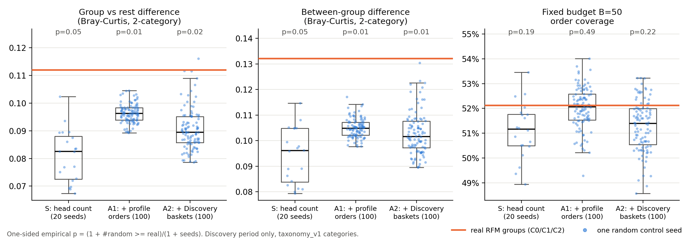

# 活跃度匹配的随机对照（B，2026-11-14）

> 分支 `b/activity-random-groups`。只用 Discovery 期，没有用 Validation/Test。
> 数据、taxonomy、门槛、排序、预算分配全部沿用 C 在 `c/pattern-mining-taxonomy`（提交 `0673ce3`）上的品类层设定。

## 1. 为什么要做

原来的 20 套随机分组（下文叫 **S**）只保证每组**人数**和真实分群一样（700 / 1,263 / 721），活跃度却完全不同：

| Discovery 期篮子数 | C0 | C1 | C2 |
|---|---|---|---|
| 真实分群 | 801 | 2,173 | 4,547 |
| S（20 个种子的中位数） | 1,974 | 3,531 | 1,992 |

因此"真实分群和随机分组差得多"有两种可能：一是分群真的抓到了不同的购物偏好；二是群的大小和活跃度不同带来的差异，比如群越小、抽样噪声越大，差异也越大；买得多和买得少的人本来就买不同的东西。这个对照就是要把第二种可能排除掉。

## 2. 做法

只在同一个"活跃度档"内部打乱真实群标签。这样每个档里，每组的人数都和真实分群完全一样；每组的活跃度构成也随之和真实分群一致。

| 对照 | 分档依据 | 档位 | 种子数 | 地位 |
|---|---|---|---|---|
| **A1** | Profile 期订单数 | 1 / 2 / 3–4 / 5–9 / 10+ | 100 | 主对照（HANDOFF 里预先计划的） |
| **A2** | Discovery 期篮子数 | 0 / 1 / 2 / 3–4 / 5–9 / 10+ | 100 | 补充：直接匹配挖规则时的篮子量。Discovery 信息只用来生成随机组，不参与分群本身 |

匹配效果（Discovery 期篮子数，100 个种子的中位数）：

| | C0 | C1 | C2 |
|---|---|---|---|
| 真实分群 | 801 | 2,173 | 4,547 |
| A1 | 963 | 2,163 | 4,400 |
| A2 | 832 | 2,277 | 4,400 |

两种对照都把篮子量拉到了和真实分群接近的水平，S 则差得很远。

**注意 A1 的局限**：RFM 本身就含频率 F，Profile 期订单数 ≥5 的顾客几乎全是 C2（385 人里有 383 人）。所以在 A1 下，随机的"C2"和真实 C2 本来就差不多，A1 主要检验的是 C0 和 C1 的区别（也就是 Recency 和 Monetary 带来的信息）。这正是 A1 要回答的问题："除了买得多不多，分群还有没有带来别的信息？"

## 3. 和 C 的结果核对

我用穷举的方式计数（所有在 Discovery 里联合次数 ≥20 的 2/3 品类组合，共 52,451 个，对应 154,339 条方向规则），先用 C 的 S 随机组复现了 C 的数字，**14 项全部一致**：

- 严格档规则数：G 1,116，C0 2,371，C1 856，C2 1,500；
- 固定预算覆盖率：G 55.06% / 63.25% / 66.12%，L 38.78% / 52.12% / 59.31%，S 中位数 37.56% / 51.17% / 59.15%；
- 群内合格但 G 不合格的比例：68.35%。

详见 `results/tables/activity_control/reproduction_check_vs_C.csv`。

## 4. 结果



经验 p 是单侧的：p = (1 + 随机 ≥ 真实的次数) / (1 + 种子数)。100 个种子时 p 最小是 0.0099，20 个种子时最小是 0.048。

### 4.1 群间差异：活跃度匹配后仍然存在，但幅度大约减半

| 指标 | 真实 | S 中位数（p） | A1 中位数（p） | A2 中位数（p） |
|---|---|---|---|---|
| 群 vs 群外差异，二品类 | 0.112 | 0.083（0.048） | 0.096（**0.010**） | 0.090（**0.020**） |
| 群 vs 群外差异，三品类 | 0.156 | 0.128（0.048） | 0.137（**0.010**） | 0.133（**0.020**） |
| 群与群之间差异，二品类 | 0.132 | 0.096（0.048） | 0.105（**0.010**） | 0.102（**0.010**） |
| 群与群之间差异，三品类 | 0.186 | 0.148（0.048） | 0.155（**0.010**） | 0.155（**0.020**） |

差异用 Bray–Curtis 衡量，越大越不同。以"群 vs 群外，二品类"为例，真实值比随机中位数高出：S +0.029，A1 +0.016，A2 +0.022。也就是说，**原来比随机多出的差异里，大约一半可以用活跃度或群大小解释；剩下的一半在两种匹配下都显著。**

### 4.2 差异主要来自 C0

逐群比较（二品类群 vs 群外差异的经验 p）：

| 群 | S | A1 | A2 |
|---|---|---|---|
| C0（流失的一次性顾客） | 0.048 | **0.010** | **0.030** |
| C1（近期少量购买） | 0.143 | 0.119 | 0.059 |
| C2（高频高消费） | 0.190 | 0.337 | 0.109 |

- **C0 在三种对照下都显著不同**。品类层的 C0 候选特征，比如"笔和美术用品、缝纫手工、小饰品盒"这类组合，值得交给 D 检查未来稳定性。
- C1 只是边缘显著；**C2 和同等活跃度的随机组没有可区分的差异**。所以 C2 的规则，可以理解为"高频顾客的普遍规律"。
- 另外，C1 的严格档规则数（856）比 98% 的 A1 随机组都少，说明 C1 的购买更分散。这只是描述性观察。

### 4.3 固定预算覆盖率：分群没有优势

| 预算 | G | L（真实） | S 中位数 | A1 中位数（随机 ≥ L 的种子数） | A2 中位数（随机 ≥ L 的种子数） |
|---|---|---|---|---|---|
| 20 | 55.1% | 38.8% | 37.6% | 40.6%（94/100） | 40.1%（81/100） |
| 50 | 63.2% | 52.1% | 51.2% | 52.1%（48/100） | 51.4%（21/100） |
| 100 | 66.1% | 59.3% | 59.2% | 59.2%（43/100） | 59.6%（64/100） |

在 S 下，L 还略高于随机中位数；换成活跃度匹配后，**L 落到随机分布的中间，B=20 时甚至低于大多数随机组**。G 在所有预算下都明显领先。这进一步支持 C 的结论：当前方案下，分群规则并不能提高整体覆盖率。

### 4.4 "群内合格但 G 不合格"的比例不是分群特有的

真实分群是 68.4%。A1 下随机中位数 62.5%（p = 0.03），A2 下 61.3%（p = 0.17）。任何三等分的分组都会产生大量"局部才合格"的规则，所以**这个比例不能当作分群有用的证据**。

## 5. 结论（可直接用于 RQ2）

1. 在品类层，真实 RFM 分群之间的组合差异，**在匹配人数和活跃度之后仍然大于随机分组**（A1 p = 0.01，A2 p ≤ 0.02），但超出随机的幅度比只匹配人数时缩小了大约一半。
2. 这部分额外差异**主要来自 C0**；C2 和同等活跃度的随机组差不多。
3. 差异显著**不等于**规则更有用：固定预算下 L 的覆盖率不比活跃度匹配的随机组高，也低于 G。
4. 以上都只是 Discovery 期的描述。p 值是在同一份数据上对多个指标分别算的，没有做多重比较校正；Bray–Curtis 的口径来自之前的探索，不是事先登记的唯一指标。最终结论要等 D 在 Validation 上验证。

## 6. 复现

```bash
python scripts/run_activity_control.py        # 约 10 秒；需要 data/processed/local/ 下的 customer_clusters.csv 和 random_groups.csv
python scripts/plot_activity_control.py
```

| 输出 | 内容 |
|---|---|
| `data/processed/local/random_groups_A1_profile_frequency.csv`、`random_groups_A2_discovery_baskets.csv` | 顾客级随机分组（不进 Git） |
| `results/tables/activity_control/activity_audit.csv` | 各对照每组的篮子数和 Profile 订单数 |
| `system_metrics.csv`、`group_metrics.csv` | 每个系统（真实分群或某个种子）和每组的全部指标 |
| `real_vs_controls.csv`、`per_group_real_vs_controls.csv` | 真实分群 vs 各对照（中位数、5–95% 分位、经验 p） |
| `reproduction_check_vs_C.csv` | 和 C 发布数字的逐项核对 |
| `results/figures/activity_control_real_vs_random.png` | 上面的图 |

代码：`src/online_trade/clustering/activity_control.py`（生成随机组）、`src/online_trade/taxonomy/category_controls.py`（品类层计数和指标），参数在 `configs/experiment.json` 的 `activity_matched_control` 部分。
