# C：Pattern Mining 阶段汇报与复现说明

> 阶段结论：分群提供了部分有解释价值的局部购物模式，但尚未证明同预算下的整体或未来优势。下一步重点是 Validation、公平去冗余及代表规则的差异保持。

本文按“现有发现”和“进一步研究方向”组织讨论内容，末尾保留交接、复现和验证说明。

## 状态与范围

截至2026-11-11，C完成Discovery开发版规则挖掘及探索分析，未用Validation选择配置，未评价Test性能。本提交不是已冻结的最终实验，也不证明真实分群优于全局。

全部独立实验保存在 `experiments/c_pattern/`，不修改A的数据处理、B的聚类或D的评价模块。它是当前可复现实验交付，尚未整合成仓库统一run_all入口。原始Excel、顾客级数据、虚拟环境、编码矩阵和含订单编号的案例样例不随功能分支上传。结果表中的商品编码和规则指标保留。

## 一、现有发现

### 1. 定位、数据与交接

C负责连接B的顾客分群和D的未来评价：发现哪些规则、解释选择依据、提供可追溯计数，并组织G/L/R公平比较。完成标准不是必须证明分群胜出。

沿用A的Online Retail II清洗口径。Profile为[2009-12-01,2010-06-01)，Discovery为[2010-06-01,2010-12-01)。主样本限Profile已知顾客：1928名顾客、7521个Discovery有效购物篮、3321个商品，含709个单商品篮。所有G/L/R使用相同订单。

A/B数据固定取快照提交 `2ae672b7ea6edb7f5e1561b6a64823004dea833e`：A文件在 `data/processed/A_data_preparation/`，B标签在 `data/processed/B_customer_clustering/`。购物篮SHA256为 `30aef702f812ab42224271871271daff5b4e37a594696eee82208252198367bf`。每项实验manifest保留输入哈希；结果来自本地原始脚本运行，发布时只调整两个脚本的仓库路径，历史manifest中的代码哈希仍代表当时版本，不能作为发布脚本哈希。

### 2. 算法对照：选择 FP-Growth 作为统一实现

CPU mlxtend 0.23.4 FP-Growth和默认Apriori，稠密布尔输入，支持度1%/2%、最长项集2/3，四组设置、每种算法三次独立进程，共24次运行。两算法项集和整数计数全部一致，并逐项重算。

|支持度|长度|项集数|FP-Growth中位秒|Apriori中位秒|FP-Growth峰值MiB|Apriori峰值MiB|
|---|---|---|---|---|---|---|
|2%|2|326|1.37|2.06|641|824|
|2%|3|327|1.28|2.33|638|824|
|1%|2|1062|5.31|19.39|657|4044|
|1%|3|1194|6.58|23.42|664|4072|

耗时仅挖掘调用，内存为约5ms采样的进程RSS峰值，包含环境和输入，非算法独占内存。进程高水位另列，含导入阶段。Apriori有较大运行波动，原始结果均保留，不宣称普遍速度优势。


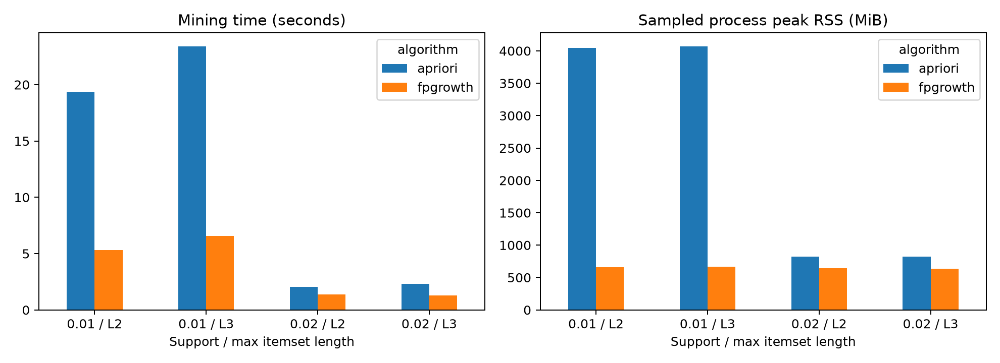

图1：相同项集结果下比较计算成本；这是实现对照，不是规则效果比较。

### 3. G/L/R 挖掘、共同候选池与系统预算

FP-Growth运行64次：G一次、L三个真实群、R二十个seed（42–61）各三组。随机标签以顾客为单位，画像期各组人数匹配。各群Discovery订单量C0=801、C1=2173、C2=4547。

开发参数：support>=1%、联合次数>=20、前件次数>=20、confidence>=0.2、lift>=1；前件1–2商品、后件1商品。C0实际支持度下限20/801≈2.50%。合格方向规则G=1116、C0=46、C1=843、C2=1590。


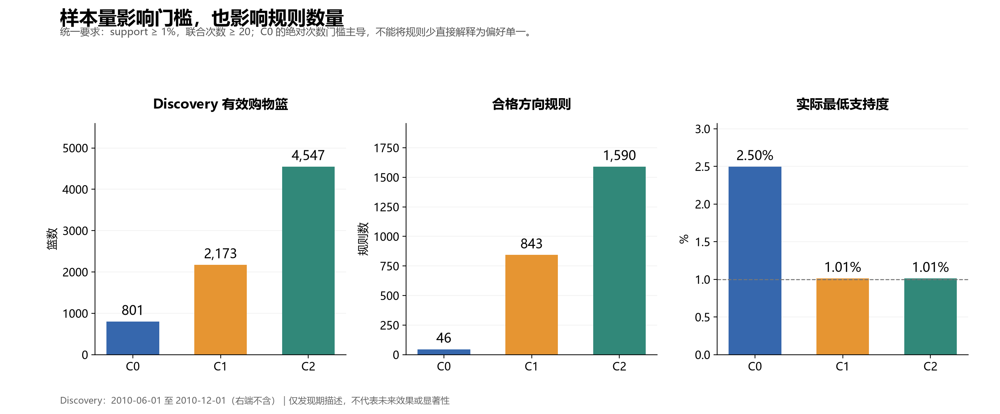

图2：C0的绝对次数门槛主导；规则数量差异不能全部解释为顾客偏好差异。

共同候选池11246条，按商品前后件去重，再为64个范围计算719744行证据。保留前件、后件、联合次数、群内support/confidence/lift、群外指标、全局排名及本范围是否独立发现。相同门槛下完整FP-Growth应找到同样的合格规则，因此native/common_pool可能相同；共同池本身不是收益证据。

系统总预算20/50/100；局部按Discovery订单量比例用最大余数法分配，余数相同按群号排序，空缺不重新分配。按联合次数、confidence、lift降序及rule_id升序筛选，仅去完全重复规则。群体条件不同占不同名额。预算50时真实群5/15/30条。

完整订单覆盖同一篮只计一次。Discovery订单覆盖G为22.32%/28.59%/39.72%，L为13.96%/22.02%/27.46%；R中位数13.25%/20.58%/26.53%。这些是发现期结果，随机范围不是置信区间，无显著性或未来效果结论。顾客宏平均另报。


|系统总规则预算|G 全局完整覆盖率|L 真实分群|R 随机分群中位数|
|---|---|---|---|
|20|22.32%|13.96%|13.25%|
|50|28.59%|22.02%|20.58%|
|100|39.72%|27.46%|26.53%|

这是相同7,521张Discovery订单上的完整覆盖，每张订单最多计一次。G规则适用于全部顾客，L/R顾客仅使用所属组规则；同系统预算不等于同用户可用规则数。不能把发现期表现称为未来泛化效果。


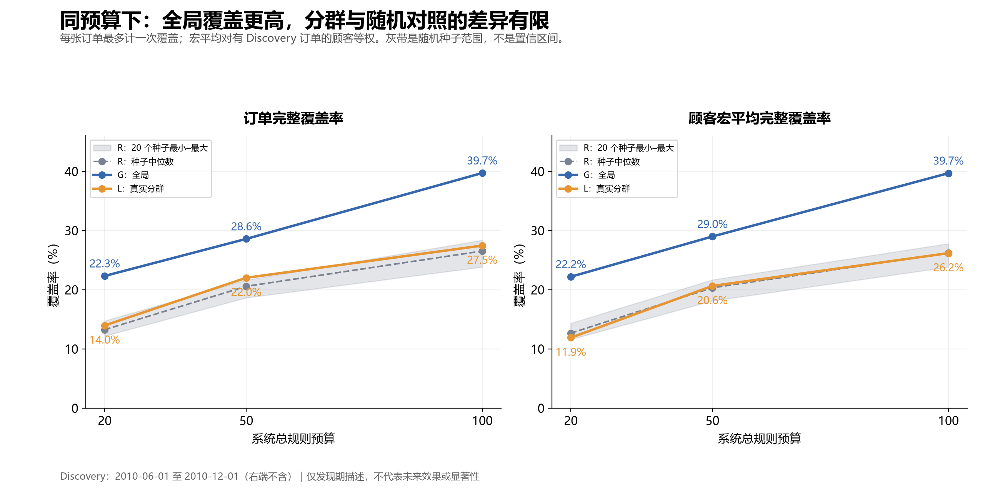

图3：G目前更高；L在订单覆盖上略高于R中位数，但顾客宏平均下并非所有预算都高于R。灰带是20个种子的最小–最大范围，不是置信区间。

### 4. 局部模式：排名提前与条件关联要分开解释

全局高排名主要涉及礼品家居、袋类、烘焙配件的同系列共购，不代表正式品类销量占比。C0暖手袋和玩具屋系列排名提前；C1毛毡靠垫较突出；C2袋类与白色木质家居较突出且与全局重合较多。C2贡献约60.5%的Discovery篮子，影响全局统计。


|群体|历史RFM画像|代表规则|群内排名 / 全局排名|群内 / 群外 confidence|
|---|---|---|---|---|
|C0|较久未购买、低频低金额|猫头鹰暖手袋→小狗暖手袋|3 / 57|66.7% / 54.0%|
|C1|较近期购买、仍以低频为主|蝴蝶毛毡靠垫→兔子毛毡靠垫|14 / 163|73.5% / 62.3%|
|C2|更近期、更高频、金额更高|SUKI收纳袋→粉色白点大购物袋|全局第75，属于局部差异候选|43.9% / 25.4%|

三个案例的群内联合次数分别为34、61、137；support分别为4.24%/2.81%/3.01%，群外为2.32%/1.42%/0.98%。这些规则全局可以发现，但未进入全局Top50，不能说“全局算法发现不了”。C2的相框等最高排名模式本来就在全局前列，应描述为热门模式在群中更突出。

反例：C0玩具屋卧室→厨房群内support较高，但confidence低于群外，不能说条件关联更强。样例是探索性挑选，未做多重检验。商品名称来自Discovery有效交易中该编码最常见描述。


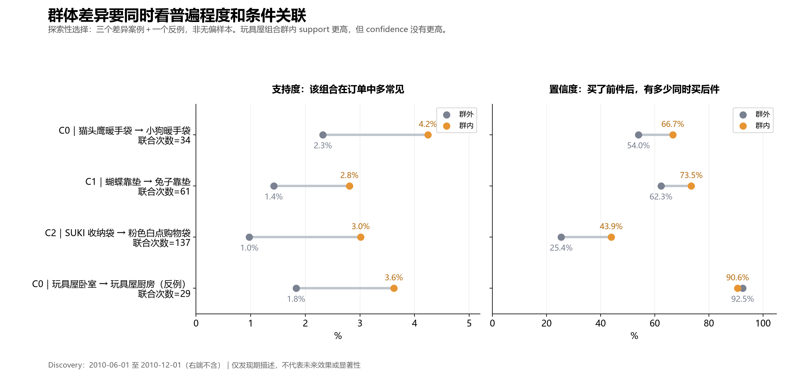

图4：玩具屋卧室→厨房在C0的support为3.62%（群外1.83%），但confidence为90.6%（群外92.5%）。更常见不等于条件关联更强，也不支持给顾客贴“亲子家庭”等身份标签。

四张中文PNG/SVG图位于pattern_analysis/figures。排行榜HTML包含全部64个范围，可切换Top10/20/50、搜索名称；C0仅46条。每组TopN不是系统总预算B。全局50条方向规则仅26个商品并集，存在完整覆盖冗余，后续去冗余须一致用于G/L/R。


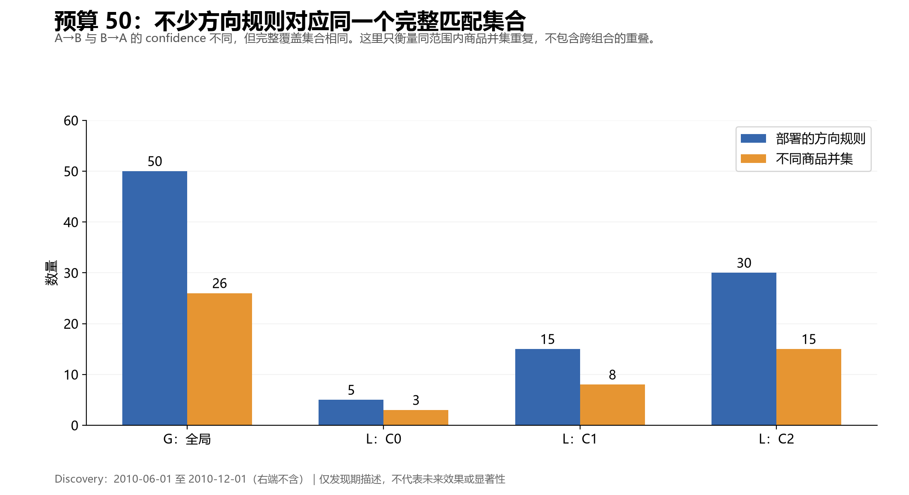

图5：A→B与B→A可占两个名额，却有相同完整覆盖集合。此图只展示同范围内相同商品并集的重复，不包括不同组合之间的覆盖重叠。

### 5. 高金额订单：独立补充分析

按全体合格Discovery订单毛购买金额90%分位数筛选，金额>=£888.47，包含并列；753张订单、310位顾客，占42.51%毛购买额，C0/C1/C2分别53/99/601张。固定原计数门槛20，因此高金额实际支持度约2.66%；得到1128条合格方向规则。

蛋糕纸杯、午餐盒、蛋糕架和茶具搭配更突出。高金额篮商品种类中位数29，其余14。按篮子大小分层后部分差异减弱；这不是因果调整。匹配规则的整单金额不能归因给规则、不能跨规则相加。此补充不是新的G/L/R未来效果实验，不预测订单是否高金额。


|高金额代表规则|高金额订单联合次数|support：高金额 / 其余订单|confidence：高金额 / 其余订单|
|---|---|---|---|
|粉色佩斯利蛋糕纸杯→波点蛋糕纸杯|68|9.03% / 2.13%|70.8% / 52.9%|
|娃娃女孩午餐盒→太空男孩午餐盒|52|6.91% / 1.98%|81.3% / 60.6%|
|红色波点蛋糕架→三层蛋糕架|45|5.98% / 1.37%|61.6% / 40.4%|

第一条规则在21–50种商品的篮中仍有差异，但在51种及以上的篮中confidence接近（63.4%对61.5%）。粗分层只能提示篮子大小影响，不能证明排除了混杂。


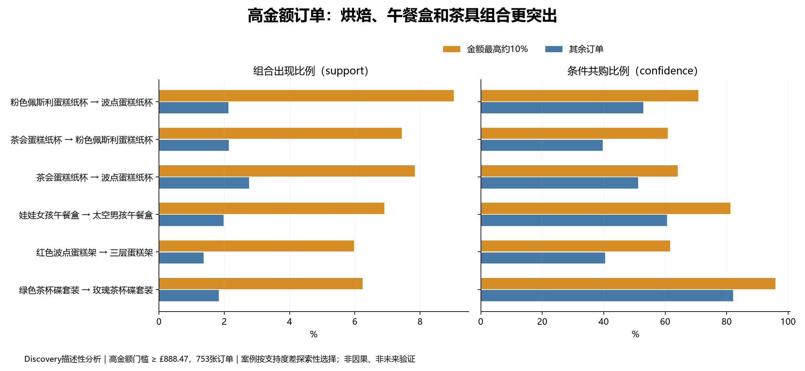

图6：按发现期支持度差探索性选择的案例。高金额是事后按整单金额筛选；不能把规则匹配订单的金额解释为规则创造的收入。

### 6. 分析1–3：群间相似度、共同池强度与群外代表规则

**分析1：Top10/Top20 Jaccard。** 先按商品并集去重，再按该组合排名最高的合格方向规则排序（联合次数、confidence、lift降序，rule_id升序），取K个不同组合。不是系统总预算实验。C2与全局Top10共享9个组合，Jaccard=9/11=0.818；Top20共享15个，Jaccard=15/25=0.600。C0与全局分别0.250/0.333，C1分别0.429/0.481。Jaccard不是简单的交集/K，结论受K和并列排序影响。

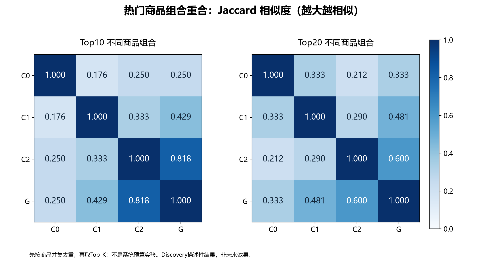

**分析2：共同池support向量差异。** 将同商品并集的方向规则合并，二商品2134个、三商品2326个分别比较。使用每群实际support，包括未过该群筛选门槛的候选；无实际出现才填0。Bray–Curtis=Σ|s−t|/Σ(s+t)，越大差异越大。C0–C1二/三商品差异0.192/0.214；C0–C2为0.266/0.571；C1–C2为0.265/0.566。因此广泛支持度分布中C0与C1更接近，不能只看热门榜单。G包含自身，且受C2的60.5%订单权重影响，不是独立参照。

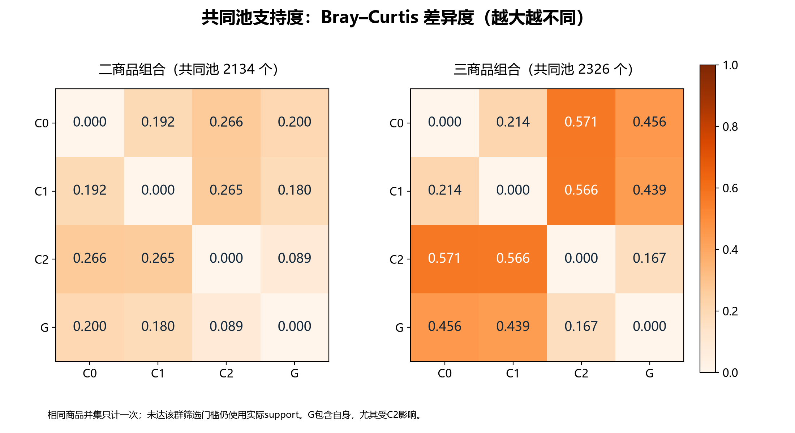

**分析3：群vs群外代表规则。** 每群选择support正差最大的3个不同组合及负差最大的1个反例，保留代表方向；附前件、联合、群内外篮数与support/confidence。规则有差异不等于更有用，也不代表显著性。[代表规则完整计数](../experiments/c_pattern/pattern_similarity/representative_rules.csv)；[完整分析报告](../experiments/c_pattern/pattern_similarity/群体相似度分析.html)。

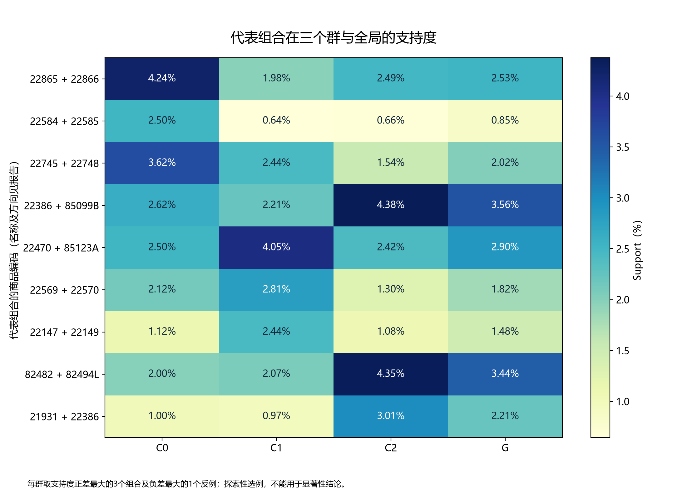

### 7. 分析4：20个随机分组的差异对照

每个seed先对3个组对等权平均，或对3个“组vs群外”指标等权平均，再得到20个随机汇总值；**不能把60个组对当作独立样本**。Top-K、候选池、门槛和真实组采用同一政策。下表所有指标越大表示差异越大，Jaccard这里换算为1−J。

|指标|真实分群|随机中位数|随机最小–最大|真实值高于的随机结果数|
|---|---|---|---|---|
|Top10组间平均Jaccard差异|0.7467|0.6427|0.4872–0.7613|19/20|
|Top20组间平均Jaccard差异|0.7214|0.6449|0.5238–0.7440|18/20|
|二商品组间Bray–Curtis|0.2409|0.2301|0.1897–0.2403|20/20|
|三商品组间Bray–Curtis|0.4505|0.4921|0.3955–0.5291|5/20|
|二商品组vs群外Bray–Curtis|0.2376|0.2046|0.1754–0.2135|20/20|
|三商品组vs群外Bray–Curtis|0.5250|0.5151|0.4346–0.5436|16/20|
|二商品组vs群外support绝对差（百分点）|0.3594|0.3345|0.2771–0.3491|20/20|
|三商品组vs群外support绝对差（百分点）|0.3943|0.5165|0.3612–0.5561|3/20|

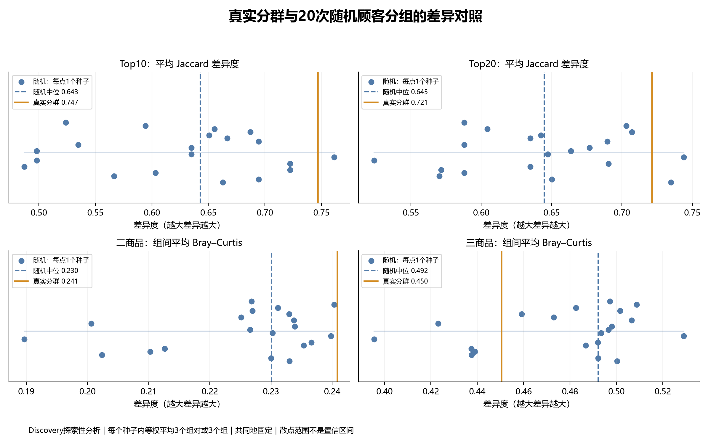

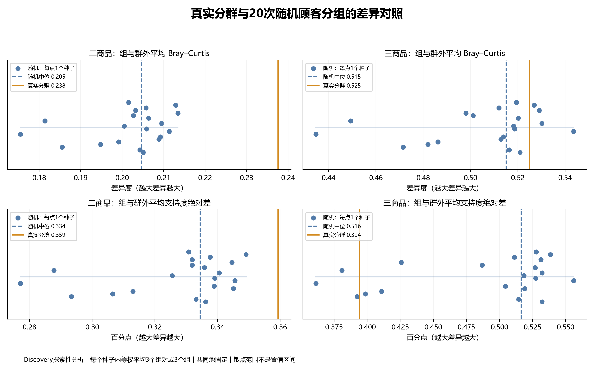

**保留负面结果：三商品的组间差异没有一致超过随机分组。** 真实三商品组间Bray–Curtis低于随机中位数；群外相对距离虽略高于中位数，绝对support差反而较低。二商品存在较强差异迹象，但组间0.2409仅略高于随机最大0.2403，不能只强调“超过全部20次”而忽略幅度。

这不是正式显著性检验：共同池由真实组及这些随机组共同生成并固定，只有20个种子，多个指标无多重检验处理。随机分组保持Profile组人数，不匹配Discovery订单数、活跃度、篮子大小和商品边际频率。无p值、无置信区间，不据此宣称独特偏好或未来优势。[每种子的指标](../experiments/c_pattern/random_similarity/seed_level_metrics.csv)；[各组对明细](../experiments/c_pattern/random_similarity/pair_and_group_details.csv)。

### 8. 二商品与三商品规则：分开统计、排名和解释

一直挖掘最长3商品项集；二商品生成A→B，三商品生成{A,B}→C，后件始终为1商品，不生成A→{B,C}。之前案例偏二商品，原因是按联合次数优先排序，子集出现次数不低于超集，正反规则也占据展示名额。现在分长度列榜，避免用二商品案例代表全部结果。

|范围|二商品合格方向规则|二商品不同集合|三商品合格方向规则|三商品不同集合|
|---|---|---|---|---|
|G|720|419|396|132|
|C0|43|22|3|1|
|C1|633|367|210|70|
|C2|900|555|690|230|

[分长度G/L Top10榜单与详细案例（Markdown）](../experiments/c_pattern/pattern_length_analysis/按长度规则榜单与三商品案例.md)包含每张榜的商品名称、计数、support/confidence/lift。[全部64个范围分长度Top50](../experiments/c_pattern/pattern_length_analysis/top50_by_scope_length.csv)按method/seed/group_id/length过滤，rank_within_length<=10或20即可取Top10/20。[全部范围计数](../experiments/c_pattern/pattern_length_analysis/counts_by_scope_length.csv)含20个随机种子。C0三商品只有3条，不能补齐Top10。这里是方向规则排行榜，不是Top-K不同组合或系统总预算结果。

### 9. 三商品案例及单前件对照

检验{A,B}→C是否有增量，比较其confidence与A→C、B→C中的较大值。两个单前件均从原Discovery篮子直接计数，即使它们未通过筛选也保留。增量是探索性条件关联，不是因果提升；联合事件更少、分母不同，仍需未来验证。

|群|前件 → 后件|群内联合/前件|群内/群外support|三商品confidence|较强单前件confidence|增量（百分点）|
|---|---|---|---|---|---|---|
|C0|POPPY'S PLAYHOUSE BEDROOM + POPPY'S PLAYHOUSE LIVINGROOM → POPPY'S PLAYHOUSE KITCHEN|20/22|2.50% / 1.41%|90.91%|93.10%|-2.19|
|C0|POPPY'S PLAYHOUSE LIVINGROOM + POPPY'S PLAYHOUSE KITCHEN → POPPY'S PLAYHOUSE BEDROOM|20/27|2.50% / 1.41%|74.07%|75.86%|-1.79|
|C1|FELTCRAFT 6 FLOWER FRIENDS + FELTCRAFT CUSHION BUTTERFLY → FELTCRAFT CUSHION RABBIT|26/33|1.20% / 0.32%|78.79%|73.49%|+5.29|
|C1|FELTCRAFT BUTTERFLY HEARTS + FELTCRAFT CUSHION BUTTERFLY → FELTCRAFT CUSHION RABBIT|26/29|1.20% / 0.43%|89.66%|73.49%|+16.16|
|C1|HEART OF WICKER SMALL + HEART OF WICKER LARGE → WHITE HANGING HEART T-LIGHT HOLDER|40/91|1.84% / 1.31%|43.96%|46.56%|-2.60|
|C2|JUMBO STORAGE BAG SUKI + JUMBO BAG PINK WITH WHITE SPOTS → JUMBO BAG RED RETROSPOT|94/137|2.07% / 0.74%|68.61%|61.42%|+7.19|
|C2|WOODEN PICTURE FRAME WHITE FINISH + WOOD 2 DRAWER CABINET WHITE FINISH → WOOD S/3 CABINET ANT WHITE FINISH|82/99|1.80% / 0.57%|82.83%|66.30%|+16.52|
|C2|LUNCH BAG PINK RETROSPOT + JUMBO BAG PINK WITH WHITE SPOTS → LUNCH BAG RED SPOTTY|68/106|1.50% / 0.84%|64.15%|64.38%|-0.23|

C0唯一三商品集合为玩具屋卧室/客厅/厨房。卧室+客厅→厨房confidence为90.91%，低于较强单前件93.10%，不能说额外前件提供增量。C1部分毛毡组合、C2部分袋类/白色木质家居组合显示正增量，同时每群保留无增量反例。案例按群内外support差选择，不只挑增量最大的规则。

[完整G/L三商品与两个单前件逐条对照](../experiments/c_pattern/pattern_length_analysis/triple_vs_single_all_GL.csv)含双方单前件次数及联合次数。[案例表](../experiments/c_pattern/pattern_length_analysis/triple_cases.csv)和上述Markdown附录同时提供群外篮数/前件数/联合数、两个单前件编码与confidence。C0只一个集合，正差案例与无增量反例可能是同集合不同方向，不能当作独立证据。

## 二、进一步研究方向

### 1. 优先与D完成Validation评价

使用Discovery产生的固定候选，检查覆盖、群内外支持度差和固定规则confidence能否保持。验证期用于选择少量候选配置，不能重新挖组合混入Discovery候选池；Test只在协议冻结后评价。预算、阈值、排序、去冗余和种子都应记录配置版本。

### 2. 以统一去冗余作为优先改进

保留当前筛选为基线，再比较同一适用范围内相同商品并集的方向规则去冗余版本。建议先以系统预算50开展小规模对照，对G/L/R一致应用，并同时看完整覆盖、前件覆盖及解释性。方向不同的confidence有不同含义，不能假定去重必然更好。若候选不足预算，应报告实际数量并补充实际容量匹配比较。

### 3. 检查最低计数对小群的影响

在预先约定的小范围内比较最低次数10/20/30，观察C0样本稀疏性及后续规则稳定性。该范围是待确认方案，尚未运行；不为单个群单独降低门槛以追求正结果，不按Test效果挑参数。

### 4. 保留高金额订单为补充方向

主线仍是历史RFM分群是否提供可持续的购物模式。高金额补充继续检查篮子大小、少数大单和重复顾客的影响。若延伸到Validation，应预先决定沿用Discovery的固定金额门槛还是研究期内分位数，两者问题不同；建议固定£888.47并报告后续覆盖范围，不能临时改定义以改善结果。

### 5. 小组讨论需要确定的事项

- **C与D交接**：规则表字段、规则匹配、空分母处理及Validation评价入口。
- **优先实验**：是否以预算50比较当前政策与统一去冗余政策；再确认小范围阈值候选。
- **范围控制**：保留G/L/R主线，高金额分析作为补充，不增加新的算法竞赛。
- **解释案例**：跟踪暖手袋、毛毡靠垫、收纳袋三个差异案例，以及玩具屋反例；未来结果无论成功失败均报告。

上述均为建议及待协调任务，不表示小组已确认或实验已完成。

## 三、输出与交接

- `patterns/selected_rules.csv`、`config.json`：给D的固定开发规则与配置，按flow/method/seed/budget筛选，避免把不同预算或种子叠加。
- `patterns/rule_evidence.csv.gz`：完整候选证据；`scope_audit.csv`和`budget_audit.csv`核对分母与实际容量。
- `results/`：算法对照原始运行与汇总。
- `pattern_analysis/`：案例、群差异、覆盖、冗余和图片。
- `pattern_top_rules/`：完整排行榜、文本和JSON。
- `high_value_analysis/`：独立高金额规则、分层证据、中文HTML报告与图片。

## 四、复现

需要Python 3.12和Git。建议新建虚拟环境，依赖精确版本见 experiments/c_pattern/requirements-lock.txt（Windows实验环境）。从仓库根目录执行：

```powershell
python -m venv .venv-c
.venv-c/Scripts/python.exe -m pip install -r experiments/c_pattern/requirements-lock.txt
.venv-c/Scripts/python.exe experiments/c_pattern/prepare_inputs.py
.venv-c/Scripts/python.exe experiments/c_pattern/benchmark.py
.venv-c/Scripts/python.exe experiments/c_pattern/pattern_mining.py
.venv-c/Scripts/python.exe experiments/c_pattern/validate_patterns.py
.venv-c/Scripts/python.exe experiments/c_pattern/analyze_patterns.py
.venv-c/Scripts/python.exe experiments/c_pattern/visualize_patterns.py
.venv-c/Scripts/python.exe experiments/c_pattern/export_top_rules.py
.venv-c/Scripts/python.exe experiments/c_pattern/high_value_patterns.py
.venv-c/Scripts/python.exe experiments/c_pattern/report_high_value.py
.venv-c/Scripts/python.exe experiments/c_pattern/compare_group_patterns.py
.venv-c/Scripts/python.exe experiments/c_pattern/compare_random_similarity.py
.venv-c/Scripts/python.exe experiments/c_pattern/analyze_pattern_lengths.py
```

prepare_inputs从固定Git快照提取A购物篮/订单、B标签，并构造Discovery矩阵；报告中文字体依赖Microsoft YaHei。benchmark会再次生成相同编码输入并运行对照；可直接跳到pattern_mining以跳过耗时对照。脚本会覆盖实验输出，重跑前请备份或使用独立checkout。参数集中在pattern_mining.py的CFG；其他分析脚本目前有固定数据量检查和少量显示文字，变更数据/阈值须同步检查，不能声称是任意数据通用工具。

可选从原始Excel重跑A的完整清洗与验证，请按主仓库文档操作；audit_data.py针对本实验processed目录运行审计。prepared快照仅按核心哈希核验，不替代A的全部审计。

新增相似度检查：Top-K集合大小、距离矩阵对称性、重复并集support一致、全局support等于群体加权平均均通过；随机真实值复现上一轮分析，各指标保留20个种子；三商品G/L规则逐条重算前件与联合计数，单前件从输入独立计数。

## 五、已执行验证与限制

本地数据验证通过；G/L/R标签唯一、20个随机顾客置换人数匹配、逐篮编码核验、相同订单范围、系统预算、规则唯一性通过；150条部署规则用独立Python集合计数复核；高金额Top50独立复核；原G/L/R文件哈希未变。发布路径调整后再执行语法和规则检查，未为上传重新运行全部64次挖掘。

Validation/Test规则表现尚未评价；阈值未冻结；额外去冗余、实际规则容量匹配、未来区间尚待与D协作。建议先以预算50比较当前政策与统一去冗余政策，再开展小范围计数阈值敏感性。不要通过Test挑参数。

## 六、工具使用披露

C使用AI辅助编写和运行实验、汇总证据、生成图表及说明。算法调用mlxtend，数据处理和群标签沿用A/B固定快照。组员须复核口径和代码、理解结论并按课程要求披露；不将AI生成解释当作额外实验证据。
