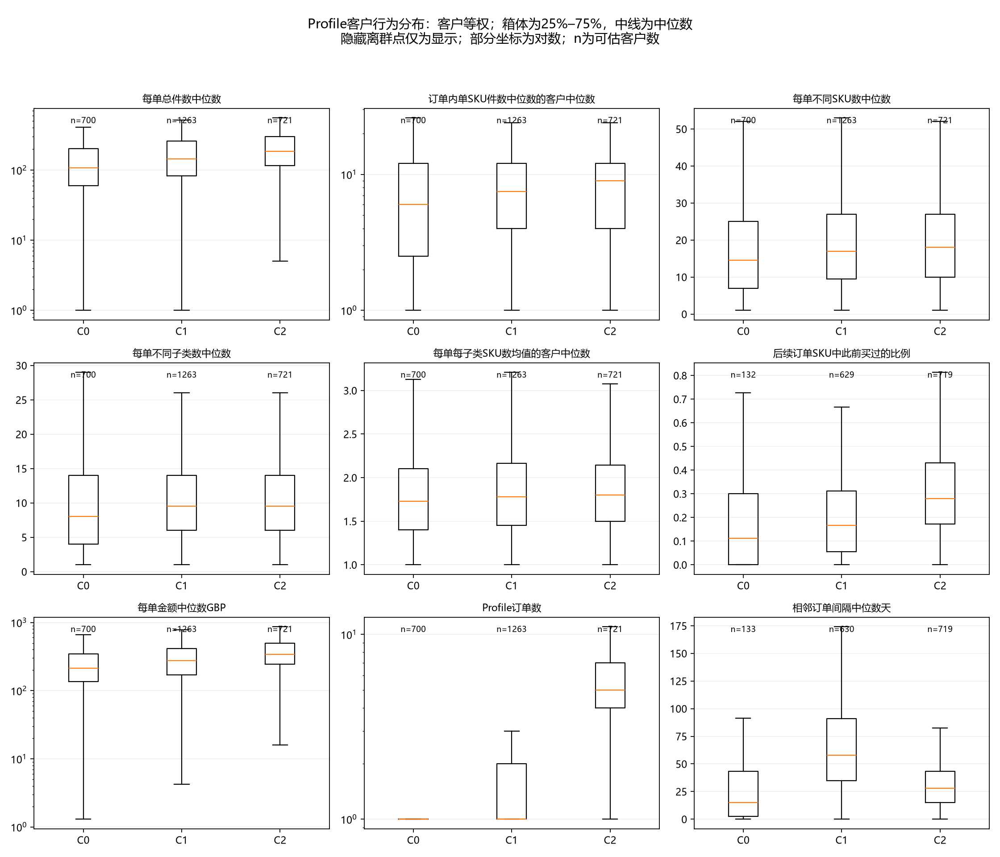

# 群体特色排序与采购行为画像补充

本次结果独立归档：[实验入口与复算说明](../experiments/c_pattern/runs/2026-11-22_specificity_behavior/README.md)。

## 未来群体特色

规则在Discovery冻结，Validation评价。P5/100普通→特色排序：confidence群内外差中位数0.93→8.75pp；基础率调整后关联差中位数0.95→6.68pp；固定效应保持率17%→62%。后者要求差≥5pp且调整差>0，分母为全部100个名额。A1有25/100次保持率达到或超过真实L，因此特色排序比普通频次排序更能体现群体差异，但尚不能确认RFM优于随机。

[全部配置报告](../experiments/c_pattern/runs/2026-11-22_specificity_behavior/ranking_gap_sensitivity/future_specificity/未来群体特色指标补充.md)

预算沿旧规则名额口径，未消除跨群或方向冗余；不能与100个不同组合预算混用。新指标不是新增确认性检验，不改D冻结Test。

## 批发商还是散客？

计算的是采购行为，不是真实身份。Profile期每位客户先算典型订单，再比较群中位数：

|指标|C0|C1|C2|
|---|---:|---:|---:|
|每单总件数|107.5|144|185|
|单SKU件数|6|7.5|9|
|每单金额GBP|212.11|277.04|342.12|
|订单数|1|1|5|
|后续SKU重复购买比例|11.11%|16.67%|27.91%|
|只有一单客户比例|81.00%|50.12%|0.28%|

复购仅在有此前订单者计算，可估客户分别132/629/719。C2更符合持续采购、重复补货；C0以低频观察为主。三群典型订单都具有批量购买特点，不宜直接分成批发商与散客。群间配货宽度差较小；频次差影响复购观察机会，应在相同频次层内进一步核对。

本报告使用旧RFM标签，与D experiments/1122重新分群不同。结果未验证真实客户职业或经营身份。
