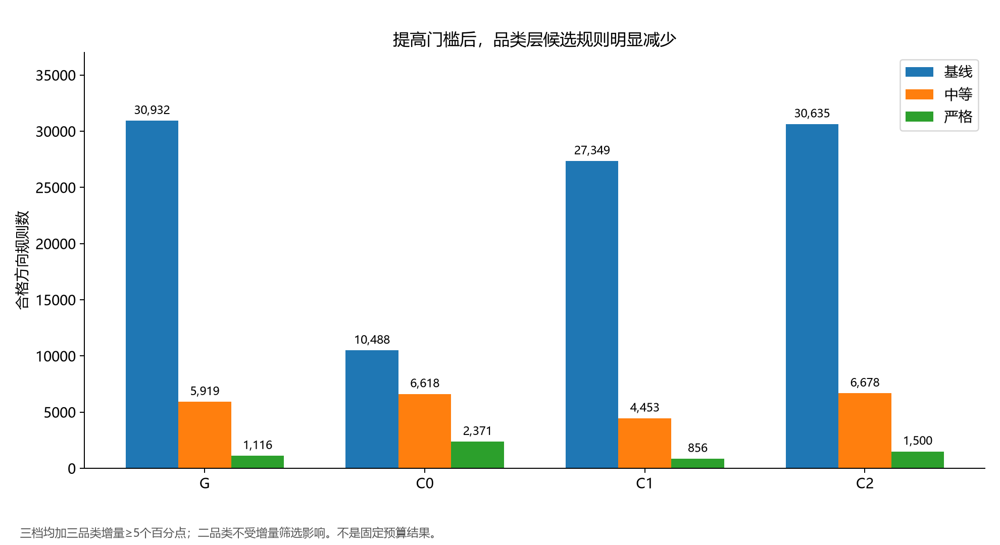
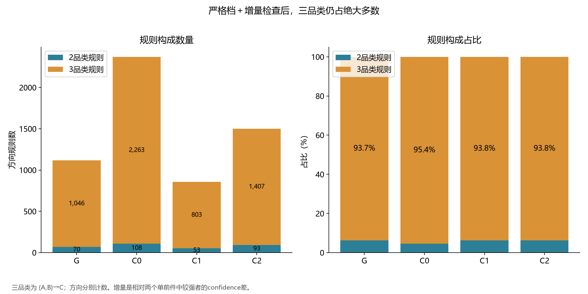
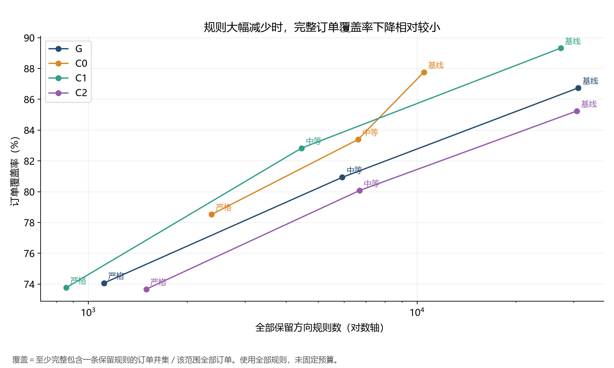
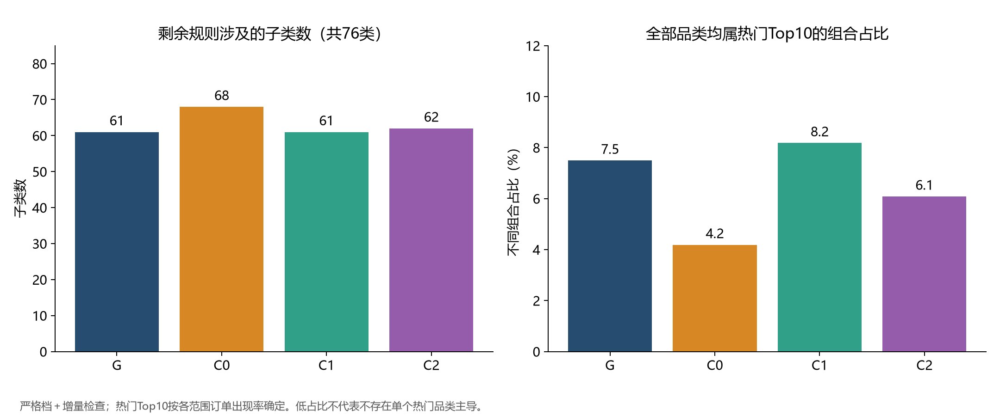
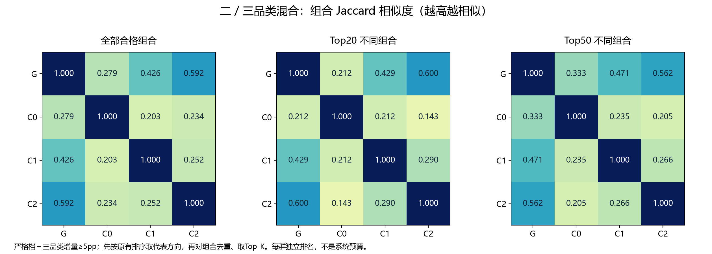
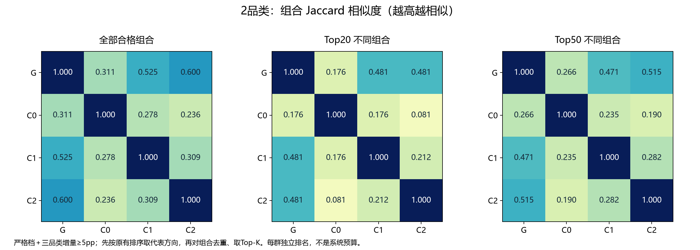
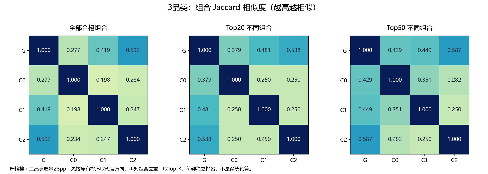
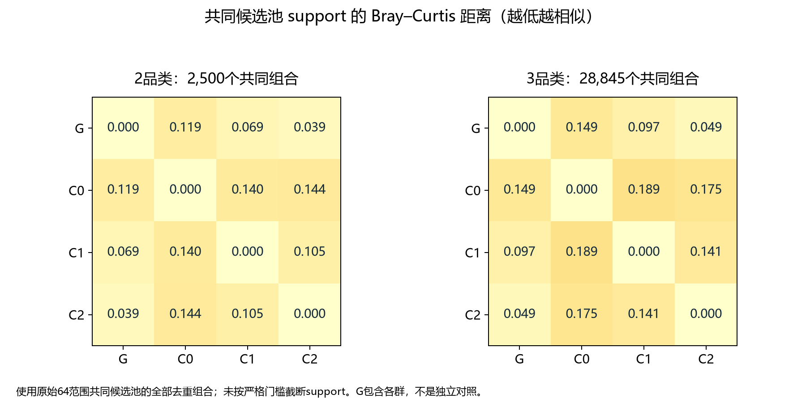
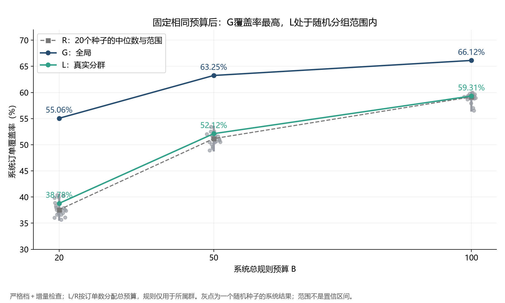

# Taxonomy Pattern Mining 阶段进展汇报

> C · 更新日期：2026-11-14  
> 分支：`c/pattern-mining-taxonomy`  
> 状态：Discovery 开发期分析已完成；参数尚未由 Validation 选定，未使用 Test。  
> 核心交付对应提交 `36ad517`；本次补充群内新增候选占比及品类层相似度分析。D 的操作约定见 [交接注意事项](c_taxonomy_handoff_D.md)。

## 1. 阶段目标与主要结论

本阶段研究的问题是：**把具体商品归并为品类之后，能否发现超出同类不同款式共购的采购结构？真实 RFM 分群是否比全局和随机分组提供更有价值的规则？**

目前得到五点结论：

1. 原 SKU 合格规则确实以同子类组合为主：全局二商品规则约70.69%、三商品约69.70%属于同类。taxonomy 使这一观察可以被量化。
2. 跨类 SKU 和品类层分析揭示了装饰、手工文具、袋类收纳等共同采购结构，也产生了若干群内外差异候选。
3. 提高门槛与三品类增量检查显著减少了规则，但三品类仍占严格档合格规则的约94%–95%，不能认为冗余问题已经完全解决。
4. **固定系统总预算后，当前配置下 G 的订单覆盖率高于 L；L仍处于20个随机种子的范围内。当前证据不支持“RFM分群用同样数量规则获得更高整体覆盖率”。**

5. 严格档下L去重方向规则中68.35%未在G合格；组合重合与support分布均显示C2更接近G，但尚未证明品类层群间差异超过随机。

这些是开发期描述性结论，不是推荐准确率、因果增销证据或未来稳定性结论。

## 2. 数据与实验框架

数据来源为 [UCI Online Retail II](https://archive.ics.uci.edu/dataset/502/online+retail+ii)。官方介绍该商家主要销售礼品，许多客户为批发商；数据未逐个标记客户业务身份，因此不能把某个聚类直接认定为批发商或零售商。

|项目|本阶段口径|
|---|---|
|Discovery|2010-06-01 至 2010-12-01，左闭右开|
|主分析订单|7,521 张；1,928 位客户|
|真实客户群|C0：801张；C1：2,173张；C2：4,547张订单|
|taxonomy|B 冻结的 `taxonomy_v1`，来源提交 `c89430d`|
|商品覆盖|4,724个商品编码，其中62个归为other，无空子类标签|
|本期商品|Discovery编码中有35个other，但原SKU共同候选规则没有涉及other|
|挖掘算法|CPU FP-Growth，最长二／三项组合，单后件方向规则|
|G/L/R|全局1个范围；真实分群3个；20个随机种子各3组，共64个范围|

随机分组沿用固定客户标签置换，保持Profile客户组规模；它不保证Discovery订单量、订单大小或活跃程度完全匹配。随机结果按种子汇总，不能把60个随机组当成60次独立实验。

## 3. 已完成工作一：给原 SKU 规则添加 taxonomy 标签

对原有11,246条共同候选规则、719,744行范围证据添加子类、设计系列和规则类型，不改变原始门槛或指标。

规则类型按前后件全部商品共同判断：

|类型|判定|
|---|---|
|同类换款|全部商品属于同一 `l2_id`|
|同系列配套|涉及不同子类，但全部属于同一个非none设计系列|
|真正跨类搭配|其他跨子类组合|
|未分类|含other或缺少子类标签；本次合格规则中为0|

三商品规则中，两件同类、一件不同类也属于跨类；只有部分商品共享系列不满足“同系列配套”。类型名称是分类约定，不自动证明换款、互补或业务价值。

### 3.1 原SKU合格规则的三分类占比

统计对象为各范围原生生成且合格的方向规则；A→B与B→A分别计数。

|范围|商品数|规则数|同类换款|同系列配套|真正跨类搭配|
|---|---:|---:|---:|---:|---:|
|G|2|720|70.69%|2.92%|26.39%|
|G|3|396|69.70%|0.76%|29.55%|
|C0|2|43|88.37%|0%|11.63%|
|C0|3|3|100%|0%|0%|
|C1|2|633|68.56%|3.48%|27.96%|
|C1|3|210|84.29%|0%|15.71%|
|C2|2|900|62.22%|4.78%|33.00%|
|C2|3|690|56.09%|0.43%|43.48%|

**解读：** 大多数规则确实来自同子类共购。C2在当前门槛下的跨类规则占比较高，但这是规则集合的构成，不能直接解释为客户跨类购物概率，也不是显著性结论。

数据见 [taxonomy分类统计](../experiments/c_pattern/taxonomy_analysis/classification_counts.csv)。

## 4. 已完成工作二：单独提取商品层跨类规则

从原有合格SKU规则中删除全部商品属于同一子类的规则，保留同系列配套和其他跨类组合；没有重新挖掘或降低门槛补齐。

|范围|原规则数|剩余跨类规则|二商品|三商品|保留比例|
|---|---:|---:|---:|---:|---:|
|G|1,116|331|211|120|29.66%|
|C0|46|5|5|0|10.87%|
|C1|843|232|199|33|27.52%|
|C2|1,590|643|340|303|40.44%|

**解读：** SKU跨类筛选显著缩小候选范围；C0没有合格的三商品跨类规则。此前全部SKU规则的随机差异结论不能直接套用到这个新子集。

完整结果见 [G/L跨类规则](../experiments/c_pattern/cross_category_analysis/GL_cross_category_rules.csv) 与 [跨类分析报告](../experiments/c_pattern/cross_category_analysis/商品层跨类规则报告.md)。

## 5. 已完成工作三：品类层重新挖掘

将SKU映射为`l2_id`，排除other，同一订单同一子类只记一次。纳入范围中的订单全部保留在分母，包括映射后2张空篮；另有974张单品类篮。Discovery实际出现76个非other子类。

先沿用商品层门槛作为探索基线：support≥1%、联合和前件次数均≥20、confidence≥20%、lift≥1。全局、真实分群与随机组统一处理。

|范围|二品类合格规则|三品类合格规则|总数|
|---|---:|---:|---:|
|G|2,604|45,344|47,948|
|C0|2,226|13,251|15,477|
|C1|2,305|39,070|41,375|
|C2|2,605|45,569|48,174|

64个范围合并得到91,535条共同候选方向规则，重算5,858,240行群内外证据。**品类合并显著增加了共现机会，原商品层门槛不足以得到精简规则集。** 规则更多并不等于效果更好，跨粒度覆盖率也不能直接判优。

参见 [品类层挖掘报告](../experiments/c_pattern/category_patterns/品类层挖掘报告.md)。

## 6. 已完成工作四：三档门槛与三品类增量检查

直接筛选已有证据，无需重跑FP-Growth。

|配置|support|confidence|lift|联合／前件次数|
|---|---:|---:|---:|---:|
|基线|≥1%|≥20%|≥1.0|均≥20|
|中等|≥2%|≥40%|≥1.3|均≥20|
|严格|≥3%|≥50%|≥1.5|均≥20|

每档都报告增量检查开／关。对三品类规则，定义：

`Δconfidence = confidence({A,B}→C) − max(confidence(A→C), confidence(B→C))`

启用时要求增量≥5个百分点。单前件规则即使未通过当前筛选，也用实际计数参与比较。**二品类不做该增量筛选。** 此增量不是显著性检验。

**图解：** 图中三档都已启用增量检查。提高门槛明显减少了候选，例如全局从30,932条降至5,919条，再降至1,116条。C0在严格档保留规则反而多于其他群，不应解释为其规则更有用；分母、分布及采样波动都可能影响过线数量。

### 6.1 严格档加增量后的规则构成

|范围|二品类方向规则|二品类不同组合|三品类方向规则|三品类不同组合|
|---|---:|---:|---:|---:|
|G|70|69|1,046|852|
|C0|108|108|2,263|1,637|
|C1|53|53|803|595|
|C2|93|91|1,407|1,109|

二品类规则数仅由严格档门槛决定。不同组合对前后件并集去重，因此不一定等于方向规则数。这些是**全部合格候选数，不是预算后的选中数**。

**图解：** 增量筛选后，三品类仍占93.7%–95.4%。更长规则的候选空间更大，不能以数量占优证明三品类更有用；后续仍需固定预算及未来验证。

### 6.2 精简规则与覆盖率的关系

覆盖率定义为至少完整包含一条保留规则的订单并集，占本范围全部订单的比例；图中横轴为对数刻度。这里使用全部保留规则，不同配置规则数量不同。

以全局严格档为例：增量检查前1,367条规则、覆盖率74.33%；检查后1,116条、覆盖率74.07%。规则减少251条，覆盖仅下降约0.25个百分点，说明被删规则的订单覆盖与其他规则高度重叠。

### 6.3 是否筛空，是否只剩热门品类

所有64个范围、三档配置及二／三品类均有剩余规则，没有筛空。

严格档加增量后，G/C0/C1/C2仍涉及61/68/61/62个子类。全部商品都属于各范围热门Top10的不同组合占比分别约7.49%/4.18%/8.18%/6.08%。因此不能简单说仅剩热门品类。

但是，单个最集中子类仍出现在约26.5%–29.0%的保留组合中。上述图衡量“全部属于热门Top10”，不能排除单个热门品类作为多个组合共同核心的现象。

完整统计见 [三档筛选报告](../experiments/c_pattern/category_screening/品类层筛选对照报告.md)。

## 7. 内容解读：共性采购结构与客户群差异

本节案例均使用严格档加增量检查。群体差异案例从群内外support差异较大的不同组合中选取，属于探索性选例，不代表每群全部规则。

### 7.1 全局：装饰类共同采购结构

|规则|联合订单|support|confidence|lift|
|---|---:|---:|---:|---:|
|悬挂装饰→烛台和灯笼|1,775|23.60%|60.95%|1.50|
|桌面装饰→悬挂装饰|946|12.58%|74.72%|1.93|
|缝纫手工用品→小物／首饰盒|895|11.90%|52.59%|1.77|

可以将其描述为装饰、礼品或手工相关商品的共同采购。不能直接断言购买用于同一场景或推荐会增加销售；悬挂装饰子类偏宽，也会影响结果。

### 7.2 群体候选特征：看群内外，不能只看Top榜

|群|规则|群内／群外support|群内／群外confidence|
|---|---|---:|---:|
|C0|笔和美术用品→小物／首饰盒|15.61%／10.00%|53.42%／45.81%|
|C0|缝纫手工用品→笔和美术用品|14.36%／9.55%|53.24%／43.20%|
|C1|派对袋和用品→缝纫手工用品|6.63%／4.43%|51.99%／39.17%|
|C1|黑板／留言板→悬挂装饰|11.27%／9.16%|66.94%／55.81%|
|C2|午餐袋→大购物袋|10.49%／7.06%|61.08%／52.24%|
|C2|家居洗衣收纳→大购物袋|11.72%／8.51%|63.53%／61.41%|

候选解释：C0的手工文具及小物收纳组合、C1的部分派对手工与展示装饰组合、C2的袋类及收纳组合值得继续验证。这描述的是Discovery中活跃客户的订单，不应推及全部历史客户。

support差异与confidence差异需要区分。例如C2收纳→大购物袋的共现率较高，但confidence仅比群外高约2.12个百分点，不能称为很强的条件关联差异。

### 7.3 三品类：增量信息不等于群体独有信息

全局 `{旗串/花环, 烛台灯笼}→悬挂装饰` 有842张联合订单，confidence70.46%，比较强单前件提升12.26个百分点。它在各群也出现，更适合作为共性结构案例。

C2的 `{烛台灯笼, 家具旋钮}→杯子` 则同时具备两种候选证据：

- 联合订单230张；群内／群外support为5.06%／2.22%。
- 群内／群外confidence为50.00%／31.43%。
- 相对较强单前件提升7.97个百分点。

这个案例可以交给D检查未来稳定性，但业务含义还需查看具体SKU和订单，不能强行解释成功能互补。

### 7.4 群内合格、但全局不合格的规则有多少

本节使用品类层“严格档＋三品类增量≥5个百分点”。“G中没有”指**同一方向规则未通过全局筛选**，不是全局订单中没有出现，也不是仅仅没进入Top榜。G包含各群订单，因此群内出现的组合在G中也有计数。

|范围|群内合格规则|群内合格但G不合格|占群内合格规则比例|
|---|---:|---:|---:|
|C0|2,371|1,718|72.46%|
|C1|856|291|34.00%|
|C2|1,500|584|38.93%|

|范围|二品类：G不合格／群内合格|占比|三品类：G不合格／群内合格|占比|
|---|---:|---:|---:|---:|
|C0|66／108|61.11%|1,652／2,263|73.00%|
|C1|11／53|20.75%|280／803|34.87%|
|C2|32／93|34.41%|552／1,407|39.23%|

各群规则会重复，不能直接相加当作独立规则数。L三个群按方向规则ID去重后共有3,495条，其中2,389条在G中不合格，占68.35%。这不表示每条规则都只属于一个群。

|群|例子|群内指标|G指标|G未通过原因|
|---|---|---:|---:|---|
|C0|笔和美术用品→小物／首饰盒|confidence 53.42%|46.85%|未达到50%|
|C1|{烛台灯笼,礼品包装／标签}→缝纫手工|confidence 53.74%|49.46%|未达到50%|
|C2|旗串／花环→悬挂装饰|lift 1.501|1.464|未达到1.5|

**解读：** 分群补充了全局门槛会遗漏的候选，C0的比例尤其高。但“仅在群内合格”不自动代表有用、独特或显著。C2最后一个例子的confidence为54.36%，反而低于G的56.69%；它过线是因为lift使用各范围不同的后件基准发生率，而且非常接近1.5阈值。

因此需结合群内外差异、样本计数和未来稳定性判断，不能把这个比例作为分群优于全局的证明。固定预算实验尚未显示这些新增候选带来更高整体覆盖率。

可复核统计见 [局部规则新增统计](../experiments/c_pattern/category_similarity/local_vs_global_counts.csv)。这里计数保留方向，与下面的组合Jaccard口径不同。

### 7.5 不同群的组合相似度与support强度差异

对G/C0/C1/C2分别比较二品类、三品类及混合结果。提供两种互补指标：

- **Jaccard组合相似度**：交集组合数／并集组合数，越高越相似。先对严格档加增量后的规则按原排序取代表方向，再对前后件品类并集去重；比较全部合格组合和各范围独立Top20/Top50。组合相同不代表方向、confidence相同。
- **Bray–Curtis support距离**：`Σ|support_a−support_b| / Σ(support_a+support_b)`，越低越相似。使用原64范围共同候选池的全部去重组合，包含未通过严格门槛的组合；不把未过线组合的support置零，也不将support向量重新归一化。

|范围对|全部合格组合Jaccard|Top20 Jaccard|Top50 Jaccard|
|---|---:|---:|---:|
|G–C0|0.279|0.212|0.333|
|G–C1|0.426|0.429|0.471|
|G–C2|0.592|0.600|0.562|
|C0–C1|0.203|0.212|0.235|
|C0–C2|0.234|0.143|0.205|
|C1–C2|0.252|0.290|0.266|

**图解：** C2最接近G：混合Top20中二者共有15个组合，并集25个，Jaccard=0.600。C0与G的Top20仅共有7个，并集33个，Jaccard=0.212。群间全部合格集合重合度较低，但集合大小不同会影响Jaccard，需与等规模Top-K一起看。

**分长度解读：** 不能一概认为某一群对在所有口径下最相似。三品类Top20中，C0–C1、C0–C2、C1–C2均为0.250；三品类Top50中C0–C1为0.351，高于另两对。Top-K、规则长度和筛选门槛都会影响相似度排序。

|范围对|二品类support距离|三品类support距离|
|---|---:|---:|
|G–C0|0.119|0.149|
|G–C1|0.069|0.097|
|G–C2|0.039|0.049|
|C0–C1|0.140|0.189|
|C0–C2|0.144|0.175|
|C1–C2|0.105|0.141|

该图分别使用2,500个二品类组合和28,845个三品类组合。C2的support分布仍最接近G；真实群之间，C1–C2在两个长度上距离都最小。这与部分Top榜单的排序不同并不矛盾：一个衡量筛选后的组合重合，一个衡量共同池中的出现强度。

**解释边界：** G包含各群，C2占订单约60.5%，因此G天然更受C2影响；G不是独立对照。热力图仅为Discovery描述，尚未为这套新品类规则重新执行随机相似度对照，不能据此证明群间差异超过随机，也不能套用之前SKU层的随机结果。后续应对同一指标按随机种子统一汇总，再在Validation检查保持程度。

完整数据见 [相似度报告](../experiments/c_pattern/category_similarity/品类层群体相似度报告.md)、[两两指标](../experiments/c_pattern/category_similarity/pairwise_metrics.csv) 与 [各范围组合数量](../experiments/c_pattern/category_similarity/scope_sizes.csv)。生成脚本为 [compare_taxonomy_similarity.py](../experiments/c_pattern/compare_taxonomy_similarity.py)；从压缩交付复现时，先还原品类证据并运行筛选脚本。

## 8. 已完成工作五：固定系统预算比较 G/L/R

全部规则覆盖率会受各系统规则数量影响，因此增加固定总预算实验。

- B=20/50/100，G使用全部名额。
- L和每个R种子按其Discovery订单数，用最大余数法分配总名额；不把B分配给每群各一份。
- 当前L配额分别为2/6/12、5/15/30、11/29/60。
- 按联合次数↓、confidence↓、lift↓、rule_id↑排序，二三品类混排；群规则只应用于对应群。
- 反向规则分别占名额，同一规则出现在不同群也分别占名额。所有系统实际选中数均为B。
- 每个随机种子形成一个全系统指标，共20次；范围不是置信区间。

|总预算|G覆盖率|L覆盖率|R中位数|R范围|L高于随机种子数|
|---|---:|---:|---:|---:|---:|
|20|55.06%|38.78%|37.56%|35.66%–40.39%|15/20|
|50|63.25%|52.12%|51.17%|48.94%–53.45%|17/20|
|100|66.12%|59.31%|59.15%|56.54%–59.97%|14/20|

**图解与结论：** 在当前严格配置、排序与配额下，G在三个预算都高于L；L略高于随机中位数，但仍处于随机范围。不能据此宣称真实分群明显优于随机，更不能将高于若干随机种子解释为显著性检验。

G的规则作用于所有订单，而分群规则拆分名额、局部使用，这会影响系统覆盖。结果不证明所有个性化方法无效，但它否定了当前方案已经提升整体覆盖率的说法。

此前全部规则分析中，真实群等权平均覆盖率75.32%，高于随机种子均值结果的范围73.65%–74.96%。**那个结果既未固定规则预算，又采用群等权平均；本节采用固定预算、订单层系统覆盖，两者口径不同，不能相互替代。**

参见 [预算报告](../experiments/c_pattern/category_fixed_budget/固定预算对照报告.md)、[实际部署规则](../experiments/c_pattern/category_fixed_budget/selected_rules.csv)。

## 9. 验证、限制与下一步

### 已完成核对

- SKU映射完整、订单分母不变，频繁组合计数直接对购物篮核对。
- 64个范围基线筛选与原结果一致；三品类对应单前件证据齐全。
- 提高门槛或增加增量筛选不会增加规则数或覆盖率；二品类不受增量筛选影响。
- 固定预算实际规则数一致；完整覆盖是前件触达的子集；增加预算覆盖不下降。
- 交付压缩计数逐文件读回校验，保留完整候选身份及生成来源。

### 仍未证明的事项

1. 严格档不是最终最优参数；所有配置、代表案例均在Discovery上探索。
2. 没有完成Validation/Test稳定性验证，也没有完成推荐式遮蔽评价或因果增销验证。
3. taxonomy存在分类误差和宽子类；冻结标签不自动等同于只使用历史期信息，构建过程应结合B文档披露。
4. 随机组只匹配客户标签规模，不完全控制订单量、篮大小或重复客户贡献；客户集中度仍可进一步检查。
5. 规则方向不表示购买时间顺序，完整共现覆盖不等于推荐准确率。

### 交给D的下一步

1. 在Validation比较预先约定的三档门槛、增量开关及固定预算方案，记录选择理由。
2. 按冻结Profile标签和一致纳入规则重算未来证据，明确零前件和未出现品类的处理。
3. 检查共性案例、群体差异案例和三品类增量是否保持，同时保留失败案例。
4. 默认评价Discovery选定规则及配额；若Validation重新排序或调整配额，应标明为调参步骤。
5. 冻结最终规则、参数、排序和预算政策，再进行Test最终评价。

## 10. 交付入口

- [D交接注意事项与复现命令](c_taxonomy_handoff_D.md)
- [图表汇总与CSV表格](../experiments/c_pattern/category_visualizations/品类层图表汇总.md)
- [交付文件校验与无损压缩说明](../experiments/c_pattern/taxonomy_delivery_manifest.json)
- [还原品类层完整证据的脚本](../experiments/c_pattern/restore_category_evidence.py)

本阶段的贡献是把SKU共购扩展为可解释的品类采购结构，加入增量与随机对照，并在固定预算下识别出当前分群方案的局限。下一阶段重点是检验这些结构在未来是否保持，而不是继续增加规则数量。
