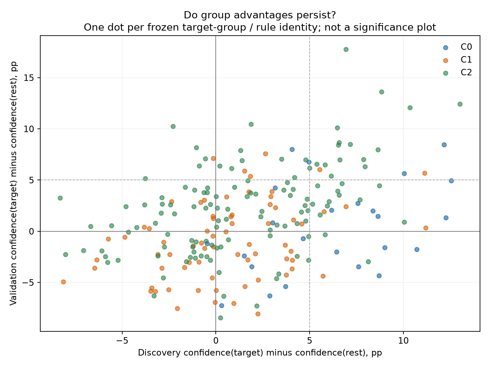

# Validation补算：分群规则与Global到底有什么不同？

2026-11-19 · **Validation 阶段探索性分析。**

先读[补算方案](../methods.md#群体差异与优势保持方案)。本批次把“名单不同”“同一规则在群内更强”“群体优势未来保持”“给Global补充覆盖”分成四层，避免相互替代。

## 先看结论：有方向性信号，但单条规则的强证据不足

- 名单确有差异。P5/100的L共有71条不同方向规则，其中22条不在G前100，新增占L不同规则约31.0%；方向规则Jaccard为40.2%。这不等于Global从未发现这些规则。
- 不少Discovery群体优势方向保持。P5/100有19个优势候选名额，其中15个在Validation仍同时保持正的置信度差与基础率调整后关联差，保持率78.9%，A1中位数52.6%。但方向保持不要求仍达到5pp，也不代表单条规则有足够统计证据。
- 按本次固定的证据量、效果幅度和BY校正主标准，真实L没有规则通过全部“未来群体优势”要求。这不否定旧报告中的群内可靠关联；旧问题没有要求群内显著强于群外。
- BH敏感性下有1个真实群规则身份通过；该身份BY q约0.069、BH q约0.010。保留为提示性案例，不据此改主校正、不宣称确认性发现。
- 互补覆盖仍见已有P3合并匹配K结果；有用的补充规则，不一定是严格意义上的群体特有规则。

## 一、名单差异和优势保持

| 配置 | 预算 | L不同规则 | 名单Jaccard | L不在G前B | D优势候选名额 | V支持优势名额 | D候选中未来仍支持 | 优势保持率 | 严格强于每群名额 |
|---|---|---|---|---|---|---|---|---|---|
| P1 | 20 | 12 | 60.0% | 0 | 3 | 0 | 0 | 0.0% | 0 |
| P2 | 20 | 14 | 61.9% | 1 | 2 | 0 | 0 | 0.0% | 0 |
| P3 | 20 | 16 | 44.0% | 5 | 3 | 0 | 0 | 0.0% | 0 |
| P4 | 20 | 14 | 61.9% | 1 | 2 | 0 | 0 | 0.0% | 0 |
| P5 | 20 | 14 | 61.9% | 1 | 2 | 0 | 0 | 0.0% | 0 |
| P1 | 50 | 33 | 66.0% | 0 | 9 | 0 | 0 | 0.0% | 0 |
| P2 | 50 | 37 | 50.0% | 8 | 10 | 0 | 0 | 0.0% | 0 |
| P3 | 50 | 39 | 48.3% | 10 | 8 | 0 | 0 | 0.0% | 0 |
| P4 | 50 | 37 | 50.0% | 8 | 10 | 0 | 0 | 0.0% | 0 |
| P5 | 50 | 37 | 50.0% | 8 | 10 | 0 | 0 | 0.0% | 0 |
| P1 | 100 | 66 | 66.0% | 0 | 21 | 0 | 0 | 0.0% | 0 |
| P2 | 100 | 72 | 43.3% | 20 | 21 | 0 | 0 | 0.0% | 0 |
| P3 | 100 | 69 | 44.4% | 17 | 21 | 0 | 0 | 0.0% | 0 |
| P4 | 100 | 72 | 42.1% | 21 | 21 | 0 | 0 | 0.0% | 0 |
| P5 | 100 | 71 | 40.2% | 22 | 19 | 0 | 0 | 0.0% | 0 |

解释：名单Jaccard=方向规则交集/并集。L不同规则数可能小于名额预算，因为不同群重复占名额。“不在G前B”只表示没进同预算Top榜，**不表示Global未发现/未通过全局门槛**；本批次未读取完整全局合格候选池。D候选=Discovery已出现至少5pp群内对群外置信度优势、正的相对基础率关联优势，并符合共同点估计证据门槛。

“V支持优势”包含原来没有达到D候选门槛、后来才更强的规则；“保持的D候选”才是D候选且V仍有支持。保持率分母包含未来未触发/证据不足的全部D候选，分母为0时记不可估，不记0%。名额数包括不同群同一方向规则；不等于独立商品组合数。

## 二、同一条规则：目标群与群外比较

主差值为 `Conf(目标群)−Conf(其余两群合并)`。因为群外和目标群顾客互斥，比“群内减包含自身的Global”更清楚。与此同时计算：

`关联提升差 = [Conf(目标群)−后件基础率(目标群)]−[Conf(群外)−后件基础率(群外)]`。

这样不会仅因为后件在目标群本来更热门，就把高confidence称为更强关联。lift目标/Global、lift目标/群外比值也输出，但只作诊断；零/缺失分母不造无穷值。

Validation支持主优势要求：共同目标群证据量/集中度/效应/三品类增量门槛通过；群外前件至少20单、10人；置信度差≥5pp、关联提升差>0；新联合检验的系统内BY q≤0.05。旧质量检验q值不复用。严格特异性还要分别强于另外每个群，而不是仅强于合并群外。

预算100的群体诊断：

| 配置 | 群 | 名额 | D优势候选 | V支持优势 | 保持的D候选 | 保持率 | V置信度差中位数pp | V关联提升差中位数pp |
|---|---|---|---|---|---|---|---|---|
| P1 | C0 | 11 | 4 | 0 | 0 | 0.0% | -2.02 | -0.73 |
| P1 | C1 | 29 | 1 | 0 | 0 | 0.0% | -0.48 | -2.00 |
| P1 | C2 | 60 | 16 | 0 | 0 | 0.0% | +2.59 | +2.85 |
| P2 | C0 | 11 | 6 | 0 | 0 | 0.0% | +0.85 | +0.60 |
| P2 | C1 | 29 | 3 | 0 | 0 | 0.0% | -1.95 | -5.02 |
| P2 | C2 | 60 | 12 | 0 | 0 | 0.0% | +1.99 | +2.56 |
| P3 | C0 | 11 | 7 | 0 | 0 | 0.0% | +2.72 | +1.36 |
| P3 | C1 | 29 | 4 | 0 | 0 | 0.0% | -2.24 | -4.70 |
| P3 | C2 | 60 | 10 | 0 | 0 | 0.0% | +2.62 | +3.77 |
| P4 | C0 | 11 | 6 | 0 | 0 | 0.0% | +0.85 | +0.60 |
| P4 | C1 | 29 | 3 | 0 | 0 | 0.0% | -1.34 | -5.02 |
| P4 | C2 | 60 | 12 | 0 | 0 | 0.0% | +1.99 | +2.56 |
| P5 | C0 | 11 | 6 | 0 | 0 | 0.0% | +0.85 | +0.60 |
| P5 | C1 | 29 | 3 | 0 | 0 | 0.0% | -1.34 | -4.19 |
| P5 | C2 | 60 | 10 | 0 | 0 | 0.0% | +1.93 | +2.43 |

## 三、哪些优势在未来仍有支持？

以下案例来自所有配置/预算的冻结规则身份联合，不是独立重复实验，也不是推荐效果。只展示D已有候选且V继续支持的前8个，完整正面与负面规则都保留。

当前共同定义和校正下，没有Discovery优势候选在Validation继续得到足够支持；这不等于证明所有群体都没有差异。

### 方向保持与随机对照

| 配置 | D优势候选 | 未来方向保持 | 真实保持率 | A1中位数 | A1≥真实次数 |
|---|---|---|---|---|---|
| P1 | 21 | 20 | 95.2% | 66.7% | 0/100 |
| P2 | 21 | 17 | 81.0% | 55.6% | 2/100 |
| P3 | 21 | 15 | 71.4% | 53.9% | 6/100 |
| P4 | 21 | 17 | 81.0% | 55.3% | 2/100 |
| P5 | 19 | 15 | 78.9% | 52.6% | 3/100 |

这里保留的是“正方向”，不等于通过5pp幅度和BY要求。效应保留比例也显示部分优势减弱，例如P5/100候选的V/D置信度差比例中位数约0.51。随机候选集合不同、分母数量不同，因此它是探索性系统对照，不是单条规则显著性的替代。

### 提示性案例：不是主标准通过案例

| 目标群 | 规则 | D置信度差pp | V置信度差pp | V关联提升差pp | BY校正q | BH校正q |
|---|---|---|---|---|---|---|
| C2 | 纸巾和创可贴 → 首饰盒与小饰品盒 | +6.93 | +17.79 | +17.01 | 0.0694 | 0.0104 |
| C2 | 午餐包 → 大号购物袋 | +8.84 | +13.61 | +9.31 | 1 | 0.66 |
| C2 | 烛台和灯笼＋悬挂装饰（含圣诞树挂饰） → 墙面标牌 | +13.01 | +12.44 | +7.18 | 1 | 0.665 |
| C2 | 悬挂装饰（含圣诞树挂饰） → 墙面标牌 | +10.35 | +12.09 | +6.83 | 1 | 0.189 |
| C2 | 首饰盒与小饰品盒 → 杯子和马克杯 | +6.48 | +10.13 | +6.80 | 1 | 0.637 |

本表专门展示原有D候选中V点估计仍满足条件的例子，BY未通过者仍是“证据未解决”。它不替代全量正负结果，也不等于新发现已被证实。

图中点位仅是差值，右上角不自动等于有统计证据；须看计数、不同顾客数、相对基础率差异和校正值。效应保留比例=V置信度差/D置信度差，只在D差值≥5pp且可估时计算，可大于1或为负，不截断。

## 四、相对活跃度随机对照，有多突出？

预算100，比较“Validation有支持优势的名额比例”；每个随机种子形成一个系统结果：

| 配置 | 真实V优势比例 | A1中位数 | A1范围 | A1≥真实次数 |
|---|---|---|---|---|
| P1 | 0.0% | 0.0% | 0.0%–0.0% | 100/100 |
| P2 | 0.0% | 0.0% | 0.0%–0.0% | 100/100 |
| P3 | 0.0% | 0.0% | 0.0%–1.0% | 100/100 |
| P4 | 0.0% | 0.0% | 0.0%–0.0% | 100/100 |
| P5 | 0.0% | 0.0% | 0.0%–0.0% | 100/100 |

全部S、A1、A2与各预算见 `random_advantage_comparisons.csv`。这是探索性上尾统计，不是全研究显著性检验。保持率若某随机种子没有D候选，单列不可估种子数，不把它伪装成0%保持。

## 五、名单不同是否带来独有覆盖？

以下为Validation、预算100、限群使用：

| 配置 | 仅L完整覆盖 | 仅G完整覆盖 | 双方都完整覆盖 | L−G净订单 | 仅L前件触达 |
|---|---|---|---|---|---|
| P1 | 0 | 558 | 2752 | -558 | 0 |
| P2 | 35 | 579 | 2974 | -544 | 0 |
| P3 | 99 | 401 | 2697 | -302 | 81 |
| P4 | 34 | 602 | 2985 | -568 | 0 |
| P5 | 34 | 617 | 3023 | -583 | 0 |

“仅L完整覆盖”是前后件都出现且G没有完整覆盖；“仅L前件触达”只看前件，两者不能混用。净订单=仅L完整覆盖−仅G完整覆盖。L能覆盖部分G遗漏订单，与G总体更高并不矛盾。

已有G50+L50去重匹配K实验见 [同预算合并实验](validation_hybrid_results.md)；该实验使用共享规则，与限群比较分开解释。

| 配置 | 去重后K | 合并−G前K/百分点 | 95%区间pp | 净增加订单 |
|---|---|---|---|---|
| P1 | 50 | +0.00 | [+0.00,+0.00] | 0 |
| P2 | 58 | -2.57 | [-3.17,-1.97] | -125 |
| P3 | 60 | +2.49 | [+1.77,+3.29] | 121 |
| P4 | 58 | -2.39 | [-2.96,-1.84] | -116 |
| P5 | 58 | -1.48 | [-1.96,-1.03] | -72 |

这是额外探索：P3有补充收益，但其他配置不支持普遍收益；尚无随机合并匹配K对照，不能归因为RFM独有优势。

## 统计和科学边界

- 假设单位是顾客，同人订单相关性通过比率影响函数处理；目标群/群外方差相加，t自由度取两边顾客数较小值减1。区间为逐项近似区间，不是同时区间或精确检验。
- 对每个真实或随机系统，联合五配置/三预算所有去重(群,规则)身份，把one-vs-rest与严格两种检验放入同一家族BY校正。BH只作诊断。没有做全研究所有系统的总体错误率保证。
- 三品类仍要求相对简单规则增量，但主群间差异不能只由商品热门程度解释。小群证据弱不等于没有特色。
- Discovery只是描述性定义候选，不将同一数据的筛选当作独立发现检验；Validation标准是在已有结果之后新增，明确是探索性扩展。
- 这是观察性共购：不计算Precision/Recall/F1，没有隐藏后件的推荐任务；没有因果增销解释。
- 方向保持/效果保留与统计支持分别报告。缺少证据，不应写成“已证明不存在群体差异”。Test尚未使用。

## 输出文件与复现

|文件|内容|
|---|---|
|configs/validation_specificity.json|计算前固定的定义、校正家族和边界|
|GL_rule_set_difference.csv|真实L的方向/组合重合、新增比例，含各群诊断|
|GL_rule_strength.csv|真实L各冻结规则在D/V的目标/群外/其他群/Global证据|
|GL_rule_advantage_retention.csv|同一规则身份的D/V配对与效应保留|
|GL_advantage_summary.csv|真实系统各配置/预算候选、支持、方向与保持|
|GL_group_advantage_summary.csv|按C0/C1/C2分开的相同统计|
|GL_supported_survivor_examples.csv|所有得到未来支持的Discovery候选案例|
|advantage_system_summary.csv|真实及全部随机种子的系统统计|
|random_advantage_comparisons.csv|S/A1/A2系统比较与不可估种子数|
|GL_complementarity.csv / complementarity_systems.csv|完整独有、前件独有、共同与净覆盖|
|family_audit.csv / run_manifest.json|校正家族、输入输出/代码哈希和核验|

所有表位于 `results/tables/validation_specificity/`。随机逐规则明细、完整群诊断和全部名单差异位于忽略目录 `data/processed/local/D_validation/`，不含进功能分支。先运行原输入准备和 `scripts/run_validation.py`，再执行 `python -X utf8 scripts/run_validation_specificity.py`、`python -X utf8 scripts/report_validation_specificity.py`。无需GPU，不重新挖规则。
