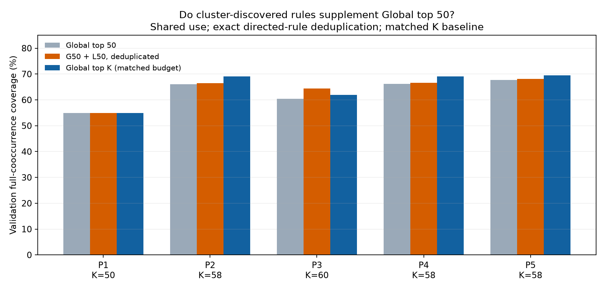

# G50＋L50去重：分群规则能否补充全局？

计算日期2026-11-18；交付整理2026-11-19。本批次是用户提出的Validation探索性补充，未选择新参数、未运行Test。

## 比较定义

- G50：C在Discovery选出的全局前50条。
- L50：三个真实cluster合计50个冻结规则名额，不是每群50；沿用原Discovery配额与排名。
- HYBRID：G50与L50按有方向的rule_id合并去重，全部共享给4,862张合格Validation订单。
- K为合并后实际不同方向规则数，不补到80或100；A→B和B→A不视为同一方向规则。
- 公平基线为同配置原Global排序前K条，从冻结G100截取；不按Validation重新排序。G50仅用于观察新增覆盖。

## 原覆盖与配对区间

|配置|L新增不同规则|实际K|G50覆盖|合并覆盖|G前K覆盖|合并−G前K/百分点 [95%区间]|净增订单|
|---|---|---|---|---|---|---|---|
|P1|0|50|54.96%|54.96%|54.96%|+0.00 [+0.00, +0.00]|+0|
|P2|8|58|66.04%|66.47%|69.05%|-2.57 [-3.17, -1.97]|-125|
|P3|10|60|60.41%|64.36%|61.87%|+2.49 [+1.77, +3.29]|+121|
|P4|8|58|66.23%|66.66%|69.05%|-2.39 [-2.96, -1.84]|-116|
|P5|8|58|67.65%|68.06%|69.54%|-1.48 [-1.96, -1.03]|-72|



每个配置内部预算K一致；不同配置的K不同，不能仅凭表中绝对覆盖宣布跨配置最优。区间按顾客整簇配对bootstrap 2,000次、种子3112，五个配置未做多重比较校正。

## 解读

- P1的L规则全部已包含于G50，没有新增规则。
- P2/P4/P5各新增8条，合并后58条；虽然补充了G50，但不如直接选全局第51–58条。
- P3新增10条，合并60条，相比G50多覆盖192单；G60相比G50多覆盖71单。因此合并比G60净多121单，高2.49个百分点，区间约[1.77,3.29]个百分点。
- P3合并独有覆盖162单，G60独有覆盖41单，说明双方各有遗漏。不能只报合并新增，不报告另一边损失。

P3支持当前严格配置下群内候选可补充全局Top榜，但尚无随机合并匹配K对照，不能据此确认收益来自RFM独有优势，也不能改写成所有配置都更好。

## 共同质量复核

合并与G_K均在全局共享范围重新验收，使用quality_v1主标准。五配置涉及的不同GLOBAL规则组成共同BY校正家族，复用原始顾客聚类检验p值，不混用旧G/L各自家族的q值。P3合并与G60质量覆盖均与原覆盖相同；P2/P4/P5质量复核后仍低于各自G58。

质量过滤覆盖是同一期回顾性指标，不是预测效果；部署清单不删改、不补选。共同校正家族与旧报告不同，细小差异不代表交易数据变化。

## 输出与复现

`results/tables/validation_hybrid/`中：rule_composition.csv为重合/新增/K；system_comparison.csv为三系统原/质量覆盖；paired_comparisons.csv为差值/区间/双方独有订单；rule_membership.csv为清单成员；shared_rule_quality.csv为共同全局质量证据；run_manifest.json为输入输出和方案哈希。

先完成原Validation与quality补算，准备本地冻结数据及质量证据后运行：

```powershell
python -X utf8 scripts/run_validation_hybrid.py
python -X utf8 scripts/report_validation_hybrid.py
```

原始15组系统的完整覆盖和可靠覆盖已通过直接集合匹配独立核验。完整测试含本批次规则去重、匹配预算、无新增规则与新规则不保证更好等语义例子。协议中的push_to_github=false记录计算当时不自动推送的约定，发布由用户后续授权，不是当前分支上传状态。
