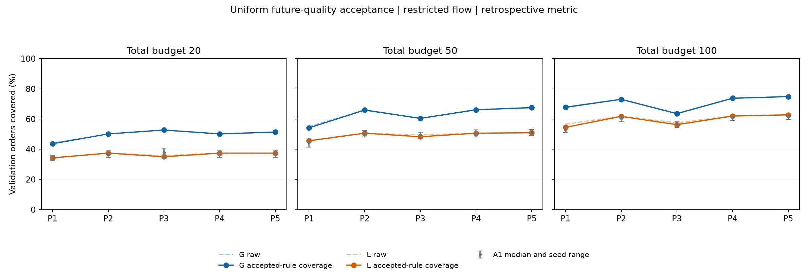

# Validation统一质量补算结果

2026-11-18 · 主标准quality_v1 · **只比较，不推荐配置、不冻结Test、不运行Test。**

## 先看什么

先读[一页验收方案](validation_quality_plan.md)。本批次把“未来仍然出现”与“未来仍有可靠且足够幅度的关联”分开。所有P1–P5使用相同验收门槛。原规则清单、原始覆盖率与旧报告保持不变。

主标准：前件≥20单/10人，联合≥10单/5人，单人联合贡献≤50%；confidence超过后件基础率至少5个百分点、lift≥1.2；三品类比两个单前件都至少提高5个百分点；按顾客聚类的近似检验经系统内BY校正≤0.05。阈值是工作性定义，不是公认最优值；敏感性全部并列报告。

**可靠关联覆盖率**：只让本期通过统一验收的冻结规则贡献订单覆盖，分母仍为全部4,862张主比较订单。同一期数据既用于验收也用于计数，所以这是回顾性关联保持指标，不能表述为未来部署后的预测效果。原部署清单不删改、不补位。

**与旧表的区别：** 这里的保持率是通过共同质量标准的比例，不是旧表“仍达各自冻结门槛”的比例。例如P5原门槛还要求原支持度/置信度和10pp增量，本次共同标准使用5pp增量、lift1.2与基础率提升等条件；两种通过率不能当作同一指标比较。

## 限群使用：主比较

| 配置 | 预算 | 原G覆盖 | 原L覆盖 | 可靠G覆盖 | 可靠L覆盖 | G名额保持 | L名额保持 | A1可靠覆盖中位数 |
|---|---|---|---|---|---|---|---|---|
| P1 | 20 | 44.26% | 34.29% | 43.62% | 34.29% | 90.0% | 100.0% | 34.02% |
| P2 | 20 | 50.14% | 37.43% | 50.14% | 37.43% | 100.0% | 100.0% | 36.77% |
| P3 | 20 | 52.71% | 35.75% | 52.71% | 35.03% | 95.0% | 85.0% | 37.89% |
| P4 | 20 | 50.14% | 37.43% | 50.14% | 37.43% | 100.0% | 100.0% | 36.77% |
| P5 | 20 | 51.38% | 37.43% | 51.38% | 37.43% | 100.0% | 100.0% | 36.77% |
| P1 | 50 | 54.96% | 45.89% | 54.15% | 45.56% | 84.0% | 96.0% | 44.60% |
| P2 | 50 | 66.04% | 50.62% | 65.94% | 50.62% | 92.0% | 100.0% | 49.95% |
| P3 | 50 | 60.41% | 49.47% | 60.41% | 48.27% | 88.0% | 78.0% | 49.37% |
| P4 | 50 | 66.23% | 50.62% | 66.13% | 50.62% | 98.0% | 100.0% | 50.02% |
| P5 | 50 | 67.65% | 50.93% | 67.54% | 50.93% | 98.0% | 100.0% | 50.75% |
| P1 | 100 | 68.08% | 56.60% | 67.73% | 54.50% | 86.0% | 86.0% | 52.87% |
| P2 | 100 | 73.08% | 61.89% | 73.06% | 61.74% | 92.0% | 93.0% | 60.47% |
| P3 | 100 | 63.72% | 57.51% | 63.55% | 56.27% | 83.0% | 73.0% | 56.46% |
| P4 | 100 | 73.78% | 62.09% | 73.76% | 61.95% | 96.0% | 94.0% | 60.86% |
| P5 | 100 | 74.87% | 62.88% | 74.85% | 62.77% | 99.0% | 97.0% | 61.61% |

## 共享使用：补充比较

共享时在全部4,862张订单上重新计算质量；不是把原群内的“通过”直接带到共享场景。同一方向规则去重后匹配，但重复来源仍占原名额。

| 配置 | 预算 | 原G覆盖 | 原L覆盖 | 可靠G覆盖 | 可靠L覆盖 | G名额保持 | L名额保持 | A1可靠覆盖中位数 |
|---|---|---|---|---|---|---|---|---|
| P1 | 20 | 44.26% | 39.43% | 43.62% | 39.43% | 90.0% | 100.0% | 39.43% |
| P2 | 20 | 50.14% | 42.00% | 50.14% | 42.00% | 100.0% | 100.0% | 43.71% |
| P3 | 20 | 52.71% | 46.50% | 52.71% | 46.50% | 95.0% | 100.0% | 47.63% |
| P4 | 20 | 50.14% | 42.00% | 50.14% | 42.00% | 100.0% | 100.0% | 43.71% |
| P5 | 20 | 51.38% | 42.00% | 51.38% | 42.00% | 100.0% | 100.0% | 43.71% |
| P1 | 50 | 54.96% | 51.07% | 54.15% | 50.16% | 84.0% | 92.0% | 50.16% |
| P2 | 50 | 66.04% | 58.41% | 65.94% | 58.41% | 92.0% | 100.0% | 58.21% |
| P3 | 50 | 60.41% | 60.61% | 60.41% | 60.61% | 88.0% | 94.0% | 60.56% |
| P4 | 50 | 66.23% | 58.41% | 66.13% | 58.41% | 98.0% | 100.0% | 58.25% |
| P5 | 50 | 67.65% | 58.93% | 67.54% | 58.93% | 98.0% | 100.0% | 59.16% |
| P1 | 100 | 68.08% | 63.10% | 67.73% | 62.61% | 86.0% | 92.0% | 59.73% |
| P2 | 100 | 73.08% | 69.40% | 73.06% | 69.37% | 92.0% | 97.0% | 69.00% |
| P3 | 100 | 63.72% | 65.80% | 63.55% | 65.80% | 83.0% | 90.0% | 65.55% |
| P4 | 100 | 73.78% | 69.40% | 73.76% | 69.37% | 96.0% | 98.0% | 69.49% |
| P5 | 100 | 74.87% | 70.44% | 74.85% | 70.42% | 99.0% | 99.0% | 70.27% |

## 预算100：为什么没有通过

以下为限群模式，按规则名额统计，每行相加为100。类别按顺序互斥：未触发→证据不足→关联幅度不足→三品类增量不足→统计证据不足→通过。详细表另有独立证据量与集中度字段，不应把“证据不足”和“统计证据不足”解释为关联被证明不存在。

| 配置 | 方法 | 未触发 | 证据不足 | 关联幅度不足 | 三品类增量不足 | 统计证据不足 | 通过 |
|---|---|---|---|---|---|---|---|
| P1 | G | 0 | 0 | 11 | 3 | 0 | 86 |
| P1 | L | 0 | 0 | 10 | 1 | 3 | 86 |
| P2 | G | 0 | 0 | 1 | 7 | 0 | 92 |
| P2 | L | 0 | 0 | 1 | 5 | 1 | 93 |
| P3 | G | 0 | 0 | 0 | 12 | 5 | 83 |
| P3 | L | 0 | 0 | 0 | 9 | 18 | 73 |
| P4 | G | 0 | 0 | 1 | 3 | 0 | 96 |
| P4 | L | 0 | 0 | 1 | 4 | 1 | 94 |
| P5 | G | 0 | 0 | 1 | 0 | 0 | 99 |
| P5 | L | 0 | 0 | 1 | 0 | 2 | 97 |

## 敏感性：门槛改变后会变化多少

下表显示所有G/L配置、预算和使用方式，相对主标准的可靠覆盖变化范围。每次只改一项定义；主标准不因结果更好而替换。完整随机对照见 `sensitivity_random_comparisons.csv`。

| 验收定义 | 可靠覆盖变化最小/百分点 | 可靠覆盖变化最大/百分点 |
|---|---|---|
| primary | 0.00 | 0.00 |
| uplift_2_5pp | 0.00 | 0.00 |
| uplift_10pp | -4.92 | 0.00 |
| lift_1_1 | 0.00 | 1.17 |
| lift_1_5 | -43.62 | -1.15 |
| evidence_looser | 0.00 | 0.00 |
| evidence_stricter | 0.00 | 0.00 |
| increment_0pp | 0.00 | 0.00 |
| increment_10pp | -0.74 | 0.00 |
| BH_exploratory | 0.00 | 1.19 |
| no_concentration_cap | 0.00 | 0.00 |

## 统计口径与限制

- 重复订单按顾客聚类；使用ratio差值的delta-method近似标准误和t分布，不是逐规则2,000次bootstrap，也不是精确检验。小群和稀疏规则的近似可能不准，因此同时有证据量门槛。
- 每个系统把所有P1–P5/预算的验收身份合并去重，原范围与全局共享范围共同校正。三品类把关联及两个增量的单侧p取最大值，要求同时有证据；BY主校正允许检验间依赖。校正家族内重复规则不重复增加检验次数。
- q≤0.05是系统内名义错误发现率标准，不是每条规则有95%概率正确。不同系统之间未做总体校正；随机上尾比例仍是描述统计，不作全研究显著性结论。
- 置信度提升/三品类增量的区间是逐项95%区间，不是多重校正后的同时区间。统计方法与公式见[方法说明](validation_quality_methods.md)。
- 关联/增量检验只检验是否为正；5个百分点与lift1.2是点估计幅度要求，不代表区间下限也超过该幅度。
- G的样本更多，通常检验力更高；小群通过较少可能反映证据较弱，不能直接推成偏好较弱，需结合证据不足比例和效应量解读。
- 保持率分母包含全部原名额，证据不足规则不会被排除来抬高通过率。另报告去重后的保持率，避免规则重复名额造成误读。
- 对Discovery的置信度变化、置信度比例及lift比例只作描述，没有假装两个时期样本相互独立来生成变化区间。
- 本批次在已看过Validation结果之后新增，属于探索性扩展，不得写成预注册。无配置选择、无最终Test结论。

## 输出文件

| 文件 | 内容 |
|---|---|
| `configs/validation_quality.json` | 补算前保存的主门槛、11套敏感性定义、校正家族 |
| `results/tables/validation_quality/GL_quality_summary.csv` | G/L主标准全配置结果，60行 |
| `results/tables/validation_quality/system_quality.csv` | 全部6,660条逐种子系统结果 |
| `results/tables/validation_quality/random_quality_comparisons.csv` | S/A1/A2质量对照，270行 |
| `results/tables/validation_quality/GL_sensitivity.csv` | 11套定义的G/L结果 |
| `results/tables/validation_quality/sensitivity_random_comparisons.csv` | 全定义随机对照汇总 |
| `results/tables/validation_quality/GL_rule_quality.csv` | G/L逐方向规则、评价范围、客户证据、区间与校正值 |
| `results/tables/validation_quality/family_audit.csv` | 各系统实际检验家族大小 |
| `results/tables/validation_quality/run_manifest.json` | 输入来源、方案哈希、代码哈希和核验记录 |

全部逐规则质量与逐种子敏感性明细位于被忽略的 `data/processed/local/D_validation/quality_rule_evidence.csv.gz`、`quality_sensitivity_systems.csv.gz`。

复现：`python -X utf8 scripts/run_validation_quality.py`，然后 `python -X utf8 scripts/report_validation_quality.py`。无需GPU、不重新挖规则。
