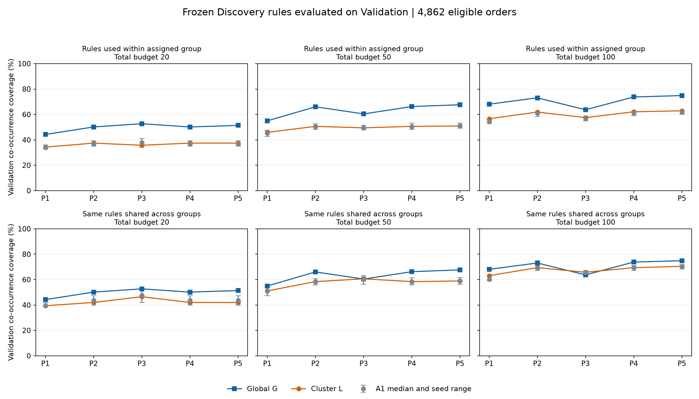

# D：Validation 比较报告（2026-11-16）

**状态：仅比较，不推荐配置，不冻结 Test 方案。** 根据用户明确要求，不选择 P1–P5 中的任何配置，也不选择预算。下述结果来自本地 CPU 实算。

## 评价对象与口径

Validation 窗口为 `[2010-12-01, 2011-06-01)`。有效购物篮共 **8,067** 张，主比较纳入 **4,862** 张、**1,458** 名 Profile 顾客，占全部有效购物篮 **60.27%**。品类映射后的空篮 **2** 张，单品类篮 **549** 张，均保留在分母。

沿用 C 的 `taxonomy_v1`、Discovery 规则身份、排名和预算配额；不根据验证结果删规则、补位或改分组。比较五套参数、三个系统总预算、两种使用方式，以及 S（20种子）、A1/A2（各100种子）。**覆盖率表示订单同时包含规则前后件，不是推荐准确率或因果销售收益。**

主口径为 restricted（只使用所属群规则），主随机对照为 A1（Profile频次分层）。shared 只解除群限制，重复规则不返还预算；A2 使用 Discovery 活跃度，只作敏感性分析。两种使用方式分开解释。

## 实际观察

- 在15个“配置×预算”设置中，restricted 下 L 覆盖高于 G 的有 **0** 个；shared 下有 **2** 个。完整结果全部列出，不挑选有利设置。
- G 与 L 使用相同系统总预算；L 把预算分给不同群，单个顾客可用规则数不同。`system_metrics.csv` 同时报告可用规则名额及顾客等权覆盖；本次未重新做等每用户预算的规则实验。
- 顾客抽样的配对95%区间使用2,000次 bootstrap，同一顾客的所有订单一起重抽。随机种子范围是随机结果的最小–最大值，**不是置信区间**；上尾统计未作多重比较校正，不作为确认性显著结论。

## 主比较：限群使用，A1对照

| 配置 | 总预算 | G覆盖 | L覆盖 | A1中位数 | A1范围 | L−G百分点 [95% CI] | A1≥L次数 |
|---|---|---|---|---|---|---|---|
| P1 | 20 | 44.26% | 34.29% | 34.03% | 33.07%–36.03% | -9.98 [-11.04, -8.87] | 36/100 |
| P2 | 20 | 50.14% | 37.43% | 36.80% | 35.09%–39.35% | -12.71 [-13.91, -11.53] | 27/100 |
| P3 | 20 | 52.71% | 35.75% | 37.93% | 34.06%–41.11% | -16.97 [-18.74, -15.32] | 91/100 |
| P4 | 20 | 50.14% | 37.43% | 36.80% | 35.09%–39.35% | -12.71 [-13.91, -11.53] | 27/100 |
| P5 | 20 | 51.38% | 37.43% | 36.80% | 35.09%–39.35% | -13.94 [-15.16, -12.72] | 27/100 |
| P1 | 50 | 54.96% | 45.89% | 45.23% | 42.60%–47.53% | -9.07 [-10.14, -8.06] | 9/100 |
| P2 | 50 | 66.04% | 50.62% | 50.31% | 48.29%–52.57% | -15.43 [-16.86, -13.98] | 34/100 |
| P3 | 50 | 60.41% | 49.47% | 49.60% | 47.94%–51.40% | -10.94 [-12.62, -9.38] | 54/100 |
| P4 | 50 | 66.23% | 50.62% | 50.38% | 48.29%–53.04% | -15.61 [-17.06, -14.16] | 38/100 |
| P5 | 50 | 67.65% | 50.93% | 51.12% | 49.20%–53.19% | -16.72 [-18.20, -15.22] | 60/100 |
| P1 | 100 | 68.08% | 56.60% | 54.20% | 53.02%–55.61% | -11.48 [-12.71, -10.23] | 0/100 |
| P2 | 100 | 73.08% | 61.89% | 60.86% | 58.52%–62.09% | -11.19 [-12.46, -9.96] | 2/100 |
| P3 | 100 | 63.72% | 57.51% | 56.83% | 54.87%–58.31% | -6.21 [-7.50, -4.96] | 19/100 |
| P4 | 100 | 73.78% | 62.09% | 61.17% | 59.21%–62.38% | -11.68 [-12.95, -10.47] | 4/100 |
| P5 | 100 | 74.87% | 62.88% | 61.94% | 59.98%–62.81% | -11.99 [-13.28, -10.78] | 0/100 |

## 补充比较：共享使用，A1对照

| 配置 | 总预算 | G覆盖 | L覆盖 | A1中位数 | A1范围 | L−G百分点 [95% CI] | A1≥L次数 |
|---|---|---|---|---|---|---|---|
| P1 | 20 | 44.26% | 39.43% | 39.43% | 39.43%–41.75% | -4.83 [-5.62, -4.09] | 100/100 |
| P2 | 20 | 50.14% | 42.00% | 43.71% | 40.00%–47.24% | -8.14 [-9.09, -7.22] | 89/100 |
| P3 | 20 | 52.71% | 46.50% | 47.63% | 41.96%–52.49% | -6.21 [-7.45, -4.95] | 66/100 |
| P4 | 20 | 50.14% | 42.00% | 43.71% | 40.00%–47.24% | -8.14 [-9.09, -7.22] | 89/100 |
| P5 | 20 | 51.38% | 42.00% | 43.71% | 40.00%–47.24% | -9.38 [-10.36, -8.42] | 89/100 |
| P1 | 50 | 54.96% | 51.07% | 51.07% | 47.31%–54.38% | -3.89 [-4.52, -3.32] | 66/100 |
| P2 | 50 | 66.04% | 58.41% | 58.21% | 55.82%–60.65% | -7.63 [-8.71, -6.64] | 40/100 |
| P3 | 50 | 60.41% | 60.61% | 60.56% | 56.36%–63.12% | 0.21 [-0.73, 1.20] | 49/100 |
| P4 | 50 | 66.23% | 58.41% | 58.25% | 55.82%–61.46% | -7.82 [-8.92, -6.81] | 42/100 |
| P5 | 50 | 67.65% | 58.93% | 59.16% | 56.25%–61.64% | -8.72 [-9.87, -7.65] | 60/100 |
| P1 | 100 | 68.08% | 63.10% | 60.16% | 59.05%–62.67% | -4.98 [-5.79, -4.20] | 0/100 |
| P2 | 100 | 73.08% | 69.40% | 69.07% | 67.15%–71.04% | -3.68 [-4.49, -2.92] | 29/100 |
| P3 | 100 | 63.72% | 65.80% | 65.55% | 63.76%–67.26% | 2.08 [1.23, 2.96] | 40/100 |
| P4 | 100 | 73.78% | 69.40% | 69.52% | 67.15%–71.04% | -4.38 [-5.21, -3.60] | 58/100 |
| P5 | 100 | 74.87% | 70.44% | 70.29% | 68.33%–71.76% | -4.42 [-5.25, -3.64] | 38/100 |

## G/L规则在未来的状态

以下状态按规则原所属范围评价；shared 的规则未来质量仍保留原范围口径，不能当作共享部署的全局规则置信度。门槛包括原支持度、置信度、lift、最低联合/前件计数，以及适用时的三品类增量。状态不改变部署清单。

| 配置 | 预算 | 方法 | 规则数 | 未触发 | 触发但无共现 | 有共现但未达冻结门槛 | 仍达冻结门槛 | 顾客等权覆盖 |
|---|---|---|---|---|---|---|---|---|
| P1 | 20 | G | 20 | 0 | 0 | 0 | 20 | 48.55% |
| P1 | 20 | L | 20 | 0 | 0 | 0 | 20 | 34.16% |
| P2 | 20 | G | 20 | 0 | 0 | 4 | 16 | 55.61% |
| P2 | 20 | L | 20 | 0 | 0 | 3 | 17 | 38.60% |
| P3 | 20 | G | 20 | 0 | 0 | 7 | 13 | 56.25% |
| P3 | 20 | L | 20 | 0 | 0 | 7 | 13 | 33.53% |
| P4 | 20 | G | 20 | 0 | 0 | 4 | 16 | 55.61% |
| P4 | 20 | L | 20 | 0 | 0 | 3 | 17 | 38.60% |
| P5 | 20 | G | 20 | 0 | 0 | 4 | 16 | 56.95% |
| P5 | 20 | L | 20 | 0 | 0 | 3 | 17 | 38.60% |
| P1 | 50 | G | 50 | 0 | 0 | 0 | 50 | 60.54% |
| P1 | 50 | L | 50 | 0 | 0 | 0 | 50 | 46.53% |
| P2 | 50 | G | 50 | 0 | 0 | 11 | 39 | 71.40% |
| P2 | 50 | L | 50 | 0 | 0 | 14 | 36 | 51.44% |
| P3 | 50 | G | 50 | 0 | 0 | 12 | 38 | 64.36% |
| P3 | 50 | L | 50 | 0 | 0 | 20 | 30 | 47.36% |
| P4 | 50 | G | 50 | 0 | 0 | 11 | 39 | 71.54% |
| P4 | 50 | L | 50 | 0 | 0 | 14 | 36 | 51.44% |
| P5 | 50 | G | 50 | 0 | 0 | 11 | 39 | 72.75% |
| P5 | 50 | L | 50 | 0 | 0 | 14 | 36 | 51.66% |
| P1 | 100 | G | 100 | 0 | 0 | 2 | 98 | 73.46% |
| P1 | 100 | L | 100 | 0 | 0 | 1 | 99 | 57.48% |
| P2 | 100 | G | 100 | 0 | 0 | 14 | 86 | 77.99% |
| P2 | 100 | L | 100 | 0 | 0 | 31 | 69 | 62.60% |
| P3 | 100 | G | 100 | 0 | 0 | 23 | 77 | 67.75% |
| P3 | 100 | L | 100 | 0 | 0 | 32 | 68 | 56.72% |
| P4 | 100 | G | 100 | 0 | 0 | 18 | 82 | 78.57% |
| P4 | 100 | L | 100 | 0 | 0 | 35 | 65 | 63.06% |
| P5 | 100 | G | 100 | 0 | 0 | 18 | 82 | 79.54% |
| P5 | 100 | L | 100 | 0 | 0 | 36 | 64 | 63.91% |

零前件时置信度和lift留空；有前件但后件未出现时置信度为0、lift不可估。三品类增量从Validation的两个单前件重新计算。因为未来各群样本数不同，“未达门槛”可能由最低计数不足造成，不能简单当作关联消失。完整逐规则证据在忽略目录 `data/processed/local/D_validation/validation_rule_evidence.csv.gz`。

## 非Profile顾客的全局回退

主比较之外的 **3,205** 张有效订单另行应用同一G清单，其中 **2,502** 张属于有标识的非Profile顾客，**703** 张为匿名订单，结果见 `non_profile_global_fallback.csv`。匿名订单不合并为一名顾客，也不纳入顾客bootstrap。不把这些订单只加到G的主比较分母里，也不给无未来订单的历史顾客制造空篮。

## 输入、核验与限制

- A快照：`2ae672b7ea6edb7f5e1561b6a64823004dea833e`；C交接：`ac2b8a3338198c24c7cf6203aa623be11a02d2f8`。核心ZIP及全部输入哈希见 `run_manifest.json`。
- 先复算C的 **6,660** 条Discovery系统指标，覆盖/触达/独立规则/组合计数全部一致，并逐一核对全部预算选中规则的Discovery计数，然后才计算Validation。
- 本次计算 **6,660** 条Validation系统指标；核对预算总数、群内配额、重复计数、完整命中包含于前件命中、共享覆盖包含限群覆盖。
- 本次只评价C的冻结预算清单品类规则，不重新挖掘、不重新聚类，也不评价整个候选池。SKU层的独立未来评价不在本批次内。
- taxonomy覆盖全期商品编码且含人工修订；冻结标签不等于全部预处理只使用历史信息，需要沿用B的方法披露。A1对高频群C2的置换空间有限。
- **未评价Test、未推荐配置、未生成最终冻结方案。** 后续由全组确定选择目标和最终方案后再开展Test。

## 文件与复现

入口：`python -X utf8 scripts/prepare_validation_inputs.py`，然后 `python -X utf8 scripts/run_validation.py`，最后 `python -X utf8 scripts/report_validation.py`。首次克隆建议执行 `git config --local core.autocrlf false` 和 `git config --local core.eol lf`，以保持冻结CSV的Git原始字节。依赖版本见 `requirements-validation.txt`。

| 文件 | 内容 |
|---|---|
| `configs/validation.json` | 计算前写定的比较范围及口径 |
| `results/tables/validation/GL_summary.csv` | G/L全配置结果与原范围规则状态 |
| `results/tables/validation/system_metrics.csv` | 全部逐种子系统指标 |
| `results/tables/validation/random_comparisons.csv` | 三种随机对照、三种覆盖口径 |
| `results/tables/validation/paired_customer_bootstrap.csv` | G、L及L−G的顾客配对区间 |
| `results/tables/validation/sample_audit.csv` | 纳入范围与空篮审计 |
| `results/tables/validation/non_profile_global_fallback.csv` | 非Profile顾客的全局回退 |
| `results/tables/validation/discovery_replay.csv` | 对C的Discovery复算结果 |
| `results/tables/validation/run_manifest.json` | 版本、输入/输出哈希和检查记录 |

所有顾客级输入、规则证据及逐订单指标都保存在 `data/processed/local/D_validation/`，不进入功能分支。人工科学复核尚待团队完成；程序测试与复算不能替代人工审阅。
