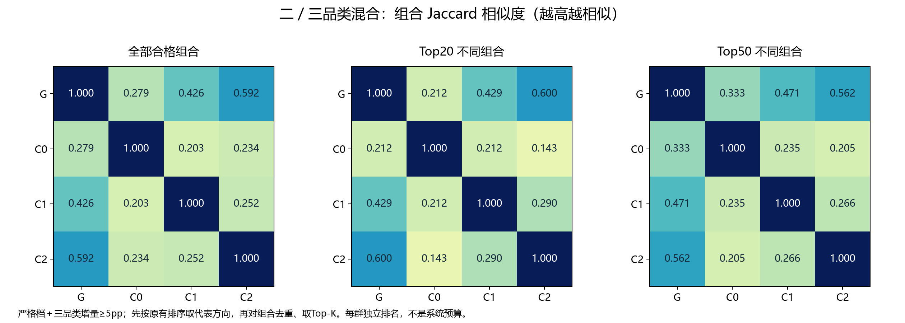
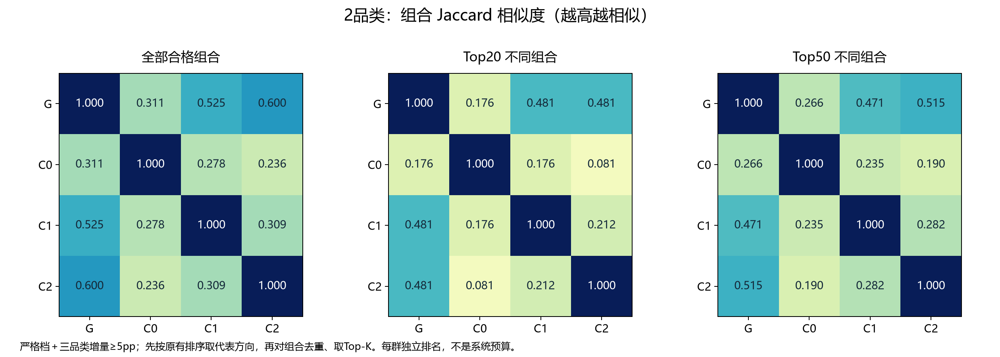
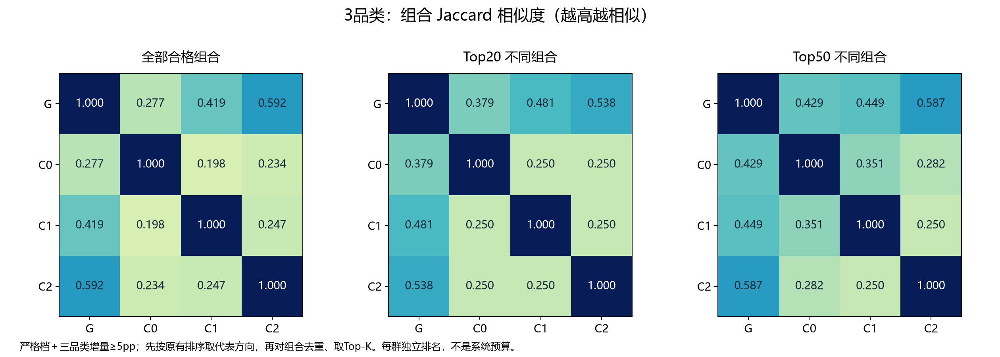
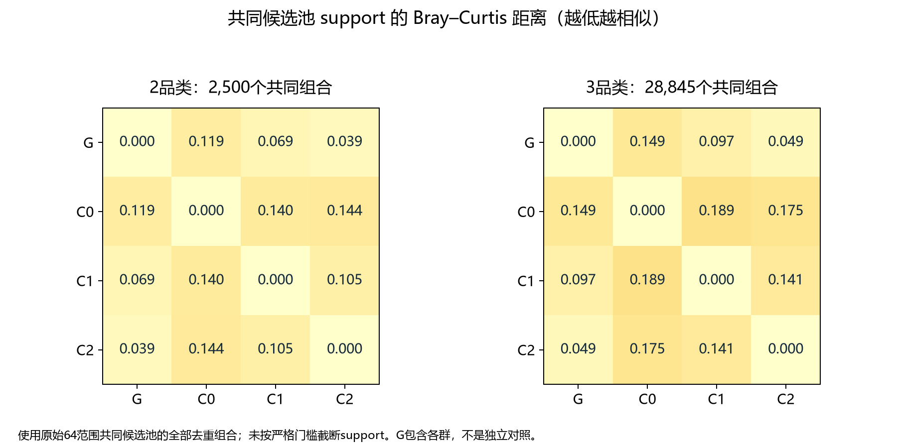

# 品类层群体相似度

对象为G/C0/C1/C2。主分析使用严格档加三品类增量≥5个百分点。方向规则先按联合次数、confidence、lift降序及rule_id升序排序，再对前后件品类并集去重，每个组合保留最靠前方向。组合相似不代表规则方向或confidence相同。

Jaccard=交集组合数/并集组合数，越高越相似。全部集合大小不同会影响数值，所以同时展示Top20/50；小数不是显著性指标。每组TopK不是系统总预算；本次不重跑随机相似度检验。

Bray–Curtis=Σ|support_a−support_b|/Σ(support_a+support_b)，越低越相似。使用原64范围共同候选池的去重组合，含未过严格门槛的组合；二三品类分开计算，不把support再归一化为概率分布。

G包含C0/C1/C2，且各群订单占比不同；群与G的接近程度受权重影响。与群外对照的业务解释、Validation稳定性仍需另行判断。

## 长度0（0为混合）

## 长度2（0为混合）

## 长度3（0为混合）

## Support强度差异

## 全部数值

| metric | length | top_k | scope_a | scope_b | n_a | n_b | intersection | union | value |
|---|---|---|---|---|---|---|---|---|---|
| jaccard | 0 | 0 | G | C0 | 921 | 1745 | 582.0 | 2084.0 | 0.2793 |
| jaccard | 0 | 0 | G | C1 | 921 | 648 | 469.0 | 1100.0 | 0.4264 |
| jaccard | 0 | 0 | G | C2 | 921 | 1200 | 789.0 | 1332.0 | 0.5923 |
| jaccard | 0 | 0 | C0 | C1 | 1745 | 648 | 404.0 | 1989.0 | 0.2031 |
| jaccard | 0 | 0 | C0 | C2 | 1745 | 1200 | 558.0 | 2387.0 | 0.2338 |
| jaccard | 0 | 0 | C1 | C2 | 648 | 1200 | 372.0 | 1476.0 | 0.252 |
| jaccard | 0 | 20 | G | C0 | 20 | 20 | 7.0 | 33.0 | 0.2121 |
| jaccard | 0 | 20 | G | C1 | 20 | 20 | 12.0 | 28.0 | 0.4286 |
| jaccard | 0 | 20 | G | C2 | 20 | 20 | 15.0 | 25.0 | 0.6 |
| jaccard | 0 | 20 | C0 | C1 | 20 | 20 | 7.0 | 33.0 | 0.2121 |
| jaccard | 0 | 20 | C0 | C2 | 20 | 20 | 5.0 | 35.0 | 0.1429 |
| jaccard | 0 | 20 | C1 | C2 | 20 | 20 | 9.0 | 31.0 | 0.2903 |
| jaccard | 0 | 50 | G | C0 | 50 | 50 | 25.0 | 75.0 | 0.3333 |
| jaccard | 0 | 50 | G | C1 | 50 | 50 | 32.0 | 68.0 | 0.4706 |
| jaccard | 0 | 50 | G | C2 | 50 | 50 | 36.0 | 64.0 | 0.5625 |
| jaccard | 0 | 50 | C0 | C1 | 50 | 50 | 19.0 | 81.0 | 0.2346 |
| jaccard | 0 | 50 | C0 | C2 | 50 | 50 | 17.0 | 83.0 | 0.2048 |
| jaccard | 0 | 50 | C1 | C2 | 50 | 50 | 21.0 | 79.0 | 0.2658 |
| jaccard | 2 | 0 | G | C0 | 69 | 108 | 42.0 | 135.0 | 0.3111 |
| jaccard | 2 | 0 | G | C1 | 69 | 53 | 42.0 | 80.0 | 0.525 |
| jaccard | 2 | 0 | G | C2 | 69 | 91 | 60.0 | 100.0 | 0.6 |
| jaccard | 2 | 0 | C0 | C1 | 108 | 53 | 35.0 | 126.0 | 0.2778 |
| jaccard | 2 | 0 | C0 | C2 | 108 | 91 | 38.0 | 161.0 | 0.236 |
| jaccard | 2 | 0 | C1 | C2 | 53 | 91 | 34.0 | 110.0 | 0.3091 |
| jaccard | 2 | 20 | G | C0 | 20 | 20 | 6.0 | 34.0 | 0.1765 |
| jaccard | 2 | 20 | G | C1 | 20 | 20 | 13.0 | 27.0 | 0.4815 |
| jaccard | 2 | 20 | G | C2 | 20 | 20 | 13.0 | 27.0 | 0.4815 |
| jaccard | 2 | 20 | C0 | C1 | 20 | 20 | 6.0 | 34.0 | 0.1765 |
| jaccard | 2 | 20 | C0 | C2 | 20 | 20 | 3.0 | 37.0 | 0.0811 |
| jaccard | 2 | 20 | C1 | C2 | 20 | 20 | 7.0 | 33.0 | 0.2121 |
| jaccard | 2 | 50 | G | C0 | 50 | 50 | 21.0 | 79.0 | 0.2658 |
| jaccard | 2 | 50 | G | C1 | 50 | 50 | 32.0 | 68.0 | 0.4706 |
| jaccard | 2 | 50 | G | C2 | 50 | 50 | 34.0 | 66.0 | 0.5152 |
| jaccard | 2 | 50 | C0 | C1 | 50 | 50 | 19.0 | 81.0 | 0.2346 |
| jaccard | 2 | 50 | C0 | C2 | 50 | 50 | 16.0 | 84.0 | 0.1905 |
| jaccard | 2 | 50 | C1 | C2 | 50 | 50 | 22.0 | 78.0 | 0.2821 |
| jaccard | 3 | 0 | G | C0 | 852 | 1637 | 540.0 | 1949.0 | 0.2771 |
| jaccard | 3 | 0 | G | C1 | 852 | 595 | 427.0 | 1020.0 | 0.4186 |
| jaccard | 3 | 0 | G | C2 | 852 | 1109 | 729.0 | 1232.0 | 0.5917 |
| jaccard | 3 | 0 | C0 | C1 | 1637 | 595 | 369.0 | 1863.0 | 0.1981 |
| jaccard | 3 | 0 | C0 | C2 | 1637 | 1109 | 520.0 | 2226.0 | 0.2336 |
| jaccard | 3 | 0 | C1 | C2 | 595 | 1109 | 338.0 | 1366.0 | 0.2474 |
| jaccard | 3 | 20 | G | C0 | 20 | 20 | 11.0 | 29.0 | 0.3793 |
| jaccard | 3 | 20 | G | C1 | 20 | 20 | 13.0 | 27.0 | 0.4815 |
| jaccard | 3 | 20 | G | C2 | 20 | 20 | 14.0 | 26.0 | 0.5385 |
| jaccard | 3 | 20 | C0 | C1 | 20 | 20 | 8.0 | 32.0 | 0.25 |
| jaccard | 3 | 20 | C0 | C2 | 20 | 20 | 8.0 | 32.0 | 0.25 |
| jaccard | 3 | 20 | C1 | C2 | 20 | 20 | 8.0 | 32.0 | 0.25 |
| jaccard | 3 | 50 | G | C0 | 50 | 50 | 30.0 | 70.0 | 0.4286 |
| jaccard | 3 | 50 | G | C1 | 50 | 50 | 31.0 | 69.0 | 0.4493 |
| jaccard | 3 | 50 | G | C2 | 50 | 50 | 37.0 | 63.0 | 0.5873 |
| jaccard | 3 | 50 | C0 | C1 | 50 | 50 | 26.0 | 74.0 | 0.3514 |
| jaccard | 3 | 50 | C0 | C2 | 50 | 50 | 22.0 | 78.0 | 0.2821 |
| jaccard | 3 | 50 | C1 | C2 | 50 | 50 | 20.0 | 80.0 | 0.25 |
| bray_curtis_support | 2 | 0 | G | C0 | 2500 | 2500 | nan | nan | 0.1192 |
| bray_curtis_support | 2 | 0 | G | C1 | 2500 | 2500 | nan | nan | 0.0689 |
| bray_curtis_support | 2 | 0 | G | C2 | 2500 | 2500 | nan | nan | 0.0395 |
| bray_curtis_support | 2 | 0 | C0 | C1 | 2500 | 2500 | nan | nan | 0.1402 |
| bray_curtis_support | 2 | 0 | C0 | C2 | 2500 | 2500 | nan | nan | 0.144 |
| bray_curtis_support | 2 | 0 | C1 | C2 | 2500 | 2500 | nan | nan | 0.1045 |
| bray_curtis_support | 3 | 0 | G | C0 | 28845 | 28845 | nan | nan | 0.1487 |
| bray_curtis_support | 3 | 0 | G | C1 | 28845 | 28845 | nan | nan | 0.0969 |
| bray_curtis_support | 3 | 0 | G | C2 | 28845 | 28845 | nan | nan | 0.0494 |
| bray_curtis_support | 3 | 0 | C0 | C1 | 28845 | 28845 | nan | nan | 0.1892 |
| bray_curtis_support | 3 | 0 | C0 | C2 | 28845 | 28845 | nan | nan | 0.1751 |
| bray_curtis_support | 3 | 0 | C1 | C2 | 28845 | 28845 | nan | nan | 0.1408 |