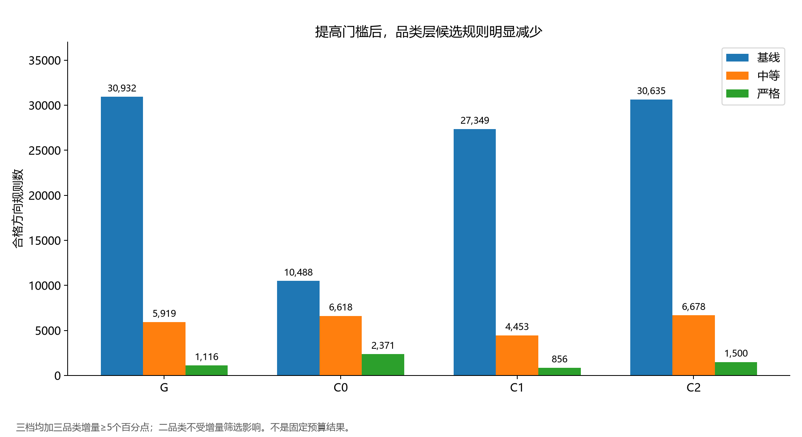
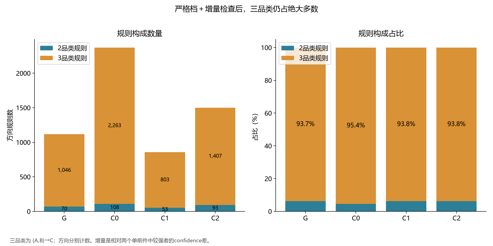
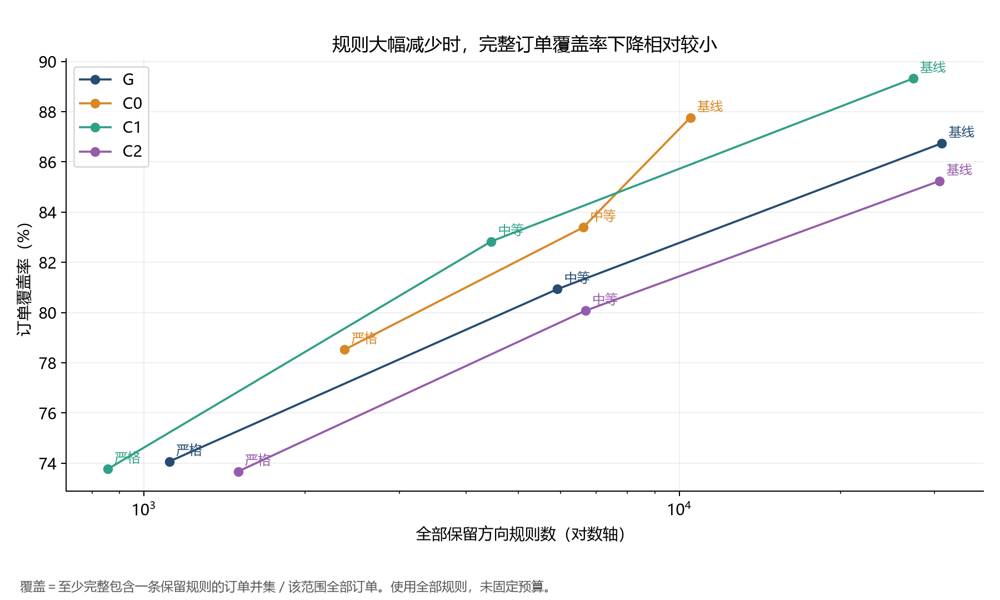
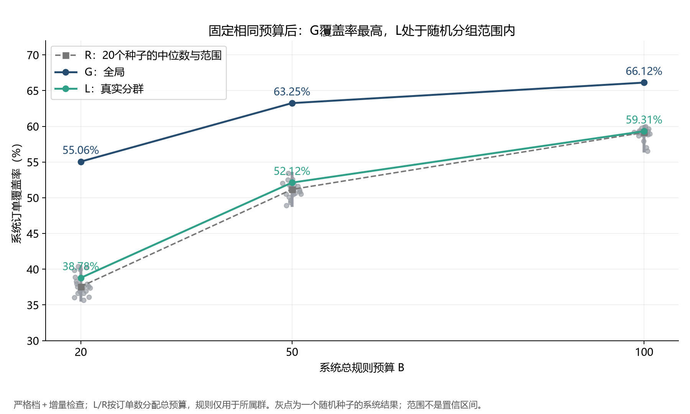
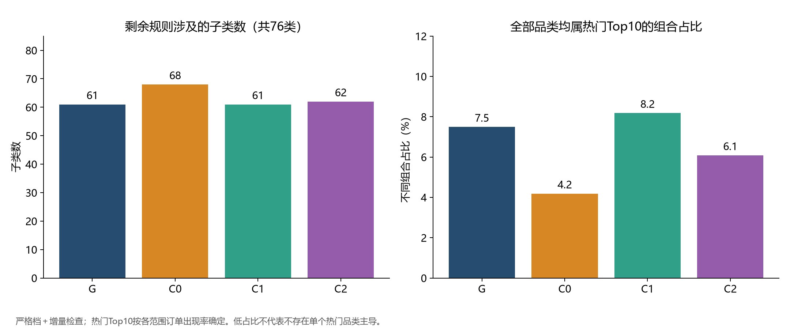

# 品类层结果图表

所有结果为Discovery开发期描述；严格档未经Validation选择。图1–3和5使用全部合格规则；图4为固定系统预算，不可混淆。

## 筛选汇总

| 范围 | 配置 | 方向规则数 | 不同组合数 | 订单覆盖率 | 涉及子类数 | 全热门组合占比 |
|---|---|---|---|---|---|---|
| G | 基线 | 30932 | 16194 | 86.74% | 76 | 0.95% |
| G | 中等 | 5919 | 4032 | 80.93% | 71 | 3.15% |
| G | 严格 | 1116 | 921 | 74.07% | 61 | 7.49% |
| C0 | 基线 | 10488 | 5190 | 87.77% | 72 | 2.58% |
| C0 | 中等 | 6618 | 3993 | 83.40% | 72 | 2.73% |
| C0 | 严格 | 2371 | 1745 | 78.53% | 68 | 4.18% |
| C1 | 基线 | 27349 | 13612 | 89.32% | 76 | 1.06% |
| C1 | 中等 | 4453 | 2946 | 82.83% | 70 | 3.84% |
| C1 | 严格 | 856 | 648 | 73.77% | 61 | 8.18% |
| C2 | 基线 | 30635 | 15924 | 85.24% | 76 | 0.95% |
| C2 | 中等 | 6678 | 4471 | 80.07% | 69 | 2.91% |
| C2 | 严格 | 1500 | 1200 | 73.67% | 62 | 6.08% |

## 严格档二／三品类数量

| 范围 | 二品类 | 三品类 |
|---|---|---|
| G | 70 | 1046 |
| C0 | 108 | 2263 |
| C1 | 53 | 803 |
| C2 | 93 | 1407 |

## 固定预算对照

| budget | G | L | R_median | R_min | R_max | L_minus_G_pp | L_greater_random | L_equal_random |
|---|---|---|---|---|---|---|---|---|
| 20 | 55.06% | 38.78% | 37.56% | 35.66% | 40.39% | -16.27 | 15 | 0 |
| 50 | 63.25% | 52.12% | 51.17% | 48.94% | 53.45% | -11.13 | 17 | 0 |
| 100 | 66.12% | 59.31% | 59.15% | 56.54% | 59.97% | -6.81 | 14 | 0 |

## 01_threshold_rule_counts

## 02_rule_length_composition

## 03_rules_vs_coverage

## 04_fixed_budget_GLR

## 05_popularity_concentration

## 汇报要点

提高门槛和三品类增量检查压缩了规则，但三品类仍占多数。严格档仍涉及61–68个子类，不能简单说只剩热门类别。固定预算后G覆盖率高于L；L处于20个随机种子的结果范围内。规则覆盖不是推荐准确率，也不能证明未来或因果收益。