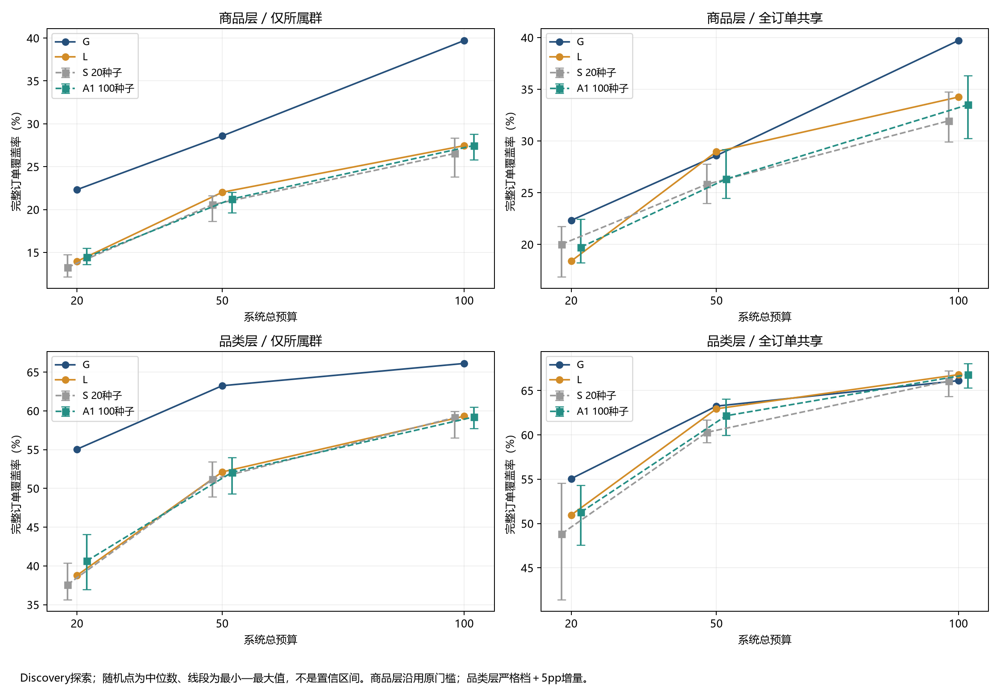

# A1历史活跃度匹配：100种子独立重跑

日期2026-11-15。A1为主对照，S为旧参考，A2未运行。未读取B的结果。两层都预先固定1000–1099全部100种子；每档每组Profile客户数及文件SHA-256均验证。只在Profile频次档内置换标签，不能解释为精确匹配Discovery篮大小或商品边际频率。

## 结果解读

- 品类层群定向使用：B20/50/100下L覆盖率38.78%/52.12%/59.31%，A1中位数40.64%/52.07%/59.22%；三个预算都在A1范围内，且G均高于L。没有一致的系统覆盖优势。
- 品类层共享使用：B50时L=62.94%，S中位数60.28%，A1中位数62.16%；A1有17/100达到或超过L，经验尾部比例18/101≈0.178。原来超过全部20次S的现象，在控制历史活跃度后不再成立。B100时L=66.80%，A1中位数66.82%，共享策略的优势仍不稳定。
- 商品层：B50群定向L=22.02%，超过100次A1，但只比随机最高结果多覆盖1张订单；B20和B100没有一致优势。不能用单个预算的尾部比例代表稳健收益。
- 品类层二/三品类组间support Bray–Curtis均值分别0.1296/0.1684，高于这100次A1的最大值0.1152/0.1600，说明当前共同池上仍存在超出A1结果范围的结构差异；Top10/20 Jaccard差异则未超出A1范围。结构差异不等于覆盖或推荐收益。
- 商品层组间二商品Bray–Curtis从原先高于全部20次S，变为A1中18/100不低于真实值；历史活跃度解释了部分原对照中的差异。群vs群外指标仍有一些较强信号，须逐指标报告而不挑选有利项。
- A1主要控制Profile频次档；对C2的置换空间有限，且未控制所有订单结构。所有经验尾部比例只作Discovery探索；多指标未校正，未来保持程度需交给D验证。

## 口径

商品层沿用原1% support、20联合/前件次数、20% confidence、lift≥1；品类层原生挖掘后记录三档筛选数量，主预算比较用严格档＋三品类增量≥5pp。G/L合格规则ID集合与旧实验逐项一致。每个种子一个系统值，预算20/50/100按Discovery订单数最大余数法分配，无补选；共享使用只解除群限制，不释放重复名额。

候选挖掘覆盖304范围。完整计数以npz保存，数组按candidate_rules.csv行序对齐，包含联合/前件/后件、群外计数、generated和分母。原S候选也纳入证据字典以便同口径比较，但不会冒充A1原生候选。

相似度：Top10/20按各范围当前配置合格原生规则去重组合；support距离固定在原S共同池上，避免候选池改变干扰S/A1对比；不是重新定义候选池后的正式置换检验。每种子三个组对/群外指标等权平均。品类层原S也按同一严格档与增量口径重算随机相似度，支持S/A1并列比较。

## 覆盖对照

| layer | flow | budget | G | L | S_median | S_min | S_max | S_ge_real | S_upper_tail | A1_median | A1_min | A1_max | A1_ge_real | A1_upper_tail |
|---|---|---|---|---|---|---|---|---|---|---|---|---|---|---|
| l2 | restricted | 20 | 55.06% | 38.78% | 37.56% | 35.66% | 40.39% | 5 | 0.2857 | 40.64% | 36.96% | 44.05% | 94 | 0.9406 |
| l2 | restricted | 50 | 63.25% | 52.12% | 51.17% | 48.94% | 53.45% | 3 | 0.1905 | 52.07% | 49.29% | 54.01% | 48 | 0.4851 |
| l2 | restricted | 100 | 66.12% | 59.31% | 59.15% | 56.54% | 59.97% | 6 | 0.3333 | 59.22% | 57.73% | 60.51% | 43 | 0.4356 |
| l2 | shared | 20 | 55.06% | 50.96% | 48.84% | 41.42% | 54.57% | 3 | 0.1905 | 51.28% | 47.56% | 54.30% | 57 | 0.5743 |
| l2 | shared | 50 | 63.25% | 62.94% | 60.28% | 59.11% | 61.69% | 0 | 0.0476 | 62.16% | 59.94% | 64.03% | 17 | 0.1782 |
| l2 | shared | 100 | 66.12% | 66.80% | 66.09% | 64.37% | 67.21% | 3 | 0.1905 | 66.82% | 65.30% | 68.06% | 52 | 0.5248 |
| sku | restricted | 20 | 22.32% | 13.96% | 13.25% | 12.18% | 14.73% | 2 | 0.1429 | 14.43% | 13.59% | 15.52% | 83 | 0.8317 |
| sku | restricted | 50 | 28.59% | 22.02% | 20.58% | 18.64% | 21.63% | 0 | 0.0476 | 21.24% | 19.61% | 22.01% | 0 | 0.0099 |
| sku | restricted | 100 | 39.72% | 27.46% | 26.53% | 23.84% | 28.36% | 2 | 0.1429 | 27.47% | 25.79% | 28.79% | 52 | 0.5248 |
| sku | shared | 20 | 22.32% | 18.39% | 20.01% | 16.89% | 21.75% | 16 | 0.8095 | 19.74% | 18.22% | 22.46% | 98 | 0.9802 |
| sku | shared | 50 | 28.59% | 28.97% | 25.81% | 23.99% | 27.76% | 0 | 0.0476 | 26.32% | 24.48% | 29.16% | 1 | 0.0198 |
| sku | shared | 100 | 39.72% | 34.25% | 31.95% | 29.90% | 34.74% | 1 | 0.0952 | 33.51% | 30.25% | 36.31% | 19 | 0.198 |

## 相似度

| layer | control | metric | real | median | minimum | maximum | upper_tail |
|---|---|---|---|---|---|---|---|
| sku | S | pair_braycurtis_len2 | 0.2409 | 0.2301 | 0.1897 | 0.2403 | 0.0476 |
| sku | S | pair_braycurtis_len3 | 0.4505 | 0.4921 | 0.3955 | 0.5291 | 0.7619 |
| sku | S | pair_jaccard_distance_top10 | 0.7467 | 0.6427 | 0.4872 | 0.7613 | 0.0952 |
| sku | S | pair_jaccard_distance_top20 | 0.7214 | 0.6449 | 0.5238 | 0.744 | 0.1429 |
| sku | S | rest_braycurtis_len2 | 0.2376 | 0.2046 | 0.1754 | 0.2135 | 0.0476 |
| sku | S | rest_braycurtis_len3 | 0.525 | 0.5151 | 0.4346 | 0.5436 | 0.2381 |
| sku | S | rest_mean_abs_support_pp_len2 | 0.3594 | 0.3345 | 0.2771 | 0.3491 | 0.0476 |
| sku | S | rest_mean_abs_support_pp_len3 | 0.3943 | 0.5165 | 0.3612 | 0.5561 | 0.8571 |
| l2 | S | pair_braycurtis_len2 | 0.1296 | 0.0941 | 0.0775 | 0.1129 | 0.0476 |
| l2 | S | pair_braycurtis_len3 | 0.1684 | 0.134 | 0.1141 | 0.1597 | 0.0476 |
| l2 | S | pair_jaccard_distance_top10 | 0.7745 | 0.6905 | 0.6032 | 0.799 | 0.2381 |
| l2 | S | pair_jaccard_distance_top20 | 0.7849 | 0.646 | 0.5457 | 0.7088 | 0.0476 |
| l2 | S | rest_braycurtis_len2 | 0.1101 | 0.0809 | 0.0658 | 0.1009 | 0.0476 |
| l2 | S | rest_braycurtis_len3 | 0.1427 | 0.1162 | 0.0972 | 0.1425 | 0.0476 |
| l2 | S | rest_mean_abs_support_pp_len2 | 0.6782 | 0.4814 | 0.3949 | 0.5958 | 0.0476 |
| l2 | S | rest_mean_abs_support_pp_len3 | 0.3941 | 0.3082 | 0.2622 | 0.3763 | 0.0476 |
| sku | A1 | pair_braycurtis_len2 | 0.2409 | 0.2314 | 0.2104 | 0.2617 | 0.1881 |
| sku | A1 | pair_braycurtis_len3 | 0.4505 | 0.4429 | 0.4012 | 0.5118 | 0.3069 |
| sku | A1 | pair_jaccard_distance_top10 | 0.7467 | 0.6944 | 0.4982 | 0.8671 | 0.2475 |
| sku | A1 | pair_jaccard_distance_top20 | 0.7214 | 0.6926 | 0.5866 | 0.7811 | 0.297 |
| sku | A1 | rest_braycurtis_len2 | 0.2376 | 0.2198 | 0.2007 | 0.2355 | 0.0099 |
| sku | A1 | rest_braycurtis_len3 | 0.525 | 0.4943 | 0.4567 | 0.5306 | 0.0495 |
| sku | A1 | rest_mean_abs_support_pp_len2 | 0.3594 | 0.3362 | 0.3131 | 0.3571 | 0.0099 |
| sku | A1 | rest_mean_abs_support_pp_len3 | 0.3943 | 0.3805 | 0.3628 | 0.3993 | 0.0594 |
| l2 | A1 | pair_braycurtis_len2 | 0.1296 | 0.1027 | 0.0953 | 0.1152 | 0.0099 |
| l2 | A1 | pair_braycurtis_len3 | 0.1684 | 0.1386 | 0.1287 | 0.16 | 0.0099 |
| l2 | A1 | pair_jaccard_distance_top10 | 0.7745 | 0.7712 | 0.6538 | 0.8426 | 0.4554 |
| l2 | A1 | pair_jaccard_distance_top20 | 0.7849 | 0.7357 | 0.6436 | 0.8189 | 0.099 |
| l2 | A1 | rest_braycurtis_len2 | 0.1101 | 0.0945 | 0.0874 | 0.103 | 0.0099 |
| l2 | A1 | rest_braycurtis_len3 | 0.1427 | 0.1233 | 0.1139 | 0.1387 | 0.0099 |
| l2 | A1 | rest_mean_abs_support_pp_len2 | 0.6782 | 0.5738 | 0.5235 | 0.6366 | 0.0099 |
| l2 | A1 | rest_mean_abs_support_pp_len3 | 0.3941 | 0.3373 | 0.3081 | 0.3933 | 0.0099 |

## 解释限制

单侧经验尾部比例=(1+随机指标≥真实的次数)/(1+种子数)，这些指标均按更大为所观察方向；覆盖越大、距离越大不是同一业务含义。此数为探索性尾部统计，不作未经校正的确认性显著结论；多指标无多重比较校正，未用Validation/Test。A1对C2的检验力有限：Profile订单≥5的385人中383人原属C2。

## 文件

各层protocol.json记录预先固定的方案；manifest.json记录完成状态与校验；mined/保留每范围原生候选；counts/为共同池精确计数；scope_audit.csv为订单量和客户量；screening_counts.csv为筛选数量；selected_rules.csv为实际预算规则；system_metrics.csv及similarity_seed_metrics.csv保留逐种子结果。S_vs_A1_coverage.csv与all_system_metrics.csv提供可复核比较。