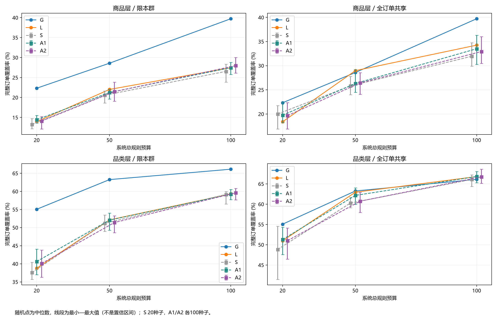

# A2 完整100种子敏感性分析

A1仍为主对照，A2仅作敏感性分析。使用 B 分支 b/activity-random-groups 的提交 13d83b7677dbf12099ab6bb1ad7018609a3b7b99，独立重跑，未读取 B 的结果。

## 主要发现

1. **覆盖优势仍不普遍。** 品类层限群匹配时，预算20/50/100分别有81/21/64个A2种子达到或超过L；共享时分别为51/0/48个。不能据预算50的局部结果宣称所有预算都更好。
2. **共享预算50是局部亮点，但依赖对照。** 品类层L=62.9438%，A2中位数60.7433%、最大62.8906%，L仅比最佳A2多覆盖4个订单；G=63.2496%，仍高于L。A1同设置有17/100次达到或超过L，因此该优势并未在两个活跃度对照下同样突出。商品层此设置L=28.9722%，A2最大28.5467%，A1有1/100次达到或超过L；这是局部的探索线索。
3. **品类support结构差异较稳定，但不等于Top榜单完全不同。** 二品类组间Bray–Curtis真实值0.129553，A2最大0.128586（0/100超过或持平）；三品类真实值0.168381，有1/100次达到或超过。A1中两者均0/100。因此三品类不能继续写成“超过全部随机结果”。Top10/Top20 Jaccard距离则有58/6次达到或超过真实值。
4. **商品层的组间差异证据较弱。** 二/三商品组间Bray–Curtis分别有9/15个A2种子达到或超过真实值；不宜把个别群外指标的较小上尾比例概括为所有商品结构均明显区别于随机。
5. **建议汇报：** A1作为主对照，A2作为敏感性分析。品类购买强度结构在两种活跃度控制下仍较突出；预算覆盖收益集中于部分设置，尚不能认定分群普遍优于全局或随机。下一步交D做冻结规则的Validation检验。

## 方法与冻结口径

- A2按Discovery合格篮子数0/1/2/3–4/5–9/10+分层，只在层内打乱真实客户群标签；每层每组人数保持不变。100个种子1000–1099全部使用。
- 随机文件SHA256：cea8ee0b237ccfd568f5fdc6cb6cff191a085e3554f626e277515dbab3691f40。
- 商品层和品类层各304个范围（G+3个L+300个R）。G/L沿用已核验的挖掘缓存，A2随机范围全部重新挖掘。原S和A1结果不覆盖。
- 商品层原门槛support≥1%、联合及前件≥20、confidence≥20%、lift≥1；品类层严格档support≥3%、confidence≥50%、lift≥1.5，联合及前件≥20，三品类增量confidence≥5个百分点。品类层使用冻结l2映射，订单内去重并排除other。
- 按联合次数、confidence、lift降序和rule_id升序选择；系统预算20/50/100按Discovery群内订单数最大余数法分配，不回收重复规则预算。限群和共享模式使用同一批规则。
- 覆盖率为同时包含前件和后件的订单并集占7521个订单的比例，不是预测准确率。
- 相似度沿用S固定共同池，避免候选空间变化影响support距离；Top-K使用各范围原生合格规则的去重组合。
- 每种子先汇总三个组对/三个群外对比，再与真实系统比较；不能把300个组当独立样本。经验上尾比例=(1+随机≥真实次数)/101，比较包含浮点容差1e-12。

## A2覆盖率

| layer | flow | budget | control | G | L | median | minimum | maximum | ge_real | upper_tail |
|---|---|---|---|---|---|---|---|---|---|---|
| l2 | restricted | 20 | A2 | 55.06% | 38.78% | 40.07% | 36.27% | 43.80% | 81 | 0.8119 |
| l2 | restricted | 50 | A2 | 63.25% | 52.12% | 51.39% | 48.57% | 53.22% | 21 | 0.2178 |
| l2 | restricted | 100 | A2 | 66.12% | 59.31% | 59.59% | 57.64% | 60.83% | 64 | 0.6436 |
| l2 | shared | 20 | A2 | 55.06% | 50.96% | 50.98% | 46.46% | 54.12% | 51 | 0.5149 |
| l2 | shared | 50 | A2 | 63.25% | 62.94% | 60.74% | 57.96% | 62.89% | 0 | 0.0099 |
| l2 | shared | 100 | A2 | 66.12% | 66.80% | 66.74% | 65.15% | 68.62% | 48 | 0.4851 |
| sku | restricted | 20 | A2 | 22.32% | 13.96% | 14.10% | 12.10% | 15.24% | 57 | 0.5743 |
| sku | restricted | 50 | A2 | 28.59% | 22.02% | 21.46% | 19.07% | 23.87% | 27 | 0.2772 |
| sku | restricted | 100 | A2 | 39.72% | 27.46% | 27.97% | 26.10% | 30.01% | 73 | 0.7327 |
| sku | shared | 20 | A2 | 22.32% | 18.39% | 19.66% | 16.89% | 22.35% | 91 | 0.9109 |
| sku | shared | 50 | A2 | 28.59% | 28.97% | 26.43% | 24.08% | 28.55% | 0 | 0.0099 |
| sku | shared | 100 | A2 | 39.72% | 34.25% | 32.93% | 30.47% | 36.02% | 14 | 0.1485 |

## S / A1 / A2对照图

完整数字见 [三对照覆盖率](S_A1_A2_coverage.csv) 和 [三对照相似度](S_A1_A2_similarity.csv)。

## A2相似度

| layer | control | metric | real | median | minimum | maximum | upper_tail | random_ge_real |
|---|---|---|---|---|---|---|---|---|
| sku | A2 | pair_braycurtis_len2 | 0.240886 | 0.215004 | 0.198471 | 0.319741 | 0.09901 | 9.0 |
| sku | A2 | pair_braycurtis_len3 | 0.450474 | 0.419474 | 0.392639 | 0.606219 | 0.158416 | 15.0 |
| sku | A2 | pair_jaccard_distance_top10 | 0.746732 | 0.662698 | 0.455433 | 0.862086 | 0.128713 | 12.0 |
| sku | A2 | pair_jaccard_distance_top20 | 0.721408 | 0.649258 | 0.514286 | 0.853801 | 0.118812 | 11.0 |
| sku | A2 | rest_braycurtis_len2 | 0.237634 | 0.195357 | 0.182 | 0.26336 | 0.029703 | 2.0 |
| sku | A2 | rest_braycurtis_len3 | 0.525041 | 0.460371 | 0.429885 | 0.60444 | 0.079208 | 7.0 |
| sku | A2 | rest_mean_abs_support_pp_len2 | 0.359373 | 0.306321 | 0.287692 | 0.476362 | 0.059406 | 5.0 |
| sku | A2 | rest_mean_abs_support_pp_len3 | 0.394319 | 0.363727 | 0.337377 | 0.902949 | 0.089109 | 8.0 |
| l2 | A2 | pair_braycurtis_len2 | 0.129553 | 0.099454 | 0.087399 | 0.128586 | 0.009901 | 0.0 |
| l2 | A2 | pair_braycurtis_len3 | 0.168381 | 0.137679 | 0.126065 | 0.178764 | 0.019802 | 1.0 |
| l2 | A2 | pair_jaccard_distance_top10 | 0.77451 | 0.77451 | 0.626068 | 0.886596 | 0.584158 | 58.0 |
| l2 | A2 | pair_jaccard_distance_top20 | 0.7849 | 0.707071 | 0.599875 | 0.81857 | 0.069307 | 6.0 |
| l2 | A2 | rest_braycurtis_len2 | 0.110069 | 0.087615 | 0.076796 | 0.114653 | 0.019802 | 1.0 |
| l2 | A2 | rest_braycurtis_len3 | 0.142695 | 0.118353 | 0.108393 | 0.157156 | 0.019802 | 1.0 |
| l2 | A2 | rest_mean_abs_support_pp_len2 | 0.678192 | 0.531503 | 0.458673 | 0.727003 | 0.039604 | 3.0 |
| l2 | A2 | rest_mean_abs_support_pp_len3 | 0.394098 | 0.322028 | 0.294468 | 0.459033 | 0.049505 | 4.0 |

## A2群内订单规模

| group_id | min | median | max | layer |
|---|---|---|---|---|
| 0 | 797 | 832.0 | 916 | sku |
| 1 | 2220 | 2276.5 | 2408 | sku |
| 2 | 4267 | 4399.5 | 4488 | sku |
| 0 | 797 | 832.0 | 916 | l2 |
| 1 | 2220 | 2276.5 | 2408 | l2 |
| 2 | 4267 | 4399.5 | 4488 | l2 |

## 解释边界与D交接

A2使用Discovery期活跃度，是更直接控制当期交易量的条件随机对照，不能替代只用Profile信息的A1主对照。它按区间匹配，并不保证每组订单总数或篮子大小完全一致。覆盖更好、support结构差异更大和规则更有预测价值是三个不同结论。所有结果仅为Discovery探索，多个指标未作多重比较校正，最小经验上尾比例为1/101≈0.0099，不报告p=0。Validation/Test尚未运行；交给D前需固定规则、排序、预算和评价口径，不能利用验证结果反向调整本次选择。
