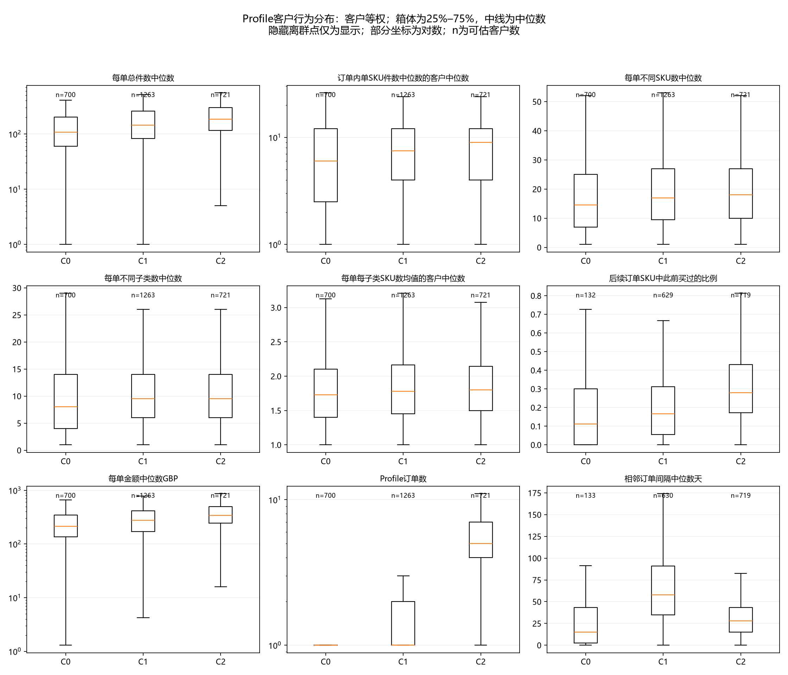

# 群体特色排序与客户采购画像（2026-11-22）

本目录独立保存新增探索性实验，不覆盖2026-11-15交付、D冻结Test或D的1122重分群结果。这里使用旧RFM标签，不能将C0/C1/C2解释直接套到D新采购形态群。

## 群体特色排序

P1–P5 ×预算20/50/100；普通频次排序、增加群内外前件证据要求的频次排序、相同要求下的confidence群内外差排序。S20、A1/A2各100种子。Discovery选规则，Validation评价，未使用Test。原群配额、跨群重复名额保留；不是不同组合去重预算实验。

- [原始报告](ranking_gap_sensitivity/排序敏感性分析报告.md)
- [未来差异与固定效应保持率](ranking_gap_sensitivity/future_specificity/未来群体特色指标补充.md)
- [冻结规则及逐条两期证据](ranking_gap_sensitivity/selected_rules_evidence.csv.gz)
- [随机对照](ranking_gap_sensitivity/future_specificity/random_comparison.csv)

P5/100：Validation confidence差中位数0.93→8.75pp；调整后差0.95→6.68pp；固定效应保持率17%→62%。保持要求Validation confidence差≥5pp且调整后差>0，以全部选中名额为分母。原报告78%为两项差保持正方向，不是本次62%的幅度标准。A1保持率中位56.5%，25/100次达到或超过真实L，不能据此确认RFM有稳定随机对照优势。四分位数不是置信区间；未做新BY检验；整个新增分析为事后探索。

## 客户采购画像

[计算口径和原始说明](customer_behavior_profile/客户行为画像说明.txt)。Profile期2684客户、7738订单。每单件数、单SKU件数、SKU和子类宽度、同子类配货、此前SKU复购、金额频次与间隔均保留逐客表及群体分布。大数量订单按全体符合条件Profile订单第90百分位≥516件定义。缺少前序购买的复购特征记缺失。

C0/C1/C2客户典型订单件数分别107.5/144/185，金额£212.11/277.04/342.12；C2有持续采购与重复补货特征。但三群都有批量购买线索，不能将C0叫散客、C2叫批发商。买家也可能是礼品零售商、转售商或企业采购；没有真实身份标签，不做身份预测准确率声明。

频次和金额参与原RFM，不能视为独立验证；复购观察机会随频次变化。taxonomy_v1是后续冻结映射回用于Profile，不是前瞻的Profile期标注。特征计算未使用未来订单。

## 复算

环境依赖pandas、NumPy、matplotlib；完整排序还需vendor/validation.py所用依赖。设置PATTERN_PROJECT_ROOT为具有下列原项目目录结构的工作目录；不设置则默认本目录。不要直接在只读归档上运行，以免覆盖已存结果。

- 本目录的ranking_gap_sensitivity/含冻结输入和vendor。
- 完整排序需此前category_P1_P5_handoff/evidence及inputs（2026-11-15完整发布包），按原目录名放入工作目录。
- 客户画像需A清洗快照的processed/clean_transactions.csv.gz、orders.csv.gz，以及labels/customer_clusters.csv、taxonomy_analysis/item_taxonomy_v1.csv。来源摘要见画像protocol.json；本包未重复归档全部A数据。
- 仅复算未来指标：python ranking_future_metrics.py。
- 完整排序：python ranking_gap_sensitivity.py，然后python report_ranking_gap.py、python ranking_future_metrics.py。
- 客户画像：python customer_behavior_profile.py。

manifest.json记录上传文件SHA256；原verification.json记录原实验核验，脚本路径适配后其原代码哈希仅指本地原版，以上传manifest为准。
