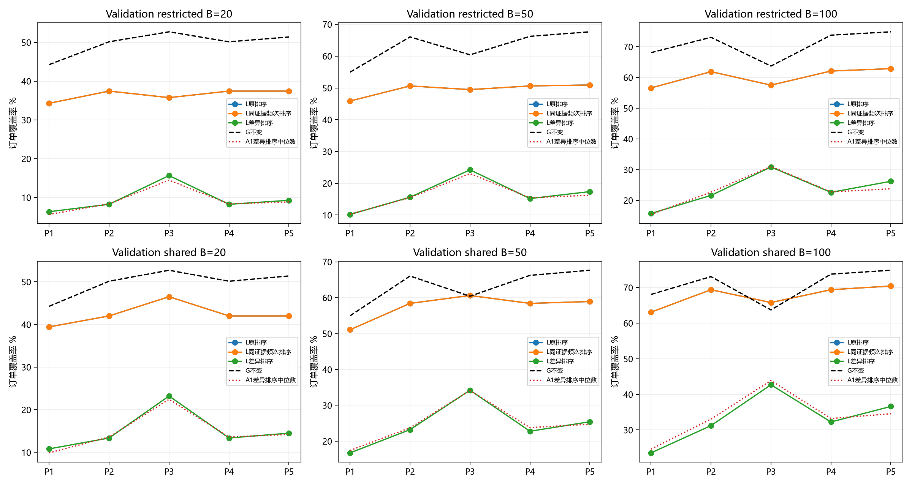

# 群体特色排序敏感性分析

基于D提交4461750、C原始P1–P5完整合格候选和冻结数据快照2ae672b。D的Test结果已公开，本实验是新增探索性分析，不替换既有冻结方案，不使用Test，不将Validation比较包装成新的独立最终检验。

## 设计

Discovery定义所有选择，Validation只评价。五配置×预算20/50/100，S20、A1/A2各100种子。原群订单配额、重复占名额、限群/共享语义保持不变；本实验不是去重补满预算实验。G保持原始频次清单。

三方案：original=原始频次排序；evidence_frequency=前件群内外各≥20单且各≥10名顾客后按频次排序；evidence_gap=同样证据要求，按群内−群外confidence差降序，平局按联合次数、confidence、lift降序、rule_id升序。不额外强制正差值或正基础率调整差，以免混入另一套筛选。候选不足记录缺额，不借位。

两新方案的直接差异仅为排序；original与新方案的差异同时包括证据要求。随机组与真实群同样处理。所有规则从本范围原生P1–P5合格候选中选择，不用Validation覆盖或差值补位。

## 当前结果

在Validation的30个配置/预算/匹配方式中，差异排序相对同证据频次排序覆盖更高0个，持平0个，更低30个。覆盖和群内外差值必须分开解释，选择高差值并不以覆盖最大化为目标。

限群、预算100、A1主对照：

| config | variant | G | L | R_median | random_ge_L | L_new_orders | L_lost_orders | L_D_signals | L_V_signals_kept | L_direction_retention | L_median_confidence_gap_pp |
|---|---|---|---|---|---|---|---|---|---|---|---|
| P1 | evidence_frequency | 68.08% | 56.60% | 54.20% | 0 | 0 | 558 | 21 | 20 | 95.24% | 1.6 |
| P1 | evidence_gap | 68.08% | 15.73% | 15.42% | 37 | 38 | 2583 | 100 | 67 | 67.00% | 9.16 |
| P1 | original | 68.08% | 56.60% | 54.20% | 0 | 0 | 558 | 21 | 20 | 95.24% | 1.6 |
| P2 | evidence_frequency | 73.08% | 61.89% | 60.86% | 2 | 35 | 579 | 21 | 17 | 80.95% | 0.93 |
| P2 | evidence_gap | 73.08% | 21.62% | 22.68% | 79 | 26 | 2528 | 100 | 81 | 81.00% | 8.43 |
| P2 | original | 73.08% | 61.89% | 60.86% | 2 | 35 | 579 | 21 | 17 | 80.95% | 0.93 |
| P3 | evidence_frequency | 63.72% | 57.51% | 56.83% | 19 | 99 | 401 | 21 | 15 | 71.43% | 0.98 |
| P3 | evidence_gap | 63.72% | 30.85% | 31.05% | 56 | 85 | 1683 | 100 | 68 | 68.00% | 6.16 |
| P3 | original | 63.72% | 57.51% | 56.83% | 19 | 99 | 401 | 21 | 15 | 71.43% | 0.98 |
| P4 | evidence_frequency | 73.78% | 62.09% | 61.17% | 4 | 34 | 602 | 21 | 17 | 80.95% | 1.06 |
| P4 | evidence_gap | 73.78% | 22.60% | 22.75% | 53 | 23 | 2511 | 100 | 79 | 79.00% | 8.12 |
| P4 | original | 73.78% | 62.09% | 61.17% | 4 | 34 | 602 | 21 | 17 | 80.95% | 1.06 |
| P5 | evidence_frequency | 74.87% | 62.88% | 61.94% | 0 | 34 | 617 | 19 | 15 | 78.95% | 0.93 |
| P5 | evidence_gap | 74.87% | 26.20% | 23.76% | 0 | 19 | 2385 | 100 | 78 | 78.00% | 8.75 |
| P5 | original | 74.87% | 62.88% | 61.94% | 0 | 34 | 617 | 19 | 15 | 78.95% | 0.93 |

## 群体优势的评价边界

输出同一所选规则在Discovery/Validation的目标/群外前件次数、联合次数、独立前件客户数、confidence差及基础率调整后关联差。描述性信号定义为Discovery置信度差≥5pp且关联差>0；方向保持要求Validation两项差值都>0。该定义不是D完整的质量/集中度/BY候选标准，不应直接把本报告的保持率与D原保持率横向等同。

本批次未重算新规则联合检验和BY家族，因此不报告“显著群体特异规则数”，不能复用D旧规则的q值。新排名会集中选择Discovery较大的差值，未来衰减应如实保留。零前件不可估，不填为0；证据不足仍保留在固定名额与方向保持分母中。

## 文件

- selected_rules_evidence.csv.gz：三方案冻结清单及逐规则两时期证据，group为贡献群。
- system_metrics.csv：39960条系统评价，含完整覆盖、新增/丢失/共同覆盖、差值中位数、方向保持；按名额计方向指标，重复规则不可当独立样本。
- comparison.csv：S/A1/A2按种子汇总；上尾比例未经跨指标校正，仅作描述。
- allocation_audit.csv：每群名额和缺额。
- protocol.json：预先写入的选择规则；verification.json：核验结果。

原始13320条D/V覆盖结果逐项复现。G跨方案不变。两新方案的客户证据门槛逐行核对；G/L共360条系统覆盖另用订单集合/布尔数组独立重算一致。没有进行新规则的确认性显著性检验。

已于2026-11-22归档上传；完整入口见上级README。

## 重点解读

P5/100限群：同证据频次排序与原始排序一致，覆盖62.88%；改成差异排序为26.20%，中位置信度群内外差由0.93pp升至8.75pp。因此该例的变化来自排序而非新增证据门槛。差异排序100个描述性Discovery信号名额中78个保持Validation正方向，但不能把原19个候选的78.95%与新100个候选的78%解释为同一批规则的稳定性几乎不变。两者候选身份和分母不同。

P5/100限群差异排序超过全部100次A1覆盖结果，是局部探索线索；依旧远低于G覆盖74.87%，且未进行新规则BY检验、跨设置校正或Test评价。其他配置的结果全部保留，不能选择该例来宣称差异排序普遍优于随机。
