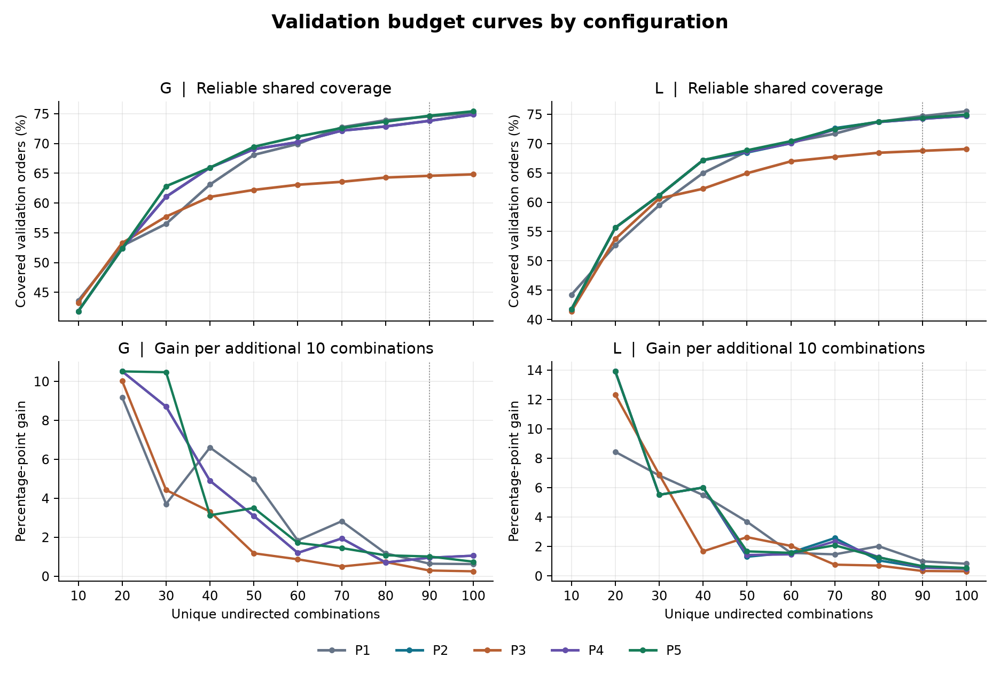

# Validation 密集预算与跨群去重重跑

全部结果使用冻结 Discovery 候选和同一批 **4,862 张 Validation 订单、1,458 名顾客**。P1–P5 各跑 10／20／…／100。每个 G、L、A1、A2、S 都独立使用相同的唯一规则预算。没有调用正式 Test。

按本轮工作标准，**推荐验证设置为 P1／90 个无向组合、共享匹配**，两边都达到 1 个百分点容许差距。G/L 原覆盖分别为 **74.74%／74.93%**，可靠覆盖为 **74.54%／74.68%**。L 的可靠覆盖相对 G 为 +0.14 pp，顾客配对 95% 区间 [-0.28, +0.55]。在相同配置与预算，A1 可靠中位数为 74.70%，55/100 套达到或超过 L。原覆盖对应为 74.92% 和 50/100。

这一页的 P1／90 来自原 quality_v1。后续严质量选参、冻结 P5／90 及 Test 补测见 [本轮实验入口](../README.md)。

## 规则怎么选

- G 按原 Discovery 排名顺序取下一条尚未入库的规则。L 和每一个随机种子各自维护三个群的原有排序。加入第 k 条时，优先选目前贡献最落后于其订单占比配额的群，三群平局按群号。取该群下一条尚未出现的规则。在共享主口径下，所有订单都能匹配最终池。限群原覆盖另报，重复身份只由首次进入清单的归属群服务。
- 两种预算单位各重跑一遍。有向去重以 rule_id 为单位。主口径以无向品类组合为单位，例如 A→B 和 B→A 只占一个名额。给定系统、配置与单位，20 档是 30 档的前 20 条，依此类推。覆盖增量是后档比前档多覆盖的订单占比，每单只算一次。
- 可靠覆盖沿用 quality_v1 的证据量、关联幅度、三品类增量和 BY 校正。每个系统把本次两种去重单位、所有配置与预算入选规则取并集做一次校正，再固定各条是否通过。该量是同一 Validation 期质量验收之后的回顾性共购覆盖。
- 核对了 3,320 个群范围与配置的候选数量及二／三品类拆分、9,960 份旧名单的顺序。新选择只使用 Discovery 排名，所有新预算均达到设定的唯一数量。

## 覆盖曲线

主口径为无向组合去重、共享匹配。每格依次为 **G / L**。

### 原订单覆盖率

| 实际预算 | P1 | P2 | P3 | P4 | P5 |
| --- | --- | --- | --- | --- | --- |
| 10 | 44.26% / 44.22% | 41.83% / 41.75% | 43.27% / 41.42% | 41.83% / 41.75% | 41.83% / 41.75% |
| 20 | 53.58% / 53.39% | 52.34% / 55.66% | 53.29% / 53.74% | 52.34% / 55.66% | 52.34% / 55.66% |
| 30 | 57.26% / 60.02% | 61.04% / 61.17% | 57.71% / 60.63% | 61.04% / 61.17% | 62.81% / 61.17% |
| 40 | 63.53% / 65.41% | 66.04% / 67.17% | 61.02% / 62.30% | 66.04% / 67.17% | 66.04% / 67.17% |
| 50 | 68.43% / 69.09% | 69.07% / 68.59% | 62.20% / 64.93% | 69.07% / 68.72% | 69.48% / 68.90% |
| 60 | 70.26% / 70.55% | 70.26% / 70.12% | 63.06% / 67.30% | 70.26% / 70.12% | 71.18% / 70.46% |
| 70 | 72.95% / 71.99% | 72.17% / 72.67% | 63.72% / 68.08% | 72.17% / 72.44% | 72.60% / 72.52% |
| 80 | 74.11% / 73.98% | 72.87% / 73.71% | 64.40% / 68.68% | 72.87% / 73.71% | 73.67% / 73.78% |
| 90 | 74.74% / 74.93% | 73.82% / 74.27% | 64.71% / 69.00% | 73.82% / 74.27% | 74.68% / 74.43% |
| 100 | 75.40% / 75.73% | 74.87% / 74.80% | 65.12% / 69.42% | 74.87% / 74.80% | 75.42% / 75.01% |

### 可靠订单覆盖率

| 实际预算 | P1 | P2 | P3 | P4 | P5 |
| --- | --- | --- | --- | --- | --- |
| 10 | 43.62% / 44.22% | 41.83% / 41.75% | 43.27% / 41.42% | 41.83% / 41.75% | 41.83% / 41.75% |
| 20 | 52.80% / 52.65% | 52.34% / 55.66% | 53.29% / 53.74% | 52.34% / 55.66% | 52.34% / 55.66% |
| 30 | 56.50% / 59.48% | 61.04% / 61.17% | 57.71% / 60.63% | 61.04% / 61.17% | 62.81% / 61.17% |
| 40 | 63.10% / 64.97% | 65.94% / 67.17% | 61.02% / 62.30% | 65.94% / 67.17% | 65.94% / 67.17% |
| 50 | 68.08% / 68.65% | 69.03% / 68.47% | 62.20% / 64.93% | 69.03% / 68.59% | 69.44% / 68.84% |
| 60 | 69.91% / 70.22% | 70.22% / 70.05% | 63.06% / 66.97% | 70.22% / 70.05% | 71.14% / 70.40% |
| 70 | 72.73% / 71.68% | 72.15% / 72.62% | 63.55% / 67.73% | 72.15% / 72.40% | 72.58% / 72.48% |
| 80 | 73.90% / 73.69% | 72.85% / 73.67% | 64.27% / 68.43% | 72.85% / 73.67% | 73.65% / 73.74% |
| 90 | 74.54% / 74.68% | 73.80% / 74.23% | 64.56% / 68.76% | 73.80% / 74.23% | 74.66% / 74.39% |
| 100 | 75.15% / 75.50% | 74.85% / 74.72% | 64.81% / 69.07% | 74.85% / 74.72% | 75.40% / 74.93% |

### 每多 10 条的可靠覆盖增量（百分点）

| 实际预算 | P1 | P2 | P3 | P4 | P5 |
| --- | --- | --- | --- | --- | --- |
| 20 | +9.17 / +8.43 | +10.51 / +13.90 | +10.02 / +12.32 | +10.51 / +13.90 | +10.51 / +13.90 |
| 30 | +3.70 / +6.83 | +8.70 / +5.51 | +4.42 / +6.89 | +8.70 / +5.51 | +10.47 / +5.51 |
| 40 | +6.60 / +5.49 | +4.90 / +6.01 | +3.31 / +1.67 | +4.90 / +6.01 | +3.13 / +6.01 |
| 50 | +4.98 / +3.68 | +3.09 / +1.30 | +1.17 / +2.63 | +3.09 / +1.42 | +3.50 / +1.67 |
| 60 | +1.83 / +1.56 | +1.19 / +1.58 | +0.86 / +2.04 | +1.19 / +1.46 | +1.71 / +1.56 |
| 70 | +2.82 / +1.46 | +1.93 / +2.57 | +0.49 / +0.76 | +1.93 / +2.34 | +1.44 / +2.08 |
| 80 | +1.17 / +2.02 | +0.70 / +1.05 | +0.72 / +0.70 | +0.70 / +1.28 | +1.07 / +1.25 |
| 90 | +0.64 / +0.99 | +0.95 / +0.56 | +0.29 / +0.33 | +0.95 / +0.56 | +1.01 / +0.66 |
| 100 | +0.62 / +0.82 | +1.05 / +0.49 | +0.25 / +0.31 | +1.05 / +0.49 | +0.74 / +0.53 |

### 80 到 100，拆成两步

| 配置 | G 80→90 | G 90→100 | G 80→100 | L 80→90 | L 90→100 | L 80→100 |
| --- | --- | --- | --- | --- | --- | --- |
| P1 | +0.64 | +0.62 | +1.25 | +0.99 | +0.82 | +1.81 |
| P2 | +0.95 | +1.05 | +2.00 | +0.56 | +0.49 | +1.05 |
| P3 | +0.29 | +0.25 | +0.53 | +0.33 | +0.31 | +0.64 |
| P4 | +0.95 | +1.05 | +2.00 | +0.56 | +0.49 | +1.05 |
| P5 | +1.01 | +0.74 | +1.75 | +0.66 | +0.53 | +1.19 |

### A1 可靠覆盖达到或超过 L 的种子数

| 实际预算 | P1 | P2 | P3 | P4 | P5 |
| --- | --- | --- | --- | --- | --- |
| 10 | 12/100 | 100/100 | 82/100 | 100/100 | 100/100 |
| 20 | 31/100 | 51/100 | 79/100 | 51/100 | 51/100 |
| 30 | 57/100 | 58/100 | 47/100 | 58/100 | 58/100 |
| 40 | 39/100 | 25/100 | 80/100 | 31/100 | 44/100 |
| 50 | 84/100 | 91/100 | 83/100 | 84/100 | 84/100 |
| 60 | 83/100 | 99/100 | 24/100 | 99/100 | 92/100 |
| 70 | 82/100 | 53/100 | 33/100 | 69/100 | 74/100 |
| 80 | 25/100 | 42/100 | 30/100 | 41/100 | 58/100 |
| 90 | 55/100 | 52/100 | 40/100 | 52/100 | 60/100 |
| 100 | 76/100 | 70/100 | 36/100 | 70/100 | 76/100 |

## Validation 怎么选 P 和预算

以各自能达到的最高可靠覆盖为参考，G 和 L 分别计算少了多少百分点。给一个容许差距，例如 1 pp，找两边都满足的**最小预算**，同预算选两边最大短缺更小的配置。如果没有共同达标，就找最大短缺最小的一档。按单个 P 查看时，以该 P 自己的最高覆盖为参考。容许差距是此轮比较的工作标准，表并列 0.5／1／2 pp，也保留所有原始曲线。A1 用来解释分群对照表现，不按某格随机排名挑参数。

| 比较范围 | 容许少覆盖 pp | 配置 / 预算 | G 可靠 | L 可靠 | 最大短缺 pp | 结果 |
| --- | --- | --- | --- | --- | --- | --- |
| 全部配置 | 0.5 | P1 / 100 | 75.15% | 75.50% | 0.25 | 达到门槛 |
| 全部配置 | 1.0 | P1 / 90 | 74.54% | 74.68% | 0.86 | 达到门槛 |
| 全部配置 | 2.0 | P5 / 80 | 73.65% | 73.74% | 1.77 | 达到门槛 |
| P1 | 0.5 | P1 / 100 | 75.15% | 75.50% | 0.00 | 达到门槛 |
| P1 | 1.0 | P1 / 90 | 74.54% | 74.68% | 0.82 | 达到门槛 |
| P1 | 2.0 | P1 / 80 | 73.90% | 73.69% | 1.81 | 达到门槛 |
| P2 | 0.5 | P2 / 100 | 74.85% | 74.72% | 0.00 | 达到门槛 |
| P2 | 1.0 | P2 / 100 | 74.85% | 74.72% | 0.00 | 达到门槛 |
| P2 | 2.0 | P2 / 80 | 72.85% | 73.67% | 2.00 | 达到门槛 |
| P3 | 0.5 | P3 / 90 | 64.56% | 68.76% | 0.31 | 达到门槛 |
| P3 | 1.0 | P3 / 80 | 64.27% | 68.43% | 0.64 | 达到门槛 |
| P3 | 2.0 | P3 / 70 | 63.55% | 67.73% | 1.34 | 达到门槛 |
| P4 | 0.5 | P4 / 100 | 74.85% | 74.72% | 0.00 | 达到门槛 |
| P4 | 1.0 | P4 / 100 | 74.85% | 74.72% | 0.00 | 达到门槛 |
| P4 | 2.0 | P4 / 80 | 72.85% | 73.67% | 2.00 | 达到门槛 |
| P5 | 0.5 | P5 / 100 | 75.40% | 74.93% | 0.00 | 达到门槛 |
| P5 | 1.0 | P5 / 90 | 74.66% | 74.39% | 0.74 | 达到门槛 |
| P5 | 2.0 | P5 / 80 | 73.65% | 73.74% | 1.75 | 达到门槛 |

只看满预算 100 时的五套配置对照如下。限群应用若更重要，可从限群原覆盖另行比较。按同样 1 pp 规则应用于**限群原覆盖**，取 **P1／100**，G／L 为 **75.40%／63.33%**，最大短缺 0.02 pp。

| 配置 | 100 个组合 G 可靠 | 100 个组合 L 可靠 | 100 个组合 L 限群原覆盖 |
| --- | --- | --- | --- |
| P1 | 75.15% | 75.50% | 63.33% |
| P2 | 74.85% | 74.72% | 62.36% |
| P3 | 64.81% | 69.07% | 55.59% |
| P4 | 74.85% | 74.72% | 62.42% |
| P5 | 75.40% | 74.93% | 62.55% |

### 为什么要补足实际规则数

下面对照原 P5／100 与新去重路径。两种新去重的方向条数都达到名额，无向去重同时保证组合数达到名额。

| P5 / 100 方案 | 系统 | 实际方向规则 | 实际无向组合 | 共享原覆盖 | 限群原覆盖 |
| --- | --- | --- | --- | --- | --- |
| 原名单 | G | 100 | 92 | 74.87% | 74.87% |
| 原名单 | L | 71 | 55 | 70.44% | 62.88% |
| 无向去重补齐 | G | 100 | 100 | 75.42% | 75.42% |
| 无向去重补齐 | L | 100 | 100 | 75.01% | 62.55% |
| 有向去重补齐 | G | 100 | 92 | 74.87% | 74.87% |
| 有向去重补齐 | L | 100 | 82 | 73.84% | 62.13% |

## 文件

- [全系统逐种子曲线](all_systems.csv) · [G/L 曲线和逐档增量](global_local_curves.csv) · [A1、A2、S 比较](random_comparisons.csv)
- [配对差及置信区间](paired_intervals.csv) · [选参每格分数](selection_scores.csv) · [容许差距敏感性](selection_sensitivity.csv) · [限群原覆盖选参备查](restricted_selection_raw.csv)
- [G、L、A1 可复核规则次序](global_local_A1_rule_paths.csv.gz) · [核对记录](verification.json)

从仓库根目录用 python -B experiments/validation_budget_redesign/run.py --out experiments/validation_budget_redesign/results 复算，然后用 python -B experiments/validation_budget_redesign/report.py 生成图与报告。继续沿用 D 的冻结 Discovery 输入和本地 Validation 数据。
